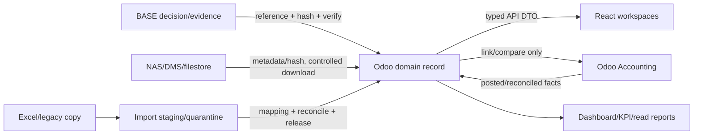

# BIZ-002 — Tích hợp, tính toán, KPI và bề mặt sử dụng

**Ngày:** 28/10/2026. **Trạng thái:** D — thiết kế có điều kiện; chưa tạo API, import, job hay bridge. Tài liệu này không thay thế [TP_DATABASE_DESIGN](TP_DATABASE_DESIGN.md), [source structure](TP_PLATFORM_SOURCE_STRUCTURE.md) hoặc OpenAPI hiện tại.

## 1. Ranh giới nguồn sự thật

| Hệ thống/kênh | Giữ gì | Đọc/ghi trong TANPHAT ONE | Trạng thái hiện tại và cổng |
| --- | --- | --- | --- |
| Odoo/ORM + PostgreSQL | company, user, project, assignment; khi triển khai thêm domain record, state, history, money metadata | Nguồn sự thật cho record, state, quyền và công thức đã được chốt; mọi action qua model/service transaction | Nền và CTR-001 read đã chạy; A–M còn thiết kế |
| BASE | Quyết định/phê duyệt chính thức, task/approval theo quy chế | TANPHAT ONE ghi reference, declared result, evidence/hash, verify state; không tự duyệt hoặc giả đồng bộ | U đã xác nhận BASE chính thức; Q1–Q3, endpoint/ID thực tế chưa xác nhận |
| Kế toán Odoo (`account.move`, `account.payment`, analytic) | posting, invoice, cash, reconciliation, tax | Bridge link/observation và đối chiếu; không tạo ledger song song | Module có trong source chưa chứng minh đã cài/cấu hình VN; FIN bridge sau khi có hồ sơ thật |
| NAS/DMS/filestore | Binary nguồn, thư mục/retention theo policy | Metadata/hash/version và download qua backend kiểm quyền; browser không mở UNC | NAS chỉ nguồn tham chiếu; adapter/retention/chủ sở hữu Q11/Q14 |
| Excel/legacy | Snapshot/staging, không phải runtime | `tp_import` đọc bản copy/hash, mapping, quarantine, issue, phát hành bằng ORM | Không chạy macro/external link; S01–S05 chỉ bằng chứng phân tích |
| React `/work/` + API v1 | Trạng thái màn hình/query cache, không quyết định state/money/permission | DTO allowlist; command sau này có CSRF/version/idempotency | CTR-001 read có 4 GET; chưa sinh command API BIZ-002 |
| Notification/audit | Chỉ là kênh/thông tin truy vết | Audit domain là nguồn chính; chatter/notify không thay audit | Quy tắc đề xuất, chưa có service A–M |

Một record “đã duyệt”, “đã ký”, “đã hiệu lực”, “đã nghiệm thu” hoặc “đã trả tiền” chỉ có nghĩa trong lớp state tương ứng và evidence. Không map một cột BASE/Excel sang mọi lớp. Khi nguồn ngoài vắng, trả `unknown`/`pending`/`missing_source`, không trả 0.

## 2. Luồng tích hợp có kiểm soát

**BASE:** reference gồm loại/ID hoặc manual ref, version/hash hồ sơ, decision, decided_by/at, evidence, recorded_by/at, verification và authority source. `approved` chưa `verified` không được làm guard chốt. Khi reference bị thu hồi, chặn action mới phụ thuộc; không auto-delete/reverse posted accounting.

**NAS/DMS:** upload/import ghi source binding, file hash, byte size, document_kind/confidentiality, version, owner, captured_at và quyền. Nguồn ngoài chỉ dùng khi hash/đường dẫn được registry; download luôn qua attachment policy/project grant. Không lưu UNC trong DTO; file trùng hash không đồng nghĩa cùng nghiệp vụ.

**Kế toán:** một link domain→move/payment có loại liên kết và amount/currency/basis/period; bridge không post thay kế toán. Đối chiếu cần company/project mapping, chứng từ, kỳ, currency, gross/net/tax basis, source freshness và status (`matched`, `difference`, `missing_source`, `not_applicable`). Dòng thiếu không được aggregate như zero. Hóa đơn đã xuất khác nghĩa vụ phải xuất; request/BASE approved khác cash.

**Import:** file copy/hash → batch/parser/schema version → row/sheet/source key → mapping review → quarantine lỗi → reconcile totals/counts → release ORM (idempotency key) → report. Release không làm mất raw row. Batch trùng hash + source binding không tạo record mới; payload thay đổi phải version mới và chờ review. Import phải lưu owner, decision, thời gian, error/warning; không import thẳng từ NAS/API web, không chạy macro.

**Audit/notification:** mọi action write tạo audit cấu trúc trước/sau theo field policy, actor, reason, evidence, version, request/idempotency. Notification chỉ chỉ rõ action/link có quyền; retry không gửi trùng nếu command đã idempotent. Audit của người quản trị/break-glass vẫn tồn tại nhưng không biến thành capability nghiệp vụ.

## 3. Quy tắc tính và dữ liệu tại một thời điểm

| Chỉ tiêu | Công thức/nguồn | Điều kiện và cảnh báo |
| --- | --- | --- |
| Contract original/effective | Snapshot revision áp dụng tại `as_of` theo effective chain | Bản chưa effective/cancelled không tính; trùng ngày/chain lỗi → conflict, không chọn ID lớn nhất |
| Contract updated | Tổng dòng snapshot sau phụ lục trong cùng scope/basis/currency | Giá mới thay giá cũ, không cộng delta; correction/void là version/effect riêng |
| Production | Tổng `production.entry` còn hiệu lực theo period/scope | Không đồng nhất acceptance/invoice/cash; missing quantity ≠ 0 |
| Acceptance | Tổng biên bản đã review/confirm theo bên/phạm vi/kỳ | KCS/chữ ký/authority/evidence theo loại; rejected/void loại khỏi summary theo rule |
| Invoiced | Dòng invoice issued/link `account.move` đã xác nhận | Không lấy nhãn “phải xuất” làm đã xuất; cần accounting source/freshness |
| Cash received/paid | Phân bổ `account.payment`/chứng từ tiền thực tế | Request/approved không tạo cash; partial payment chỉ ghi phần đã phân bổ |
| Retention | Nghĩa vụ/giữ lại theo điều khoản và đợt; release riêng | Không trừ hai lần; basis/thuế/currency cần xác minh |
| Acceptance − cash/invoice | Chênh quản trị cùng basis/currency/period | Không gọi là công nợ đến hạn nếu thiếu due date/ledger/reconcile |
| NT chính − NT cấp 1 | Chỉ số quản trị theo cohort/source | Không gọi là lợi nhuận kế toán; cấp 2 không cộng lần hai |
| Coverage/freshness | Số record/nguồn/kỳ biết tại thời điểm Y | Cảnh báo unmapped/missing_source riêng, không để cột ưu tiên che cảnh báo khác |

Mọi báo cáo có header `as_of_business`, `known_at`, `company`, `project_scope`, `currency`, `tax_basis`, `data_freshness`, `source_status`. Datetime lưu UTC; business/effective date là ngày nghiệp vụ, không timezone-convert; UI hiển thị datetime theo Asia/Ho_Chi_Minh. Business/effective/recorded/known dates không gộp. Kỳ kế toán đóng theo kế toán, không đổi bằng thao tác sửa nghiệp vụ.

### 3.1. Các công thức kiểm soát đề xuất

| Quy tắc | Công thức/điều kiện kiểm | Khi thiếu căn cứ hoặc vi phạm |
| --- | --- | --- |
| Giá trị hợp đồng | `effective_total = Σ confirmed(line_snapshot)` chỉ khi mọi dòng đủ amount và cùng currency/basis xác nhận; bản mới thay toàn snapshot | null/incomplete hoặc conflict; không cộng gross/net/unknown, không lấy 0 thay missing |
| Khoán cấp 1/2 | company/project total = `Σ level1`; `parent_remaining = parent − Σ children`; `overrun = max(Σ children − parent, 0)` | Phần còn lại âm được giữ; cảnh báo overrun riêng; policy block Q7, không tự quyết định |
| Giá trị khối lượng | `value = quantity × applicable_rate` chỉ khi unit/rate/version/basis/currency có căn cứ; rounding theo Odoo | Không suy đơn giá từ tổng Excel; quantity chỉ xác nhận chuyên môn, financial value unknown khi thiếu rate |
| Phân bổ nhiều payment/request | `Σ allocations(payment) ≤ available_payment` theo kế toán; `request_unallocated = request − Σ matched_links`; aggregate cash trên payment ID duy nhất | Thừa phân bổ bị từ chối; tiền chưa phân bổ/overpayment là case riêng, không tự tăng request hoặc nhân tiền khi join; Q4/Q6/Q8 |
| Tạm ứng | `advance_outstanding = disbursed − offsets − refunds` trên chứng từ/link đã đối chiếu | Request approved chưa giải ngân không tạo dư tạm ứng; không nghiệm thu giả; khoản điều chỉnh cần policy Q8 |
| Giữ lại | `retention_outstanding = confirmed_held − released + documented_adjustments` | Release có điều kiện/evidence riêng; request release không tạo cash; không trừ retention hai lần vào chênh acceptance/cash |
| Chênh lệch quản trị | `production − acceptance`, `acceptance − invoice`, `acceptance − cash`; cùng scope/currency/basis/kỳ phù hợp | Không gọi là công nợ đến hạn/lợi nhuận kế toán; thiếu nguồn trả missing_source |
| Tỷ lệ quản trị từ mẫu E13 | `(NT chính − NT cấp 1) / NT chính` theo cohort, không gồm cấp 2 lần hai | Mẫu số 0/unknown → null + undefined/missing warning; tỷ lệ âm giữ được, không clamp |
| Aging/freshness | aging cần due date/basis được kế toán xác nhận; freshness theo `source_binding + project + source_snapshot_at` | Không due date → age/overdue unknown; import nguồn mới không làm tươi mọi project |
| Hai mốc báo cáo | Chọn fact có hiệu lực tại X và đã biết tại Y; correction recorded sau Y không được viết lại output lịch sử tại Y | Đây là D: CTR-001 hiện có as_of, chưa có API known_at/history snapshot hoàn chỉnh; Q4/Q8 trước báo cáo chính thức |

Không quy đổi ngoại tệ khi chưa có rate source/rate date và policy Finance. Các phép tính giả lập dùng Decimal để đối chiếu logic; không chứng minh precision/thuế Odoo đã đúng cho dữ liệu thật. Frontend chỉ format decimal string/currency do backend trả.

## 4. KPI và dashboard catalogue

Các KPI dưới đây là D; owner, kỳ cập nhật, ngưỡng và quyền phải được công ty xác nhận (Q13). Chỉ tính từ record user được phép đọc, kể cả aggregate/cache/export. Không tạo reporting database trong giai đoạn thiết kế.

| KPI/dashboard | Định nghĩa | Nguồn/owner đề xuất | Cảnh báo và trạng thái thiếu |
| --- | --- | --- | --- |
| Pipeline opportunity | count/value cơ hội theo stage, outcome, due date | `tp.bid`/CRM; KD | quá hạn, trùng, missing decision/evidence |
| Project plan health | project active/on_hold, milestone overdue, owner gap, unaccepted handoff | project/task; KD/owner | không owner, hold quá hạn theo căn cứ, stale plan |
| Contract exposure | original/effective/committed theo scope + basis/currency | contract/revision/approval; KD/QT-TC | pending evidence, unverified authority, conflicting effective |
| Allocation coverage | cấp 1, con cấp 2, parent overrun và phần chưa phân bổ | allocation/line; KD/phòng | child > parent, missing parent/scope, double count |
| Delivery/quality | production vs acceptance, returned issues, review cycle, design release | production/acceptance/design; chuyên môn/KCS | chưa đủ evidence, rejected, revision conflict |
| Cash/settlement | acceptance/invoice/cash/retention/request; `age` chỉ khi có due date/kỳ được xác nhận | settlement/account bridge; QT-TC | missing accounting, partial/unreconciled, tax basis/due date unknown; không tính aging nếu Q4/Q6/Q13 chưa chốt |
| Data quality | unmapped, duplicate, missing required, stale source, import quarantine | import/audit; data owner | batch không release, hash/binding conflict |
| Security/operations | grant active/expiring/revoked, failed action, break-glass, backup/restore | grant/audit/ops; Platform Manager | quyền sắp hết, cache stale, restore chưa thử |

Dashboard hiển thị `null`/`unknown`/`missing_source` bằng nhãn riêng, không tô 0. Một summary ưu tiên không loại bỏ các cảnh báo khác; drilldown mở đúng scope, không lộ record ngoài quyền. KPI financial yêu cầu financial grant từng project; metadata dashboard không tự cấp financial.read.

## 5. Màn hình, thao tác và API ở mức thiết kế

| Workspace | Màn hình/command dự kiến | API/DTO cần trước khi code | Cổng |
| --- | --- | --- | --- |
| TP Dashboard | scope/project selector, KPI, warnings, as-of/known-at, export có grant | `GET /dashboard/overview`, `/warnings`, pagination/filter allowlist | KPI owner/formula Q13; aggregate security |
| TP Projects | project detail, plan, assignment, hold/resume/complete/handover | `GET /projects/{id}/plan`; commands project với CSRF/version/idempotency | PRJ-002 + Q9 |
| TP Contracts | existing read; draft/submit/return/revision/evidence/sign/effectivity | POST action endpoints với action-specific DTO, no direct state write | Q1–Q4/Q8; CTR-002 gates |
| TP Tasks | inbox/accept/return/result/reopen/handover/overdue | task command DTO + notification/audit | Q10/Q9; owner/handoff |
| TP Survey | field visit, observation, evidence, handoff | survey DTO, attachment policy, offline/retry if needed | Q10, retention/privacy |
| TP Design | design package, BIM/version, review/KCS, issue, release | design/review/revision DTO, supersede action | Q10; no legal release assumption |
| TP Finance | production/acceptance/payment request, invoice/cash links, reconciliation | settlement DTO; account bridge read/link only | Q4/Q6/Q8; accounting config |
| TP Documents | classification, version, share, download, archive/restore | document metadata/action + short-lived content URL | Q11/Q14; attachment security |
| TP HR/admin | org catalog, role/assignment, handover, grant request/revoke/audit | admin DTO; no self-grant; audit export | Q2/Q11; superuser gap in current grant |
| TP Import/Ops | batch/file/row errors, mapping/reconcile, backup/restore reports, incident | import/ops read/action DTO with separate capability | Q12/Q14; runbook and approval |

API v1 phải trả error `{code,message,details,request_id}`, kiểm 401/403/404/409/422, no-store cho financial/session, không trả field tiền khi thiếu grant. Filter/sort/group/aggregate/export đều là allowlist ở backend; native ORM/RPC và React cùng policy. API action đòi CSRF form/multipart theo quy ước hiện có, optimistic `version`, idempotency key và concurrency check. Không sinh client hoặc route trong BIZ-002.

## 6. Xử lý lỗi và đối chiếu

Mỗi integration batch có trạng thái `received → validated → mapped → quarantined/reconciled → released/closed`; invalid/mapping/duplicate/security/source-timeout là lỗi phân loại riêng. Có thể retry lỗi hạ tầng theo key; lỗi dữ liệu cần sửa source/mapping và version batch. Không tự bỏ qua hàng lỗi để “đủ tổng”. Đối chiếu mismatch tạo issue có owner/hạn theo căn cứ, không sửa source ngoài quyền.

BASE unavailable giữ decision pending/unknown; NAS/DMS unavailable giữ metadata và đánh dấu file chưa truy cập; accounting missing giữ `missing_source`; restore fail tạo incident, không tuyên bố backup đạt. Fallback thủ công phải ghi actor/time/source/hash và được review; không biến file Excel/email thành nguồn runtime ngầm.

## 7. Câu hỏi còn mở

Q1–Q8 giữ nguyên tại [workflow KD](TP_KD_WORKFLOW_AND_PERMISSIONS.md). BIZ-002 bổ sung:

| Mã | Cần xác nhận | Đầu mối đề xuất | Chặn |
| --- | --- | --- | --- |
| Q9 | Điều kiện mở/hold/complete/reopen project; owner/handover và công cụ giao việc chính thức | Lãnh đạo/KD + trưởng phòng | PRJ/task pilot |
| Q10 | Catalog khảo sát/thiết kế/KCS, reviewer/chữ ký kỹ thuật, bản phát hành và issue/revision | Kỹ thuật/BIM/KCS | Survey/Design/acceptance |
| Q11 | Phân loại file, chia sẻ nội bộ/đối tác, retention/privacy, HR joiner/mover/leaver và khoán cá nhân | HR/Docs/Pháp chế | Documents/HR/allocation |
| Q12 | Mapping code/master, source owner, batch cutover, dữ liệu legacy và reconcile | Data owner/QT-TC/KD | Import/pilot |
| Q13 | Owner, formula, kỳ/cadence, ngưỡng cảnh báo và quyền export từng KPI | Lãnh đạo/QT-TC/KD | Dashboard/reporting |
| Q14 | RPO/RTO/retention/mã hóa/backup ngoài máy, lịch job, incident severity/SLA | Ops/Platform + lãnh đạo | Production readiness |

