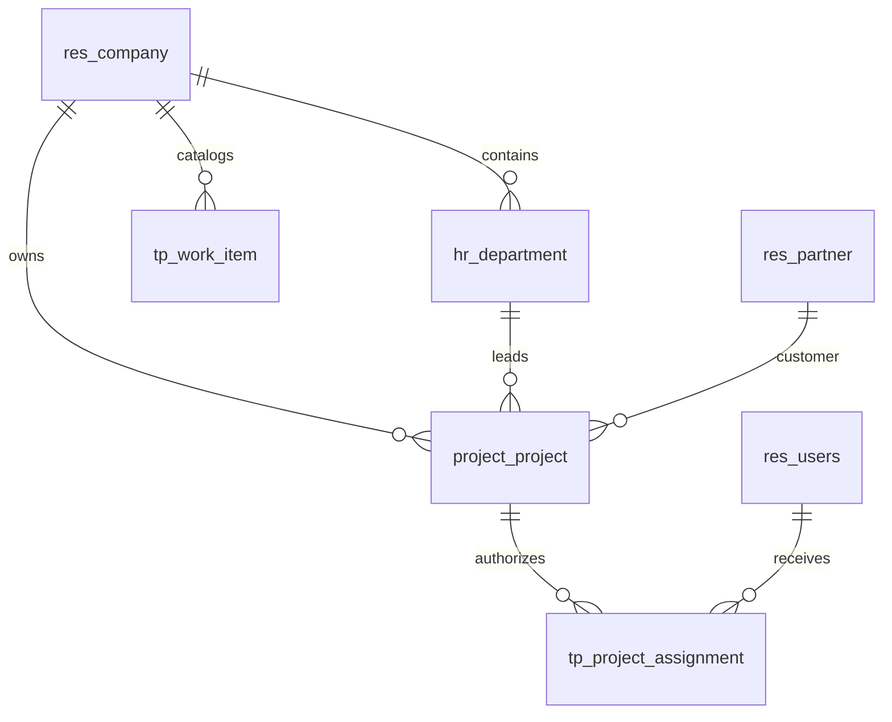

# Thiết kế database nền TANPHAT ONE

Ngày 28/10/2026. Phân biệt phần đã triển khai nền với mô hình nghiệp vụ sẽ bổ sung sau.

## 1. Phương án chọn

Một database PostgreSQL do Odoo quản lý cho mỗi môi trường. Các phòng ban cùng dùng một hồ sơ dự án, hợp đồng, giao khoán và chứng từ; phạm vi truy cập được kiểm tra ở backend. Không tách database theo phòng ban vì sẽ phải đồng bộ cùng một nghiệp vụ và khó duy trì transaction.

| Môi trường | Database | Vai trò |
| --- | --- | --- |
| Dev trên máy này | `tp_tanphat_dev` | dữ liệu giả lập, phát triển thủ công |
| Test tự động trên máy này | `tp_tanphat_test` | install/upgrade và test có rollback |
| Staging, đề xuất | `tp_tanphat_staging` | nghiệm thu, chạy migration thử |
| Production, đề xuất | `tp_tanphat_prod` | dữ liệu doanh nghiệp chính thức |

Dev/test hiện dùng cluster riêng trong `.local/postgres/data`, PostgreSQL 18, cổng `127.0.0.1:55432`. Script không sửa service, cấu hình hoặc role của PostgreSQL khác trên máy. Staging và production cần hạ tầng riêng với tài khoản và backup riêng; không dùng cluster dev làm production.

App đăng nhập PostgreSQL bằng `tp_odoo`, không phải superuser và không có quyền tạo database/role. Role quản trị `tp_dev_admin` chỉ quản lý cluster dev này. Database do role app sở hữu để Odoo có thể tạo/nâng cấp schema trong dev. Production cần kiểm soát quyền DDL và cửa sổ nâng cấp qua quy trình triển khai.

## 2. Schema đã triển khai cho nền dự án

Odoo ORM quản lý bảng trong schema chuẩn; module được phân biệt bằng namespace model và tên bảng. Không tạo schema PostgreSQL riêng cho từng phòng, không tạo bảng bằng SQL song song với ORM.



| Model | Thay đổi hiện có | Ràng buộc chính |
| --- | --- | --- |
| `res.company`, `res.users`, `res.partner` | dùng chuẩn Odoo | không tạo bộ bảng doanh nghiệp/người dùng/đối tác thứ hai |
| `hr.department` | thêm `tp_code` | mã duy nhất trong company |
| `project.project` | thêm `tp_managed`, `tp_code`, `tp_department_id`, `tp_assignment_ids` | dự án managed phải có company/code; code duy nhất trong company |
| `tp.project.assignment` | project, user, role, active, company liên quan | unique project/user/role; user thuộc company và group nền |
| `tp.work.item` | code, name, company, active | unique company/code, code không rỗng |

`tp_managed=False` giữ dự án Odoo thông thường theo quyền chuẩn. Dự án managed áp dụng scope Tấn Phát bổ sung. Reader chỉ đọc dự án được phân công còn active; manager xem/quản lý các dự án trong company đang được phép. Group-less restrictions chặn quyền rộng từ các group Odoo khác. Chỉ platform manager cấu hình metadata và phân công dự án; role coordinator ở bản đầu cũng chỉ cấp quyền đọc, không ngầm có quyền phê duyệt hay sửa nghiệp vụ.

Không dùng tên hiển thị làm khóa. ID nội bộ là khóa quan hệ; `tp_code` là mã nghiệp vụ, không phải khóa chính để join/import. Mã ngoài được mapping có provenance khi xây `tp_import`. Company, phòng ban và assignment là các chiều khác nhau, không được đồng nhất.

## 3. Mô hình tổng thể (contract read đã có, các domain tiếp theo chưa tạo bảng)

```text
project.project
  +-- tp.contract -> tp.contract.revision -> tp.contract.line
  +-- tp.allocation -> tp.allocation.line -> allocation con
  +-- tp.production.entry
  +-- tp.acceptance -> acceptance line
  +-- tp.payment.request
  +-- ir.attachment / metadata hồ sơ

tp.contract -- bridge --> sale.order / purchase.order (khi áp dụng)
tp.acceptance / tp.payment.request -- bridge --> account.move / account.payment
```

- Hợp đồng bên ngoài khác giao khoán nội bộ. Khoán nội bộ không tạo vendor bill/PO giả.
- Catalog hạng mục khác dòng phạm vi hợp đồng; nhiều hợp đồng cùng đối tác/hạng mục vẫn có ID riêng.
- Giao khoán con liên kết cha bằng ID, cùng company/project; kiểm tra vòng lặp và vượt khoán tại model. Tổng công ty chỉ tính cấp 1.
- Sản lượng, nghiệm thu, hóa đơn, tiền thu/chi và giữ lại là các khái niệm riêng. Kế toán là nguồn chính thức cho posting và reconciliation.
- BIZ-001 đối chiếu S03 xác định giá cập nhật của PKH là tổng mới theo phạm vi hạng mục/đơn vị, không phải delta. Đề xuất revision snapshot đầy đủ được dựng từ bản trước và phần thay đổi; không lấy một giá trị hạng mục làm tổng hợp đồng hoặc lấy “dòng dương cuối” làm quy tắc. Hiệu lực pháp lý/ngày hồi tố vẫn cần hồ sơ đại diện xác nhận.
- Nháp sửa được theo quyền; chứng từ đã chốt cần revision/cancellation có lý do và bản trước. Với hợp đồng, CTR-001 mới có read slice: bản đã chốt (review/ký/hiệu lực đã ghi nhận) không xóa được, nhưng action draft/revise/cancel chưa mở.

## 4. Quy tắc dữ liệu và hiệu năng

- Thời điểm hệ thống lưu theo quy ước UTC của Odoo; DTO datetime trả ISO 8601 có `Z`. Ngày nghiệp vụ và ngày hiệu lực là trường riêng khi cần; UI hiển thị Asia/Ho_Chi_Minh.
- Tiền dùng field/currency/rounding chuẩn Odoo, không tự đổi kiểu cột chuẩn. Khi xây tài chính phải kiểm tra precision, thuế, gross/net, phụ lục và đa tiền tệ bằng test. API tiền trả decimal string và currency; JavaScript không quyết định số tiền chính thức.
- `null`, số 0 và chưa đối chiếu nguồn được giữ khác biệt. Số âm hợp lệ theo nghiệp vụ không tự ép thành 0.
- Mỗi model dùng ngoại khóa và policy `ondelete` phù hợp. Chứng từ đã chốt ưu tiên hủy/đảo thay vì xóa; có migration version khi đổi schema.
- Index hiện có cho project code/managed, assignment project/user/company và unique keys. Bổ sung index theo truy vấn và số liệu đo được, chưa tạo kho báo cáo riêng.
- Aggregate phải chịu cùng scope company/project như dữ liệu chi tiết. SQL view/cache/export cần kiểm quyền riêng.

## 5. Excel và hồ sơ

Luồng nhập dự kiến: file hash/batch -> staging -> mapping được duyệt -> danh sách lỗi -> đối chiếu -> phát hành vào model nghiệp vụ bằng ORM. Lưu file/sheet/dòng/phiên bản parser và binding để import lặp không cộng trùng. Không dùng NAS/Excel làm database runtime và không chạy macro để nhập.

Database chỉ lưu metadata hồ sơ; binary dùng filestore/adapter tài liệu. Download phải kiểm quyền bản ghi liên quan; browser không nhận UNC trực tiếp. Chưa cấu hình NAS/DMS hoặc chuyển dữ liệu thật trong lượt dựng nền này.

## 6. Backup và vận hành

Một bộ phục hồi Odoo gồm database dump, filestore tương ứng, phiên bản source/addon và cấu hình cần thiết. Trước pilot dữ liệu thật phải thử restore ở môi trường khác. Đề xuất ban đầu: backup hằng ngày, giữ nhiều thế hệ và bản ngoài máy chủ; chốt RPO/RTO theo vận hành thực tế, bổ sung PITR khi cần. Chưa thiết lập lịch backup production.

OPS-001 ngày 28/10/2026 đã kiểm chứng local: chụp dev nhất quán khi tạm dừng riêng Odoo, khôi phục DB/filestore và source commit `d9e8ccdc` vào cluster/HTTP/data-dir mới, đối chiếu 314 bảng và 37 tham chiếu attachment, kiểm login/API/quyền/tải tệp. Script ở `scripts/backup_restore.py`, hướng dẫn tại [BACKUP_RESTORE.md](../../ops/runbooks/BACKUP_RESTORE.md). Backup/credential nằm `.local/ops-001` có giới hạn ACL, chưa mã hóa. Đây là diễn tập cùng máy dùng lại `.venv`; backup ngoài máy, host khác, lịch/retention và RPO/RTO vẫn cần hoàn thiện trước production.

Runtime dev chỉ bind loopback, chưa là triển khai production. Khi triển khai thật: HTTPS cùng origin cho SPA/Odoo, secrets riêng, không mở database manager công khai, staging kiểm migration và đủ test quyền/CSRF/MFA. Cấu hình mẫu nằm ở `ops/config/`, cấu hình/mật khẩu thật nằm trong `.local/` ngoài Git.

## 7. Đề xuất chi tiết cho phần nghiệp vụ tiếp theo

Bốn dòng đầu (hợp đồng, revision, dòng phạm vi, approval reference) đã có read slice trong `tp_contract` (CTR-001, DEC-017); các model còn lại chưa được tạo. [Baseline BIZ-001](TP_KD_WORKFLOW_AND_PERMISSIONS.md) và [nguồn/ca nghiệm thu](TP_KD_EVIDENCE_AND_ACCEPTANCE.md) là đầu vào hiện hành. Có thể triển khai read slice với dữ liệu giả; action chốt/pháp lý đợi cổng thẩm quyền và hồ sơ thực tế. Không copy cấu trúc nhật ký Excel thành bảng transaction đa năng.

| Model (đã có/đề xuất) | Trường/quan hệ cốt lõi | Vai trò |
| --- | --- | --- |
| `tp.contract` (đã có) | company, project, department (phòng chủ trì project khi tạo, CTR-002a), aggregate_version (CTR-002a), partner, contract_type, code (unique theo company), currency, lifecycle_state, legacy_unverified, active | Danh tính ổn định của hợp đồng chủ đầu tư/thầu phụ; lifecycle `effective` cần một revision đã ghi nhận hiệu lực |
| `tp.contract.revision` (đã có) | contract, sequence (unique theo contract), revision_kind original/amendment/correction, previous_revision, reference, signed_date, effective_date, recorded_at, review_state, signature_status, signature_authority_status, effectivity_status, legacy_unverified | Snapshot bản gốc/phụ lục, review và căn cứ hiệu lực; ngày ký khác ngày nhập/ngày hiệu lực; trùng ngày hiệu lực được báo, không tự chọn |
| `tp.contract.line` (đã có) | revision, scope_key, name, work_item, change_kind original/unchanged/amended/added, previous_line | Phạm vi của một phiên bản; provenance tới dòng bản trước. Khối lượng/đơn giá chưa có trong read slice |
| `tp.contract.line.amount` (đã có) | line, project, company, currency, amount_state confirmed/unconfirmed, amount, tax_basis | Giá trị dòng nằm ở model riêng, chỉ đọc khi có grant `financial_read` của project; unconfirmed lưu không có amount |
| `tp.approval.reference` (đã có) | revision/contract/project/company, purpose, reference_kind, base_reference, source_url, decision, decided_by_name/decided_at, evidence_sha256, submitted_document_sha256, recorded_by/at, verification_state `pending/verified/disputed`, verified_by/at, authority_status/source, previous_reference | Kết quả BASE theo đúng hồ sơ; kết quả khai báo khác xác minh; không thay bản ký |
| `tp.approval.reference.amount` (đã có) | reference, project, company, currency, amount_state, amount, tax_basis | Giá trị được duyệt trên BASE, cùng policy tiền với dòng hợp đồng |
| `tp.contract.document` (đã có) | contract, revision, project, company, document_kind, confidentiality general/financial, file (attachment) | Tệp hồ sơ; hợp đồng ký/phụ lục/evidence BASE luôn là financial |
| `tp.project.grant` (đã có, `tp_project`) | user, project, company, capability `financial_read` / `financial_draft_edit` / `contract_draft_edit` / `contract_submit` / `contract_review_commercial`, department (bắt buộc với capability CTR-002a, cấm với `financial_read`), reason, granted_by, date_end, active | Quyền xem tiền theo project; quyền workflow hợp đồng theo project + phòng ban (CTR-002a, chỉ test). Superuser cấp khi Q2 chưa chốt |
| `tp.contract.submission` (CTR-002a, test) | revision, contract/project/company, sequence, previous_submission, submitted_by/at, reviewer, contract_version, fix_summary, metadata_snapshot + sha256, payload_sha256, outcome pending/returned, returned_by/at/reason/issues, rework_started_by/at/reason | Một lần gửi rà soát bất biến (S1, S2…); không chứa tiền |
| `tp.contract.submission.amount` (CTR-002a, test) | submission, revision/project/company, financial_snapshot, salt, financial_sha256 | Snapshot tiền của lần gửi, ACL như amount CTR-001 |
| `tp.contract.audit` / `tp.contract.outbox` (CTR-002a, test) | audit: event_id, action, actor, acted_at, request_id, contract/revision/submission, department, state và version trước/sau, payload_sha256, reason; outbox: event_id, audit, event_type, recipient, state, attempt_count, last_error, delivered_at | Lịch sử append-only và thông báo một event/người nhận ghi cùng transaction; chưa có cron/kênh gửi |
| `tp.contract.idempotency` (CTR-002a, test) | user, action, key, object_ref, fingerprint, company/project, required_capabilities, result contract/revision/submission | Retry cùng key/payload trả kết quả cũ sau khi kiểm lại quyền; khác payload 409. Chưa có hạn lưu |
| `tp.allocation` | project, contract/revision, parent_allocation, assignee, kind, state | Giao khoán; phân biệt phòng nội bộ với đối tác bên ngoài |
| `tp.allocation.line` | allocation, contract_line, work_item, quantity, value | Dòng phạm vi khoán và nguồn hợp đồng tương ứng |
| `tp.production.entry` | project, work_item, period, quantity, source | Sản lượng thực hiện; chưa đồng nhất với nghiệm thu |
| `tp.acceptance` và dòng | project, contract/allocation, business_date, state, revision | Chứng từ nghiệm thu theo đúng phạm vi và bên liên quan |
| `tp.payment.request` | project, contract/allocation, currency, requested_amount, state | Đề nghị thanh toán; không tự trở thành tiền đã thu/chi |
| Liên kết kế toán | source document ↔ `account.move`/`account.payment` | Kế toán quản lý bút toán, thuế, hóa đơn và đối soát chính thức |
| Import staging | batch, file hash, sheet, row, parser version, source binding | Truy vết và nhập lại an toàn, không cộng trùng |

`revision` tham chiếu hợp đồng, dòng phạm vi tham chiếu revision. Không móc phụ lục dưới một dòng hợp đồng cụ thể. Đề xuất snapshot đầy đủ có provenance từ phụ lục và bản trước; xử lý hiệu lực muộn/thu hồi phải có policy trước khi mở action. Approval reference gắn đúng phiên bản bất biến/hash/phạm vi/amount/currency; BASE approved không tự cho signed/effective. Bản thiếu chứng cứ được đọc với nhãn chưa xác minh, không giả approval.

Financial read/edit là capability riêng theo project. Ưu tiên record tài chính có scope được bảo vệ riêng hoặc cơ chế ORM tương đương; field group toàn cục chưa đủ cho user chỉ được xem tiền một phần các project đang đọc metadata. Phải kiểm ORM read/search/read_group/RPC/API/export; lọc DTO frontend chưa đủ. Attachment/evidence chứa tiền, related fields và audit before/after chịu cùng policy. Admin/superuser có khả năng bypass kỹ thuật nên cần audit, không coi là quyền nghiệp vụ. Cách biểu diễn null/zero trong ORM phải dùng trạng thái xác nhận nếu field chuẩn chuyển giá trị thiếu thành zero/False; decimal string của API không tự giải quyết vấn đề này.

Mỗi giao dịch mang company và project. Liên kết cha-con, hợp đồng, hạng mục và acceptance phải cùng phạm vi hợp lệ, được kiểm bằng ORM/constraint. Không chỉ dựa vào bộ lọc dropdown trên frontend. `department_id` biểu diễn đơn vị chịu trách nhiệm; assignment/role biểu diễn quyền, không thay thế lẫn nhau.

### Điều kiện theo cổng triển khai tp_contract

Trạng thái CTR-001: mục 1 đạt cho dữ liệu giả lập (hồ sơ thực tế khử dữ liệu còn chờ); mục 2 đạt ở mức lưu basis thuế, currency và trạng thái chưa xác nhận, tổng chỉ tính khi đủ và cùng basis; `fields.Monetary` vẫn là float, API trả decimal string làm tròn theo currency. Mục 3 có ngày ký/hiệu lực/recorded_at và `as_of`; policy hồi tố chưa có. Mục 4–6 áp dụng khi mở action ghi. CTR-002a (CHG-20261028-014, chỉ test) đạt mục 6 cho draft/submit/return/rework: transaction Odoo, `aggregate_version` khóa `FOR UPDATE`, idempotency và audit/outbox; mục 4 (BASE/pháp lý) chưa mở.

1. Read slice dùng ca giả lập BIZ-001, field policy và scope đã thiết kế. Trước pilot bổ sung 2–3 bộ hồ sơ thực tế khử dữ liệu có phụ lục, cấp 2 và correction/void để chủ nghiệp vụ nghiệm thu.
2. Lưu tiền trước/sau thuế, currency, rounding và trạng thái chưa xác nhận; unknown không suy công nợ. Chốt basis/thuế trước tính toán chính thức/import thật. `fields.Monetary` dùng số thực Python; decimal string không tự giải quyết sai số; test currency precision, không sửa kiểu cột chuẩn bằng SQL.
3. Tách ngày ký/nghiệp vụ/hiệu lực và recorded_at; báo cáo nêu as-of nghiệp vụ và thời điểm dữ liệu đã biết. Policy hồi tố/kỳ khóa cần xác nhận trước action liên quan.
4. BASE giữ phê duyệt chính thức. Read/draft development không cần phát minh hạn mức; action xác minh/chốt pháp lý cần Q1–Q3 của BIZ-001. Posted không xóa vật lý; correction/reversal có reason/version trước.
5. Dùng unique key theo company + mã nghiệp vụ, và contract + sequence cho revision. Thêm index cho company/project/state/date khi truy vấn thực tế cần; chưa tạo partition hoặc reporting database riêng.
6. Một thao tác chốt chạy trong một transaction Odoo. Thêm kiểm soát cập nhật đồng thời và idempotency cho API ghi trước khi dùng cho chứng từ thật.

**Thứ tự triển khai:** `tp_contract` → `tp_allocation` → `tp_settlement`/reporting → staging import → accounting bridge → workspace các phòng tiếp theo. Schema được tạo/nâng cấp bằng addon và migration có version, không bằng script SQL phát sinh ngoài ORM.

**Cổng BIZ-002 hiện hành:** [dictionary/ERD/ma trận truy cập](TP_DATA_DICTIONARY_AND_ACCESS_MATRIX.md) bổ sung khái niệm A–M và phân biệt field runtime với proposed/unconfirmed; [readiness](TP_BIZ002_ACCEPTANCE_AND_READINESS.md) xác định câu hỏi trước từng slice. Thiết kế database này giữ schema/constraint thực tế; không tạo bảng từ ERD hoặc mở tiếp code cho đến khi người dùng quyết định chuyển giai đoạn. Q4/Q6/Q8 còn chặn tính/import số tài chính chính thức.
