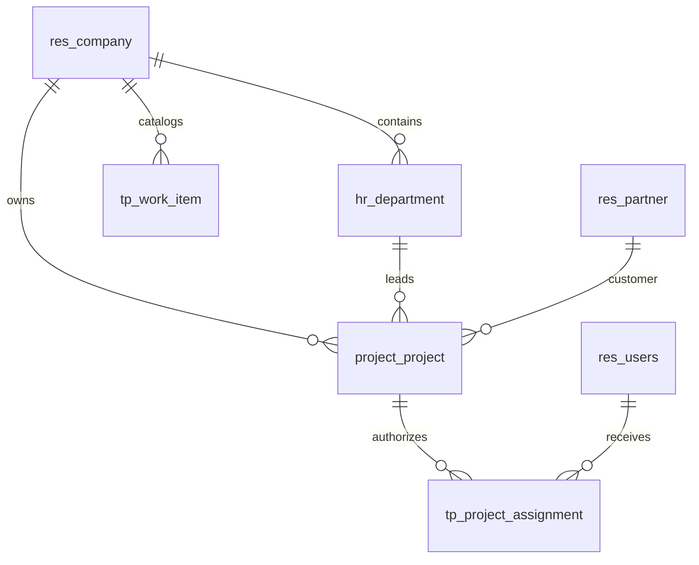

# Thiết kế database nền TANPHAT ONE

Ngày 28/10/2026. Phân biệt phần đã triển khai nền với mô hình nghiệp vụ sẽ bổ sung sau.

## 1. Phương án chọn

Một database PostgreSQL do Odoo quản lý cho mỗi môi trường. Các phòng ban cùng dùng một hồ sơ dự án, hợp đồng, giao khoán và chứng từ; phạm vi truy cập được kiểm tra ở backend. Không tách database theo phòng ban vì sẽ phải đồng bộ cùng một nghiệp vụ và khó duy trì transaction.

| Môi trường | Database | Vai trò |
| --- | --- | --- |
| Dev trên máy này | `tp_tanphat_dev` | dữ liệu giả lập, phát triển thủ công |
| Test tự động trên máy này | `tp_tanphat_test` | install/upgrade và test có rollback |
| Staging, đề xuất | `tp_tanphat_staging` | nghiệm thu, chạy migration thử |
| Production, đề xuất | `tp_tanphat_prod` | dữ liệu doanh nghiệp chính thức |

Dev/test hiện dùng cluster riêng trong `.local/postgres/data`, PostgreSQL 18, cổng `127.0.0.1:55432`. Script không sửa service, cấu hình hoặc role của PostgreSQL khác trên máy. Staging và production cần hạ tầng riêng với tài khoản và backup riêng; không dùng cluster dev làm production.

App đăng nhập PostgreSQL bằng `tp_odoo`, không phải superuser và không có quyền tạo database/role. Role quản trị `tp_dev_admin` chỉ quản lý cluster dev này. Database do role app sở hữu để Odoo có thể tạo/nâng cấp schema trong dev. Production cần kiểm soát quyền DDL và cửa sổ nâng cấp qua quy trình triển khai.

## 2. Schema đã triển khai cho nền dự án

Odoo ORM quản lý bảng trong schema chuẩn; module được phân biệt bằng namespace model và tên bảng. Không tạo schema PostgreSQL riêng cho từng phòng, không tạo bảng bằng SQL song song với ORM.



| Model | Thay đổi hiện có | Ràng buộc chính |
| --- | --- | --- |
| `res.company`, `res.users`, `res.partner` | dùng chuẩn Odoo | không tạo bộ bảng doanh nghiệp/người dùng/đối tác thứ hai |
| `hr.department` | thêm `tp_code` | mã duy nhất trong company |
| `project.project` | thêm `tp_managed`, `tp_code`, `tp_department_id`, `tp_assignment_ids` | dự án managed phải có company/code; code duy nhất trong company |
| `tp.project.assignment` | project, user, role, active, company liên quan | unique project/user/role; user thuộc company và group nền |
| `tp.work.item` | code, name, company, active | unique company/code, code không rỗng |

`tp_managed=False` giữ dự án Odoo thông thường theo quyền chuẩn. Dự án managed áp dụng scope Tấn Phát bổ sung. Reader chỉ đọc dự án được phân công còn active; manager xem/quản lý các dự án trong company đang được phép. Group-less restrictions chặn quyền rộng từ các group Odoo khác. Chỉ platform manager cấu hình metadata và phân công dự án; role coordinator ở bản đầu cũng chỉ cấp quyền đọc, không ngầm có quyền phê duyệt hay sửa nghiệp vụ.

Không dùng tên hiển thị làm khóa. ID nội bộ là khóa quan hệ; `tp_code` là mã nghiệp vụ, không phải khóa chính để join/import. Mã ngoài được mapping có provenance khi xây `tp_import`. Company, phòng ban và assignment là các chiều khác nhau, không được đồng nhất.

## 3. Mô hình nghiệp vụ tiếp theo (chưa tạo bảng)

```text
project.project
  +-- tp.contract -> tp.contract.revision -> tp.contract.line
  +-- tp.allocation -> tp.allocation.line -> allocation con
  +-- tp.production.entry
  +-- tp.acceptance -> acceptance line
  +-- tp.payment.request
  +-- ir.attachment / metadata hồ sơ

tp.contract -- bridge --> sale.order / purchase.order (khi áp dụng)
tp.acceptance / tp.payment.request -- bridge --> account.move / account.payment
```

- Hợp đồng bên ngoài khác giao khoán nội bộ. Khoán nội bộ không tạo vendor bill/PO giả.
- Catalog hạng mục khác dòng phạm vi hợp đồng; nhiều hợp đồng cùng đối tác/hạng mục vẫn có ID riêng.
- Giao khoán con liên kết cha bằng ID, cùng company/project; kiểm tra vòng lặp và vượt khoán tại model. Tổng công ty chỉ tính cấp 1.
- Sản lượng, nghiệm thu, hóa đơn, tiền thu/chi và giữ lại là các khái niệm riêng. Kế toán là nguồn chính thức cho posting và reconciliation.
- Phụ lục lưu loại điều chỉnh và ngày hiệu lực. Prototype đang giả định số thay thế; cần đối chiếu hồ sơ và chốt quy tắc trước khi xây model. Không lấy điều kiện “dòng dương cuối cùng” làm quy tắc chung.
- Nháp sửa được theo quyền; chứng từ đã chốt cần revision/cancellation có lý do và bản trước. Phần này chưa được áp dụng cho hợp đồng vì addon đó chưa triển khai.

## 4. Quy tắc dữ liệu và hiệu năng

- Thời điểm hệ thống lưu theo quy ước UTC của Odoo; DTO datetime trả ISO 8601 có `Z`. Ngày nghiệp vụ và ngày hiệu lực là trường riêng khi cần; UI hiển thị Asia/Ho_Chi_Minh.
- Tiền dùng field/currency/rounding chuẩn Odoo, không tự đổi kiểu cột chuẩn. Khi xây tài chính phải kiểm tra precision, thuế, gross/net, phụ lục và đa tiền tệ bằng test. API tiền trả decimal string và currency; JavaScript không quyết định số tiền chính thức.
- `null`, số 0 và chưa đối chiếu nguồn được giữ khác biệt. Số âm hợp lệ theo nghiệp vụ không tự ép thành 0.
- Mỗi model dùng ngoại khóa và policy `ondelete` phù hợp. Chứng từ đã chốt ưu tiên hủy/đảo thay vì xóa; có migration version khi đổi schema.
- Index hiện có cho project code/managed, assignment project/user/company và unique keys. Bổ sung index theo truy vấn và số liệu đo được, chưa tạo kho báo cáo riêng.
- Aggregate phải chịu cùng scope company/project như dữ liệu chi tiết. SQL view/cache/export cần kiểm quyền riêng.

## 5. Excel và hồ sơ

Luồng nhập dự kiến: file hash/batch -> staging -> mapping được duyệt -> danh sách lỗi -> đối chiếu -> phát hành vào model nghiệp vụ bằng ORM. Lưu file/sheet/dòng/phiên bản parser và binding để import lặp không cộng trùng. Không dùng NAS/Excel làm database runtime và không chạy macro để nhập.

Database chỉ lưu metadata hồ sơ; binary dùng filestore/adapter tài liệu. Download phải kiểm quyền bản ghi liên quan; browser không nhận UNC trực tiếp. Chưa cấu hình NAS/DMS hoặc chuyển dữ liệu thật trong lượt dựng nền này.

## 6. Backup và vận hành

Một bộ phục hồi Odoo gồm database dump, filestore tương ứng, phiên bản source/addon và cấu hình cần thiết. Trước pilot dữ liệu thật phải thử restore ở môi trường khác. Đề xuất ban đầu: backup hằng ngày, giữ nhiều thế hệ và bản ngoài máy chủ; chốt RPO/RTO theo vận hành thực tế, bổ sung PITR khi cần. Chưa thiết lập lịch backup production.

OPS-001 ngày 28/10/2026 đã kiểm chứng local: chụp dev nhất quán khi tạm dừng riêng Odoo, khôi phục DB/filestore và source commit `d9e8ccdc` vào cluster/HTTP/data-dir mới, đối chiếu 314 bảng và 37 tham chiếu attachment, kiểm login/API/quyền/tải tệp. Script ở `scripts/backup_restore.py`, hướng dẫn tại [BACKUP_RESTORE.md](../../ops/runbooks/BACKUP_RESTORE.md). Backup/credential nằm `.local/ops-001` có giới hạn ACL, chưa mã hóa. Đây là diễn tập cùng máy dùng lại `.venv`; backup ngoài máy, host khác, lịch/retention và RPO/RTO vẫn cần hoàn thiện trước production.

Runtime dev chỉ bind loopback, chưa là triển khai production. Khi triển khai thật: HTTPS cùng origin cho SPA/Odoo, secrets riêng, không mở database manager công khai, staging kiểm migration và đủ test quyền/CSRF/MFA. Cấu hình mẫu nằm ở `ops/config/`, cấu hình/mật khẩu thật nằm trong `.local/` ngoài Git.

## 7. Đề xuất chi tiết cho phần nghiệp vụ tiếp theo

Các model trong phần này chưa được tạo. Chốt ví dụ giao dịch và quy tắc phê duyệt trước khi tạo schema để tránh cố định sai cách hiểu từ Excel.

| Model đề xuất | Trường/quan hệ cốt lõi | Vai trò |
| --- | --- | --- |
| `tp.contract` | company, project, partner, direction, code, currency | Danh tính ổn định của hợp đồng chủ đầu tư/thầu phụ |
| `tp.contract.revision` | contract, sequence, effective_date, state, revision_kind, previous_revision | Bản gốc/phụ lục, hiệu lực và lịch sử; xác định rõ thay thế hay điều chỉnh delta |
| `tp.contract.line` | revision, work_item, description, quantity, uom, unit_price, tax | Phạm vi và giá trị của một phiên bản hợp đồng |
| `tp.allocation` | project, contract/revision, parent_allocation, assignee, kind, state | Giao khoán; phân biệt phòng nội bộ với đối tác bên ngoài |
| `tp.allocation.line` | allocation, contract_line, work_item, quantity, value | Dòng phạm vi khoán và nguồn hợp đồng tương ứng |
| `tp.production.entry` | project, work_item, period, quantity, source | Sản lượng thực hiện; chưa đồng nhất với nghiệm thu |
| `tp.acceptance` và dòng | project, contract/allocation, business_date, state, revision | Chứng từ nghiệm thu theo đúng phạm vi và bên liên quan |
| `tp.payment.request` | project, contract/allocation, currency, requested_amount, state | Đề nghị thanh toán; không tự trở thành tiền đã thu/chi |
| Liên kết kế toán | source document ↔ `account.move`/`account.payment` | Kế toán quản lý bút toán, thuế, hóa đơn và đối soát chính thức |
| Import staging | batch, file hash, sheet, row, parser version, source binding | Truy vết và nhập lại an toàn, không cộng trùng |

`revision` tham chiếu hợp đồng, dòng phạm vi tham chiếu revision. Không móc phụ lục dưới một dòng hợp đồng cụ thể. Trước khi mở nghiệp vụ cần chốt cách lưu snapshot đầy đủ hay delta và cách xử lý phụ lục có hiệu lực muộn/thu hồi; chưa áp dụng ngầm quy tắc fixture.

Mỗi giao dịch mang company và project. Liên kết cha-con, hợp đồng, hạng mục và acceptance phải cùng phạm vi hợp lệ, được kiểm bằng ORM/constraint. Không chỉ dựa vào bộ lọc dropdown trên frontend. `department_id` biểu diễn đơn vị chịu trách nhiệm; assignment/role biểu diễn quyền, không thay thế lẫn nhau.

### Điều kiện khóa thiết kế trước khi viết tp_contract

1. Chọn 2–3 hồ sơ dự án giả lập/đã khử dữ liệu nhạy cảm có phụ lục, giao khoán cấp 2 và hủy chứng từ.
2. Chốt tiền trước/sau thuế, tiền tệ, rounding và cách biểu diễn dữ liệu chưa xác nhận. `fields.Monetary` của Odoo dùng giá trị số thực ở lớp Python; API decimal string không tự giải quyết sai số. Cần test theo currency precision và nghiệp vụ thay vì sửa kiểu cột chuẩn bằng SQL.
3. Chốt ngày ký, ngày nghiệp vụ, ngày hiệu lực và thời điểm ghi nhận; chọn cách hỏi số liệu tại một thời điểm.
4. Chốt ai nhập, ai chốt, ai duyệt và quyền sửa/hủy ở từng trạng thái. Posted không xóa vật lý; thao tác thay đổi lưu lý do và phiên bản trước.
5. Dùng unique key theo company + mã nghiệp vụ, và contract + sequence cho revision. Thêm index cho company/project/state/date khi truy vấn thực tế cần; chưa tạo partition hoặc reporting database riêng.
6. Một thao tác chốt chạy trong một transaction Odoo. Thêm kiểm soát cập nhật đồng thời và idempotency cho API ghi trước khi dùng cho chứng từ thật.

**Thứ tự triển khai:** `tp_contract` → `tp_allocation` → `tp_settlement`/reporting → staging import → accounting bridge → workspace các phòng tiếp theo. Schema được tạo/nâng cấp bằng addon và migration có version, không bằng script SQL phát sinh ngoài ORM.
