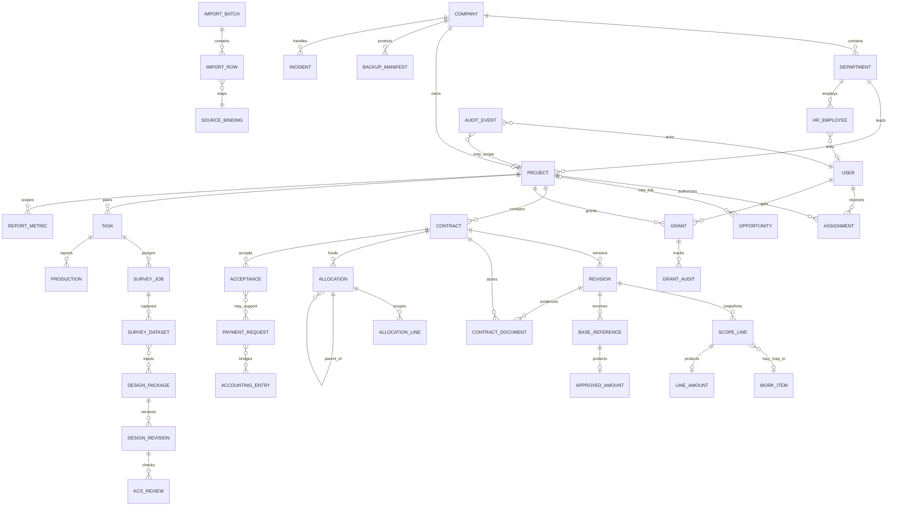

# BIZ-002 — Từ điển dữ liệu và ma trận truy cập TANPHAT ONE

**Phạm vi:** mô hình khái niệm dùng chung cho gói thiết kế BIZ-002 (A–M), với trọng tâm TP Projects, TP Contracts, TP Tasks, TP Finance và TP Documents. Đây là tài liệu thiết kế; không tạo model, migration, security rule hoặc API mới.

**Ngày:** 28/10/2026 (Asia/Saigon)  
**Nguồn hiện hành:** [TP_DATABASE_DESIGN](TP_DATABASE_DESIGN.md), [TP_BUSINESS_WORKFLOW](TP_BUSINESS_WORKFLOW.md), [BIZ-001 workflow và quyền](TP_KD_WORKFLOW_AND_PERMISSIONS.md), [BIZ-001 evidence](TP_KD_EVIDENCE_AND_ACCEPTANCE.md), `custom_addons/tp_*`, `contracts/openapi/tanphat-v1.yaml`.

## Cách đọc trạng thái

| Nhãn | Ý nghĩa | Cách dùng trong tài liệu |
| --- | --- | --- |
| **Confirmed** | Đã có bằng chứng trong source/runtime hoặc quyết định người dùng đã ghi trong DEC-013–017. | Có thể dùng làm baseline đọc và security hiện tại; không mở rộng nghĩa ngoài bằng chứng. |
| **Proposed** | Thiết kế cần để triển khai vertical slice tiếp theo, phù hợp với workflow hiện hành nhưng chưa có runtime. | Chỉ là đầu vào review/model/action; phải có test và owner trước khi code. |
| **Unconfirmed** | Câu hỏi Q1–Q14, quyền pháp lý, công thức hoặc mapping chưa có hồ sơ xác minh. | Giữ trạng thái/nhãn rõ ràng; không suy thành quyền, tiền, hiệu lực hay quyết định. |

Các trường được đánh dấu `[C]`, `[P]`, `[U]` trong bảng lần lượt là Confirmed, Proposed và Unconfirmed. “Bắt buộc” là bắt buộc ở lớp khái niệm; field Odoo cụ thể vẫn phải theo model và migration được duyệt.

Sensitivity: **Internal** là nội bộ đúng scope; **Confidential/Personal** là dữ liệu đối tác/nhân sự cần thêm field policy; **Restricted/IP** là hồ sơ kỹ thuật và sở hữu trí tuệ; **Financial/Highly restricted** gồm tiền, evidence pháp lý/tài chính và audit bảo mật. Nhãn khái niệm này chưa phải selection runtime. Runtime Contracts chỉ có `general/financial`; không tự gắn thêm classification đã triển khai.

## 1. Phạm vi, nguyên tắc và nguồn sự thật

- Odoo là nguồn sự thật cho ID, quyền, trạng thái, lịch sử và công thức đã được chốt. React chỉ giữ state màn hình và DTO API.
- Một PostgreSQL database dùng chung cho các phòng ban trong mỗi môi trường; `company_id`, `project_id`, `department_id` và assignment là các chiều khác nhau.
- Không dùng tên hiển thị làm khóa. Mã nghiệp vụ chỉ là alternate key có phạm vi; mọi mapping ngoài phải giữ provenance.
- Record nháp có thể sửa theo capability. Record đã submit/chốt giữ bất biến; revise, correction, void hoặc reversal có reason, actor và lịch sử.
- `null`, `0`, số âm và “chưa xác nhận” có nghĩa khác nhau. Không biến unknown/missing thành 0.
- BASE là nơi phê duyệt chính thức giai đoạn đầu. TANPHAT ONE quản lý hồ sơ và ghi nhận kết quả; `approved` không đồng nghĩa đã ký, có hiệu lực hoặc đã post kế toán.

## 2. ERD khái niệm A–M

Quan hệ `PAYMENT_REQUEST`–`ACCOUNTING_ENTRY` là bridge, không biến đề nghị thành tiền đã thu/chi. Cơ hội có thể chưa có project; request tạm ứng có thể chưa có acceptance, các căn cứ acceptance dùng bridge khi áp dụng. Dòng phạm vi có thể chưa map work item; audit ở cấp company/system có thể chưa có project. `ALLOCATION` con không tạo một nghĩa vụ vendor thứ hai; tổng cấp 1 không cộng lại các con cấp 2.

Survey/design/HR/Documents mở rộng/operations là entity khái niệm; ERD không khẳng định mọi node đã có bảng. Runtime hiện có project, assignment, grant, contract/revision/line/amount, approval reference/amount và contract document; `res.company`, `res.users`, `res.partner`, `hr.department` dùng Odoo chuẩn.

## 3. Từ điển dữ liệu khái niệm A–M

### Field kiểm soát dùng chung cho action mới (đều Proposed)

| Field | Meaning | Type | Required | Source | Sensitivity | Owner |
| --- | --- | --- | --- | --- | --- | --- |
| `expected_version`, `record_version` | Phát hiện sửa đồng thời trước khi command ghi | integer/version token | Có cho mutation nhạy cảm | Backend domain; không phải field đã có của CTR-001 | Internal | Domain service |
| `idempotency_key`, `payload_hash` | Retry đúng payload trả cùng kết quả, payload khác bị từ chối | opaque string + SHA-256 | Theo command/retry contract | Caller key + backend hash/canonical payload | Security | API/domain owner |
| `request_id`, `actor_id`, `action`, `acted_at` | Tương quan command/audit và actor thực | string + user ID + action code + UTC datetime | Có | Session/backend, không tin actor truyền từ browser | Security | System/auditor |
| `reason`, `evidence_id`, `previous_record_id` | Căn cứ return/reject/cancel/correction/reopen/handover | text + document/record references | Khi transition yêu cầu | Người thực hiện + evidence được phân loại | Inherits field/file policy | Domain owner |
| `business_date`, `effective_date`, `recorded_at` | Ngày nghiệp vụ/hiệu lực và lúc biết/ghi dữ liệu | date + date + UTC datetime | Tùy domain; recorded_at luôn có | Hồ sơ nguồn/backend | Internal hoặc Financial theo record | Domain owner |

Field dùng chung là hợp đồng kiểm soát đề xuất, không phải một model giao dịch hoặc workflow engine tổng quát; tên/type/schema API cuối cùng được chốt trong slice, giữ cơ chế native Odoo phù hợp.

### A — Cơ hội, đánh giá tham gia và đấu thầu

| Field | Meaning | Type | Required | Source | Sensitivity | Owner |
| --- | --- | --- | --- | --- | --- | --- |
| `opportunity_id` [P] | Danh tính cơ hội/dự thầu | Odoo model ID | Có khi triển khai | Chưa có model runtime | Internal | KD_HEAD |
| `opportunity_lifecycle` [P] | State khái niệm A; enum/action theo workflow A, không suy từ BASE decision | selection | Có khi triển khai | [Workflow A–E](TP_PROCESS_WORKFLOWS_A_E.md) | Internal | KD owner |
| `tender_code` [P] | Mã gói thầu/hồ sơ | string, unique trong company | Có | Hồ sơ nguồn, mapping duyệt | Internal | KD_HEAD |
| `participation_decision` [P/U] | Kết quả tham gia/không tham gia | selection + reason | Có khi chốt | BASE reference hoặc hồ sơ quyết định | Restricted | KD_HEAD/BASE |
| `submission_at` [P] | Thời điểm nộp hồ sơ | UTC datetime | Có nếu đã nộp | Evidence/hash | Internal | KD_HEAD |

Q1 (văn bản thẩm quyền/hạn mức) và Q3 (BASE ID/evidence) chưa xác nhận; không dùng A để suy quyền ký hoặc quyết định chính thức.

### B — Khởi tạo project, phân công và kế hoạch nền

| Field | Meaning | Type | Required | Source | Sensitivity | Owner |
| --- | --- | --- | --- | --- | --- | --- |
| `company_id` [C] | Pháp nhân sở hữu record | Odoo many2one | Có | `res.company`, ORM | Internal | Platform/Finance |
| `project_id` [C] | Project managed chứa nghiệp vụ | Odoo many2one | Có với nghiệp vụ project | `project.project` | Internal; scope key | Project owner |
| `department_id` [C/P] | Đơn vị chủ trì/chịu trách nhiệm | many2one | Có khi nghiệp vụ cần | `hr.department.tp_code`; exact per model | Internal | Department owner |
| `assignment(user, role, active)` [C] | Người được phân công và vai trò trong project | relation + boolean | Có để cấp scope | `tp.project.assignment` | Access-control | Platform manager |
| `business_code` [C/P] | Mã ổn định trong company (project/contract/work item) | uppercase string | Có với entity có mã | Odoo constraint | Internal | Domain owner |
| `project_lifecycle` [P] | Draft/review/active/on_hold/completed/cancelled, khác `active` Odoo | selection | Có khi mở PRJ-002 | Action model đề xuất | Internal | Project owner |
| `plan_baseline`, `hold_reason`, `close_reason` [P] | Kế hoạch nền và căn cứ hold/complete/cancel | version + text/evidence | Có khi action liên quan | Plan/review evidence | Restricted | Project owner |

### C — Contract chính/thầu phụ, phụ lục, ký, hiệu lực và thanh lý

#### Danh tính hợp đồng

| Field | Meaning | Type | Required | Source | Sensitivity | Owner |
| --- | --- | --- | --- | --- | --- | --- |
| `contract_id` [C] | ID nội bộ hợp đồng | Odoo integer | Có | `tp.contract` | Internal | Contract owner |
| `code` [C] | Mã hợp đồng, duy nhất trong company | uppercase string | Có | `tp.contract.code`, UNIQUE(company, code) | Internal | KD_HEAD |
| `name` [C] | Tên hồ sơ hợp đồng | string | Có | `tp.contract.name` | Internal | Contract owner |
| `partner_id` [C/P] | Đối tác/bên còn lại | many2one | Không bắt buộc ở runtime; đề xuất bắt buộc hồ sơ mới | `res.partner` | Confidential | Contract/Finance |
| `contract_type` [C] | `owner`, `general_contractor`, `subcontractor` | selection | Có | Odoo model | Internal | Contract owner |
| `currency_id` [C] | Đồng tiền của snapshot/amount | many2one | Có | `res.currency` | Financial metadata | Finance |
| `lifecycle_state` [C] | `not_effective`, `effective`, `suspended`, `execution_completed`, `liquidated`, `terminated` | selection | Có | Odoo model | Restricted | Contract owner |
| `legacy_unverified` [C] | Hồ sơ lịch sử thiếu căn cứ đã xác minh | boolean | Có (default false) | Odoo model | Restricted | Contract owner |

#### Revision, hiệu lực và snapshot

| Field | Meaning | Type | Required | Source | Sensitivity | Owner |
| --- | --- | --- | --- | --- | --- | --- |
| `revision_id` [C] | ID bản gốc/phụ lục/correction | Odoo integer | Có | `tp.contract.revision` | Internal | Contract owner |
| `sequence` [C] | Thứ tự trong một contract; `0` dành cho original | integer, UNIQUE(contract, sequence) | Có | Odoo constraint | Internal | Contract owner |
| `revision_kind` [C] | `original`, `amendment`, `correction` | selection | Có | Odoo model | Restricted | Contract owner |
| `previous_revision_id` [C] | Bản trước cùng contract | many2one | Có với amendment/correction | Odoo constraint | Restricted | Contract owner |
| `signed_date` [C] | Ngày ký ghi nhận | business date | Có khi `signed_recorded` | Hồ sơ ký | Restricted | Legal/contract |
| `effective_date` [C] | Ngày bản có hiệu lực | business date | Có khi `effective_recorded` | Điều khoản/evidence | Restricted | Legal/contract |
| `recorded_at` [C] | Thời điểm hệ thống ghi record | UTC datetime | Có | Odoo audit fields | Internal | System |
| `review_state` [C] | `draft`, `in_review`, `returned`, `review_complete`, `cancelled` | selection | Có | `tp.contract.revision` | Internal | Reviewer |
| `signature_status`, `signature_authority_status` [C/U] | Bản ký và căn cứ thẩm quyền ký | two selections | Có | Odoo model; Q1 còn mở | Restricted | Legal/contract |
| `effectivity_status` [C] | `not_effective`, `effective_recorded` | selection | Có | Odoo constraint | Restricted | Contract owner |

Snapshot hiệu lực chọn theo `effective_date` và trạng thái đã ghi nhận. Trùng ngày/mâu thuẫn tạo warning; không chọn ID lớn nhất. Bản tương lai không thay số hiện tại.

#### Phạm vi contract và catalog hạng mục

| Field | Meaning | Type | Required | Source | Sensitivity | Owner |
| --- | --- | --- | --- | --- | --- | --- |
| `scope_line_id` [C] | Dòng phạm vi của một revision | Odoo integer | Có | `tp.contract.line` | Internal | Contract owner |
| `scope_key` [C] | Khóa ổn định của hạng mục qua các revision | string, UNIQUE(revision, scope_key) | Có | Odoo constraint | Internal | Domain owner |
| `work_item_id` [C] | Mapping tới catalog hạng mục | many2one | Không nếu legacy chưa map | `tp.work.item` | Internal | Technical |
| `change_kind` [C] | `original`, `unchanged`, `amended`, `added` | selection | Có | Odoo model | Internal | Contract owner |
| `previous_line_id` [C] | Dòng cùng `scope_key` ở revision trước | many2one | Có với unchanged/amended | Odoo constraint | Restricted | Contract owner |
| `line_amount(amount, amount_state, tax_basis)` [C] | Giá trị snapshot tách khỏi metadata | protected monetary + selection | Record có thể có; amount chỉ khi confirmed | `tp.contract.line.amount` | Financial | Finance |

Catalog work item khác stage thiết kế và event mô tả. Không dùng tên hạng mục làm join key.

Các khái niệm submission/snapshot, previous submission, aggregate version, hash, submit/return actor/time/reason/issues của CTR-002a-P1 tại readiness mục 7.1.3 đều là **[P]**, chưa có model/field runtime. Vòng sửa nháp S1/S2 thuộc cùng legal revision, không thay `sequence`/previous revision pháp lý. Snapshot tài chính, audit và idempotency payload cần storage/ACL/domain tương đương model amount; không đặt JSON tiền vào record metadata reader được đọc. Document snapshot phải giữ binary/version bất biến, S2 thay file bằng bản mới; hash đơn thuần không bảo toàn được hồ sơ.

#### BASE decision và evidence

| Field | Meaning | Type | Required | Source | Sensitivity | Owner |
| --- | --- | --- | --- | --- | --- | --- |
| `base_reference_id` [C] | Hồ sơ tham chiếu BASE gắn đúng revision | Odoo integer | Có | `tp.approval.reference` | Restricted | KD_HEAD |
| `reference_kind`, `base_reference`, `source_url`, `provenance` [C] | Cách nhận diện nguồn BASE | selection + strings | Có theo kind | Odoo constraints | Restricted | BASE recorder |
| `decision` [C] | `pending`, `approved`, `rejected`, `cancelled` | selection | Có | Odoo model | Restricted | BASE recorder |
| `decided_by_name`, `decided_at`, `decision_reason` [C] | Ai/khi nào/kết luận/lý do | string + UTC datetime + text | Có khi decision khác pending; reason khi reject/cancel | Odoo constraints | Restricted | BASE recorder |
| `verification_state` [C] | `pending`, `verified`, `disputed` | selection | Có | Odoo model | Restricted | Evidence verifier |
| `authority_status`, `authority_source` [C/U] | Schema đã có; kết luận thẩm quyền cần hồ sơ xác minh | selection + source | Có nếu confirmed | Odoo model; Q1/Q3 chưa có hồ sơ đủ | Highly restricted | Legal/owner |
| `evidence_sha256`, `submitted_document_sha256` [C] | Hash bằng chứng và hồ sơ trình | lowercase SHA-256 | Không nếu chưa có file; bắt buộc theo policy pilot | Odoo constraint | Highly restricted | Evidence owner |
| `approved_amount(amount_state, amount, tax_basis)` [C/U] | Số BASE khai báo, bảo vệ theo grant | protected monetary | Chỉ khi confirmed; basis có thể unknown | `tp.approval.reference.amount`; Q4 mở | Highly restricted | Finance/BASE |

Trong code hiện tại, `verification_state` chỉ nhận `pending/verified/disputed`; từ “declared” là nhãn diễn giải/UI, không phải selection runtime. `approved` + `verified` + `authority confirmed` vẫn chưa tự ký/effective.

### D — Giao nhận, coordinator, task, overdue và handoff

| Field | Meaning | Type | Required | Source | Sensitivity | Owner |
| --- | --- | --- | --- | --- | --- | --- |
| `task_id` [P] | ID task/kế hoạch | Odoo integer | Có | `project.task` + extension dự kiến | Internal | Planning |
| `owner_user_id` [P] | Một người chịu trách nhiệm task | many2one | Có | Assignment + task | Internal | Planning |
| `due_at` [P] | Hạn hoàn thành | UTC datetime/date | Có tùy loại | Task plan | Internal | Planning |
| `deliverable` [P] | Đầu ra cần bàn giao | text/reference | Có với task chốt | Task record | Internal | Task owner |
| `base_reference_id` [P] | Tham chiếu quyết định, không phải state phê duyệt | many2one | Khi workflow yêu cầu | `tp.approval.reference` | Restricted | KD_HEAD |
| `task_state` [P] | `draft`, `assigned`, `in_progress`, `returned_to_assigner`, `result_submitted`, `returned`, `completed`, `cancelled` | selection | Có | Workflow D; trả assignment khác trả result | Internal | Planning |
| `coordinator_user_id`, `assigned_at`, `accepted_at` [P] | Người điều phối, lúc giao và lúc nhận | user + UTC datetimes | Có khi giao/nhận | Task action audit | Internal | Planning |
| `handoff_from`, `handoff_to`, `handoff_evidence` [P] | Nguồn/đích và bằng chứng bàn giao | scoped relations + document | Có khi handoff | Task/department action | Restricted | Task owner |
| `overdue_at`, `overdue_reason` [P] | Mốc quá hạn và giải trình | derived UTC datetime + text | Khi trễ hạn | Due date + state; không auto đổi ngày | Internal | Task owner |

### E — Khoán nội bộ/bên ngoài, cấp 1–2 và điều chỉnh

| Field | Meaning | Type | Required | Source | Sensitivity | Owner |
| --- | --- | --- | --- | --- | --- | --- |
| `allocation_id` [P] | Danh tính giao khoán | Odoo integer | Có | Model đề xuất `tp.allocation` | Restricted | KD_HEAD |
| `allocation_kind` [P] | `external_subcontract`, `internal_allocation`, `department_subcontract` | selection | Có | BIZ-001 E09 | Restricted | KD_HEAD/Finance |
| `parent_allocation_id` [P] | Khoán cấp 1 làm cha của cấp 2 | many2one | Có với department_subcontract | Constraint cùng project/company | Restricted | KD_HEAD |
| `assignee_id` [P] | Đối tác/phòng nhận | many2one | Có | Partner/department mapping | Confidential | KD_HEAD |
| `allocation_line(quantity, value, contract_line_id)` [P] | Phạm vi và phần giao | decimal + many2one | Có theo loại | Allocation source | Financial | Finance |
| `overflow_warning` [P/U] | Con vượt cha hoặc thiếu mapping | warning collection | Không; phải được báo nếu có | Calculation/audit | Restricted | KD_HEAD |
| `adjustment_revision`, `settlement_reference`, `settled_at` [P/U] | Điều chỉnh khoán và căn cứ quyết toán | version + reference + date | Có khi điều chỉnh/quyết toán | Evidence; Q4/Q7/Q8 còn mở | Financial | KD_HEAD/Finance |

Hard block khi vượt khoán mẹ là **Unconfirmed (Q7)**; baseline thiết kế chỉ yêu cầu cảnh báo và giữ số âm hợp lệ của phần chênh quản trị. Chưa có runtime allocation/warning.

### F — Survey: kế hoạch, hiện trường, dữ liệu và bàn giao

| Field | Meaning | Type | Required | Source | Sensitivity | Owner |
| --- | --- | --- | --- | --- | --- | --- |
| `survey_job_id`, `project_id`, `task_id` [P] | Lệnh khảo sát và phạm vi được giao | Odoo ID + relations | Có | TP Survey model đề xuất | Restricted | Survey lead |
| `site_location`, `coordinate_system`, `survey_period` [P/U] | Vị trí, hệ tọa độ và kỳ khảo sát | geometry/reference + date range | Theo loại khảo sát | Hồ sơ kỹ thuật; chuẩn tọa độ cần xác minh | Restricted/IP | Survey lead |
| `crew_owner_id`, `equipment_ref` [P] | Người chịu trách nhiệm và thiết bị | user/catalog | Có với lệnh thực hiện | Task/HR/equipment mapping | Confidential | Survey lead |
| `raw_dataset_id`, `capture_at`, `source_hash` [P] | Dữ liệu gốc và dấu vết thu thập | document + UTC datetime + SHA-256 | Có khi nộp dữ liệu | Thiết bị/hồ sơ hiện trường | Restricted/IP | Survey lead |
| `check_result`, `handoff_document_id` [P] | Kiểm tra chất lượng và bàn giao | selection + document | Có khi chốt | Reviewer/evidence | Restricted | Technical/KCS |

Bàn giao dữ liệu khảo sát khác nghiệm thu thương mại. Số điện thoại/nhân sự đoàn khảo sát theo HR scope; raw dataset không được public theo quyền xem metadata project.

### G — Design, BIM, KCS, review, issue và revision

| Field | Meaning | Type | Required | Source | Sensitivity | Owner |
| --- | --- | --- | --- | --- | --- | --- |
| `design_package_id`, `project_id`, `work_item_id` [P] | Danh tính gói thiết kế và phạm vi kỹ thuật | ID + scoped relations | Có | TP Design model đề xuất | Restricted | Chủ trì thiết kế |
| `design_stage_id`, `discipline_id`, `bim_model_ref` [P/U] | Giai đoạn thiết kế, bộ môn và mô hình | catalog references | Theo loại; mapping Q5 chưa chốt | Catalog đã duyệt/hồ sơ nguồn | Restricted/IP | Technical/BIM |
| `design_revision`, `previous_revision_id` [P] | Phiên bản kỹ thuật bất biến sau phát hành | sequence + relation | Có khi issue | Design version history | Restricted/IP | Design owner |
| `review_checklist`, `kcs_result`, `reviewer_id` [P] | Rà soát và kết quả KCS | checklist + selection + user | Có trước issue | Technical evidence | Restricted | Technical/KCS |
| `issued_at`, `issued_document_id`, `recipient_scope` [P] | Bản đã phát hành, khi nào và cho ai | UTC datetime + document + scope | Có khi issue | Document version | Restricted/IP | Design owner |

Work item khác design stage; catalog hiện có không xác nhận mapping nghiệp vụ Q5. KCS/review hoàn tất không tự tạo nghiệm thu tiền hoặc hiệu lực contract.

### H — Production, acceptance, request, advance và retention

| Field | Meaning | Type | Required | Source | Sensitivity | Owner |
| --- | --- | --- | --- | --- | --- | --- |
| `production_entry_id` [P] | Phát sinh sản lượng theo kỳ/hạng mục | Odoo integer | Có | Model đề xuất | Financial | Technical/owner |
| `period`, `business_date` [P] | Kỳ/ngày nghiệp vụ của phát sinh | date/period | Có | Evidence nguồn | Internal | Domain owner |
| `quantity` [P] | Khối lượng thực hiện | decimal + unit | Có nếu đã xác nhận | Technical evidence | Restricted | Technical |
| `production_value`, `acceptance_amount` [P/U] | Giá trị quản trị sản lượng và biên bản; không đổi khối lượng thành tiền khi thiếu đơn giá/căn cứ | protected monetary + amount_state/currency/basis | Khi báo cáo tiền; unknown nếu chưa xác nhận | Hồ sơ nguồn + Q4; quy tắc chuẩn riêng khi code | Highly restricted | Domain owner/Finance |
| `acceptance_id` [P] | Biên bản nghiệm thu theo bên/phạm vi | Odoo integer | Có cho nghiệm thu | Model đề xuất | Financial | KD_HEAD/technical |
| `production_state` [P] | `draft`, `submitted`, `confirmed`, `returned` | selection | Có | Workflow H | Restricted | Technical owner |
| `acceptance_state` [P] | `draft`, `returned`, `reviewed`, `confirmed`, `void`; return/correction giữ bản cũ và tạo version mới | selection | Có | Workflow H; không gộp chữ ký | Restricted | Acceptance owner |
| `acceptance_signature_status` [P/U] | `unsigned`, `signed_recorded` và authority riêng | selection + evidence | Khi cần ký | Workflow H; Q1/Q8 | Restricted | Người record được chỉ định |
| `evidence_id` [P/U] | File/biên bản làm căn cứ | document reference | Có khi confirmed | TP Documents; Q4/Q8 còn mở | Restricted | Acceptance owner |
| `payment_request_id` [P] | Đề nghị thanh toán, không phải tiền đã trả | Odoo integer | Có | Model đề xuất | Financial | Finance |
| `requested_amount`, `currency_id`, `tax_basis` [P/U] | Số tiền đề nghị và cơ sở so sánh | monetary + currency + selection | Có khi có amount; basis có thể unknown | Request/evidence; Q4 chưa chốt thuế | Highly restricted | Finance |
| `payment_request_state` [P] | `draft`, `finance_review`, `ready_for_base`, `returned`, `awaiting_base`, `externally_approved`, `rejected`, `withdrawn`; projection/disposition khác BASE decision | selection | Có | Workflow H | Restricted | Finance |
| `advance_amount`, `advance_source_id` [P/U] | Tạm ứng theo contract/request, không cần nghiệm thu giả | protected monetary + relation | Khi có tạm ứng | Contract/request/accounting; Q4/Q8 | Highly restricted | Finance |
| `retention_amount`, `release_condition`, `released_at` [P/U] | Giữ lại, điều kiện giải tỏa và lần giải tỏa | protected monetary + condition + datetime | Khi điều khoản áp dụng | Contract/acceptance/accounting; Q8 | Highly restricted | Finance |

Production không phải acceptance; acceptance không phải invoice hoặc cash. Một event bị void giữ lịch sử và đóng góp bằng 0 theo policy đã duyệt.

### I — Invoice, cash, debt, reconcile và accounting bridge

| Field | Meaning | Type | Required | Source | Sensitivity | Owner |
| --- | --- | --- | --- | --- | --- | --- |
| `accounting_entry_id`, `account_move_id`, `account_payment_id` [P] | Link chứng từ Accounting chính thức | many2one/bridge | Khi đã bridge | Odoo Accounting | Highly restricted | Accounting |
| `invoice_number`, `invoice_date`, `invoice_issued_amount` [P/U] | Hóa đơn đã phát hành, khác nghĩa vụ cần xuất | string + date + monetary | Khi có invoice | Accounting/feed cần đối chiếu Q6 | Highly restricted | Accounting |
| `cash_received`, `cash_paid`, `cash_date` [P/U] | Tiền thực thu/chi theo chứng từ | protected monetary + date | Khi có cash event | Accounting/bank; Q6 | Highly restricted | Accounting |
| `debt_due_date`, `debt_basis`, `reconciliation_state` [P/U] | Công nợ đến hạn và trạng thái đối chiếu | date + basis + selection | Chỉ khi đủ contract/thuế/kỳ | Accounting; Q4/Q6 chưa chốt | Highly restricted | Accounting |
| `posted_at`, `reconciled_at` [P/U] | Thời điểm post/đối soát thật | UTC datetimes | Khi accounting posted/reconciled | Odoo Accounting | Highly restricted | Accounting |
| `request_payment_link`, `allocated_amount` [P] | Phân bổ nhiều request ↔ nhiều payment | bridge relation + monetary | Khi phân bổ | ORM bridge | Highly restricted | Accounting |

Request approved không tự thành paid. Acceptance trừ cash là chênh lệch quản trị cùng basis; chưa đủ để gọi công nợ đến hạn. Cash có thể gồm advance trước acceptance.

### J — Documents, phân loại, version, share và archive

| Field | Meaning | Type | Required | Source | Sensitivity | Owner |
| --- | --- | --- | --- | --- | --- | --- |
| `document_id` [C] | Metadata hồ sơ gắn contract/revision | Odoo integer | Có | `tp.contract.document` | Internal | Contract owner |
| `document_kind` [C] | `signed_contract`, `amendment`, `base_evidence`, `technical_scope`, `other` | selection | Có | Odoo model | Restricted | Document owner |
| `confidentiality` [C] | `financial` hoặc `general` | selection | Có | Odoo model; default financial | Security classification | Document owner |
| `attachment_id/file/file_name` [C] | Binary lưu filestore và tên hiển thị | attachment/binary/string | File tùy hồ sơ; name bắt buộc | `ir.attachment` / filestore | Same as record; filename may leak | Document owner |
| `message_id/chatter` [P] | Trao đổi và thông báo theo record | Odoo mail message | Không | Odoo chatter | Inherits highest related sensitivity | Record owner |
| `document_version`, `previous_document_id`, `content_sha256` [P] | Version và dấu vết nội dung hồ sơ | sequence + relation + hash | Có khi version/issue | TP Documents extension đề xuất | Inherit classification | Document owner |
| `share_recipient_scope`, `expires_at`, `archive_at` [P] | Đối tượng chia sẻ, hết hạn và lưu trữ | scope + UTC datetimes | Khi share/archive | Document action audit | Restricted | Document owner |

Signed contract, amendment và BASE evidence luôn `financial`. Upload chưa phân loại vào vùng financial; link/copy sang task không hạ sensitivity. Chatter, filename, preview và notification không được lộ tên/số tiền vượt policy.

### K — Organization, HR, job, handover và grant/revoke

| Field | Meaning | Type | Required | Source | Sensitivity | Owner |
| --- | --- | --- | --- | --- | --- | --- |
| `department_id`, `department_code` [C] | Đơn vị tổ chức trong company | ID + code | Có khi phân công phòng | `hr.department.tp_code` | Internal | HR/organization |
| `employee_id`, `job_id`, `employment_state` [P] | Nhân sự, vị trí và tình trạng làm việc | HR relations + selection | Khi TP HR triển khai | Odoo HR/config được duyệt | Personal/restricted | HR |
| `handover_id`, `replacement_user_id`, `handover_at` [P] | Bàn giao vai trò khi đổi vị trí/nghỉ việc | relation + user + UTC datetime | Khi chuyển trách nhiệm | HR/Project handover evidence | Confidential | HR/project owner |
| `grant_id`, `user_id`, `project_id`, `capability` [C] | Grant `financial_read` theo người + project | relation + selection | Có với grant | `tp.project.grant` | Security | Superuser hiện tại; Q2 chưa chốt |
| `reason`, `granted_by_id`, `date_end`, `active` [C] | Lý do, người cấp, hạn và trạng thái grant | text + user + date + boolean | Reason/grantor/active có; hạn tùy | Odoo grant model | Security | Grant owner |
| `revoked_by`, `revoked_at`, `revoke_reason`, `delegation_id` [P/U] | Ledger thu hồi và ủy quyền riêng | user + datetime + text + relation | Có khi revoke/delegate | Action/audit đề xuất; Q1/Q2 mở | Security/highly restricted | Security owner |

Chức danh/department membership không tự cấp capability. HR handover phải yêu cầu review assignment/grant, không copy toàn bộ quyền cũ. Ledger revoke/delegation chưa có runtime.

### L — KPI, Dashboard, alert và report

| Field | Meaning | Type | Required | Source | Sensitivity | Owner |
| --- | --- | --- | --- | --- | --- | --- |
| `metric_id` [P] | Chỉ tiêu theo domain (production/acceptance/invoice/cash/retention) | typed metric | Có trong report | Odoo query/view; công thức phải duyệt | Inherits source | Report owner |
| `as_of_date`, `known_at` [P] | Ngày hiệu lực nghiệp vụ và thời điểm dữ liệu đã biết | date + UTC datetime | Có trong report | Revision/event/import | Internal | Report owner |
| `scope_company_id`, `scope_project_id` [P] | Phạm vi aggregate | many2one | Có | Access domain | Internal | Platform |
| `warning_codes` [P] | Tập cảnh báo độc lập, không che nhau | array/related warning | Không; bắt buộc nếu phát hiện | Reconcile engine | Restricted | Domain owner |

`TP Dashboard` chỉ tổng hợp trong scope và không tạo quyết định. “Lợi nhuận” từ các file mẫu chỉ là chỉ số quản trị khi được duyệt; không gọi là lợi nhuận kế toán đầy đủ.

### M — Import, legacy, provenance và mapping

| Field | Meaning | Type | Required | Source | Sensitivity | Owner |
| --- | --- | --- | --- | --- | --- | --- |
| `import_batch_id` [P] | Một lần tiếp nhận file/snapshot | Odoo integer | Có khi import | Model đề xuất | Internal | Data steward |
| `source_file_sha256` [P] | Hash file nguồn | SHA-256 | Có | File intake | Restricted | Data steward |
| `source_snapshot_at` [P] | Thời điểm nguồn được chụp | UTC datetime | Có | Import manifest | Internal | Data steward |
| `sheet_name`, `row_number`, `source_key` [P] | Vị trí và khóa trong file | string + integer | Có với Excel | Parser/staging | Restricted | Data steward |
| `target_model`, `target_id`, `mapping_version` [P] | Mapping đã duyệt tới Odoo | string + integer + version | Có khi phát hành | Mapping decision | Restricted | Data steward/domain owner |
| `unmapped_reason`, `reconcile_state` [P/U] | Lý do thiếu mapping/đối chiếu | text + selection | Có nếu lỗi/missing | Import QA; Q5/Q6 mở | Restricted | Data steward |
| `audit_event_id` [P] | Actor, before/after, reason, evidence, request/version | append-only event | Có cho mutation/security | Odoo audit service đề xuất | Highly restricted | Platform/security |
| `legacy_verification_state`, `legacy_source_id` [P] | Nhãn dữ liệu lịch sử chưa đủ căn cứ | selection + source | Có khi intake legacy | Import steward | Restricted | Domain owner |
| `notification_id`, `recipient_scope`, `delivery_state` [P] | Thông báo và đối tượng nhận có quyền | ID + scope + selection | Khi notify | Notification audit | Inherit source sensitivity | Record owner |
| `backup_manifest_id`, `snapshot_at`, `restore_verified_at` [C/P] | Manifest backup và bằng chứng restore, không chứa secret | ID + UTC datetimes | Theo runbook | OPS-001 tooling; lịch production chưa có | Highly restricted | Operations |
| `incident_id`, `severity`, `resolved_at`, `evidence_ref` [P] | Sự cố dữ liệu/quyền/vận hành | ID + selection + datetime + reference | Khi incident | Operations log đề xuất | Highly restricted | Operations/security |

Excel/NAS chỉ là nguồn staging/provenance; không phải database runtime. Import lặp phải idempotent theo source binding + loại sổ + source key, không cộng trùng.

Các field `allocation_state`, `survey_state`, `design_state`, `document_lifecycle`, `assignment_request_state`, `report_definition_state`, `import_batch_state`, `backup_state`, `restore_state`, `incident_state` đều là **[P]**, kiểu selection trong domain tương ứng, bắt buộc khi action liên quan được triển khai, sensitivity theo record và owner theo RACI. Enum/transition chuẩn duy nhất nằm trong [workflow A–E](TP_PROCESS_WORKFLOWS_A_E.md) và [workflow F–M](TP_PROCESS_WORKFLOWS_F_M.md); dictionary không tự tạo enum rút gọn cạnh tranh. Chia sẻ, chữ ký, BASE verification, audit case và delivery log là các chiều riêng; không gộp vào lifecycle entity chính.

## 4. Mã, unique key và mapping

| Đối tượng | Khóa nội bộ | Alternate/unique key | Quy tắc |
| --- | --- | --- | --- |
| Company | Odoo integer ID | Theo mã chuẩn được cấu hình Odoo, chưa có `tp_code` riêng | Không dựng bộ pháp nhân thứ hai hoặc join bằng tên. |
| Project/department/work item | Odoo integer ID | `tp_code`/`code` trong company, theo từng model | Trim/uppercase theo model; không join bằng tên. |
| Contract | `contract_id` | `(company_id, code)` | Code không rỗng; đổi code phải audit; không tái dùng làm foreign key. |
| Revision | `revision_id` | `(contract_id, sequence)` | Sequence 0 chỉ original; amendment/correction có previous revision. |
| Scope line | `scope_line_id` | `(revision_id, scope_key)` | `scope_key` ổn định qua snapshot; previous line cùng key. |
| Allocation | `allocation_id` | đề xuất `(company_id, business_code)` | Thống nhất workflow E: mã giao khoán duy nhất trong company; parent cùng company/project, chống vòng lặp; cấp 2 không cộng trùng. |
| Grant | `grant_id` | active `(project_id, user_id, capability)` | Grant đang active chỉ một bản; hiện capability runtime là `financial_read`. |
| BASE reference | `base_reference_id` | BASE ID không tự coi unique nếu nguồn chưa xác minh | Manual reference bắt buộc provenance; correction liên kết previous reference. |
| Import | `import_batch_id` + `import_row_id` | `(source_binding, source_kind, source_key)` | Parser/mapping version và file hash bắt buộc để import lại an toàn. |

Mapping ngoài hệ thống phải ghi `source_system`, `source_key`, `target_model`, `target_id`, `mapping_version`, `mapped_by`, `mapped_at` và confidence/reason. Tên đối tác, tên hạng mục, số dòng Excel, hoặc URL không phải khóa tin cậy.

## 5. Quy tắc giá trị, tiền và thời gian

### 5.1 Null, zero, negative và unknown

- `null`/missing: chưa có dữ liệu hoặc chưa xác nhận; API trả `null`, không trả `0`.
- `0`: giá trị đã xác nhận bằng không; phải có `amount_state=confirmed` hoặc evidence tương đương.
- `amount_state=unconfirmed`: không mang amount có nghĩa; constraint hiện tại giữ amount rỗng/0 để không tạo false fact.
- Số âm hợp lệ cho chênh lệch/điều chỉnh đã được định nghĩa (ví dụ phần phòng giữ lại âm khi con vượt mẹ); không ép về 0. Snapshot line/approved amount hiện bị chặn âm trong code; loại correction/reversal âm cần model/policy riêng.
- Unknown tax basis (`unknown`) không được cộng gross/net hoặc suy công nợ.

### 5.2 Currency và precision

Mỗi amount có `currency_id`, `tax_basis`, trạng thái xác nhận và nguồn. Dùng precision/rounding của Odoo; không đổi tiền bằng JavaScript float. DTO tiền dùng decimal string + currency + basis + verification/amount state. Không cộng khác currency hoặc khác basis; aggregate thiếu một dòng confirmed trả `null`/incomplete, không giả tổng.

### 5.3 Date, datetime và snapshot

Lưu riêng `business_date/period`, `signed_date`, `effective_date`, `recorded_at`, `source_snapshot_at`, `known_at`. Datetime lưu UTC (ISO 8601 `Z`), UI hiển thị Asia/Ho_Chi_Minh. Sửa record không reset business date về hôm nay. Report phải ghi “effective/as-of X, known at Y”. Kỳ kế toán khóa do Accounting quyết định; hồi tố chỉ được ghi khi có reason/evidence và audit.

### 5.4 Revision, snapshot, correction và void

- Revision là full snapshot có provenance từ bản trước + thay đổi; phụ lục 100 → 110 thay thế bản cũ, không cộng 210.
- Bản đã submit/signed/effective không xóa vật lý. Draft chưa gửi có thể xóa theo quyền; correction/amendment tạo bản mới và liên kết `previous_*`.
- Trùng effective date hoặc mâu thuẫn nguồn tạo conflict/warning, không tự chọn bản có ID cao nhất.
- Void làm đóng góp của đúng event bằng 0 nhưng giữ record, reason, actor, time và bản trước. Accounting posted dùng reversal/credit note chuẩn; không xóa bút toán.
- BASE decision/evidence bị thu hồi chỉ chặn action phụ thuộc và mở xử lý; không auto-reverse payment đã posted.

## 6. Ma trận capability, scope, field và attachment

Đây là **preset đề xuất** dựa trên DEC-014/017; capability legal/BASE và người cấp grant còn Q1–Q3. “✓” chỉ có trong scope được cấp, không phải quyền toàn công ty.

### 6.1 Capability theo vai trò

| Capability | KD_HEAD | PROJECT_OWNER | PLANNING | SUPPORT | TECHNICAL | FINANCE | EXECUTIVE |
| --- | --- | --- | --- | --- | --- | --- | --- |
| `project.metadata_read` | ✓ | ✓ | ✓ | ✓ | ✓ | ✓ | ✓ |
| `document.metadata_prepare` | ✓ | ✓ | ✓ | ✓ | ✓ | ✓ | — |
| `financial.read` | ✓ | ✓ | grant riêng | grant riêng | grant riêng | ✓ theo scope | ✓ theo scope |
| `contract.draft_edit/submit` | ✓ | ✓ | — | — | — | — | — |
| `contract.review_commercial` | ✓ | — | — | — | — | — | — |
| `financial.draft_edit` | đề xuất | đề xuất | — | — | — | — | — |
| `task.result_submit` / `production.prepare` | — | ✓ | ✓ | — | ✓ | — | — |
| `allocation.prepare` / `acceptance.prepare` | ✓ | ✓ | — | — | — | — | — |
| `finance.review/reconciliation.record` | — | — | — | — | — | ✓ | — |
| `base_reference.record` | chỉ khi chỉ định | chỉ khi chỉ định | — | — | — | chỉ khi chỉ định | — |
| `base_result.verify` | chỉ định riêng | chỉ định riêng | chỉ định riêng | chỉ định riêng | chỉ định riêng | chỉ định riêng | chỉ định riêng |
| `legal_evidence.record/effectivity_confirm` | Q1/Q2 chờ | Q1/Q2 chờ | Q1/Q2 chờ | Q1/Q2 chờ | Q1/Q2 chờ | Q1/Q2 chờ | Q1/Q2 chờ |
| `financial.export` | grant riêng | grant riêng | grant riêng | grant riêng | grant riêng | grant riêng | grant riêng |
| `audit.read_scoped` | ✓ | ✓ | ✓ | ✓ | ✓ | ✓ | ✓ |

Assignment, company membership, project scope và state guard đều phải đạt. Role name không tự là legal authority; admin/superuser là khả năng kỹ thuật cần break-glass audit, không phải quyền nghiệp vụ mặc định.

Các capability domain ngoài Contracts dưới đây là **Proposed**, chưa có group/XML ID hoặc API runtime. Mỗi capability ghi vẫn phải chốt action/state/audit trước khi dùng:

| Luồng | Capability đề xuất | Actor nghiệp vụ | Scope bắt buộc / hạn chế |
| --- | --- | --- | --- |
| A | `opportunity.prepare/assess/review`, `bid.submission_record`, `bid.result_record` | KD được giao, reviewer được chỉ định | Company/department/cơ hội trước project; BASE authority độc lập |
| B | `project.prepare/submit`, `work_plan.prepare`, `project.lifecycle_manage` | Project owner/KD được chỉ định | Company/project; hold/complete/cancel cần reason/evidence |
| D | `task.assign/accept/result_submit/result_review` | Planning/owner/receiver | Project + task assignment; một owner, không cấp tiền qua task |
| E | `allocation.prepare/submit/revise/settle` | KD/project owner/Finance theo bước | Project + parent-child + financial grant; không cộng cấp 2 |
| F | `survey.prepare/start/result_submit/handoff`, `technical.review` | Survey lead/crew/KCS được giao | Project + task + technical dataset; HR fields hạn chế |
| G | `design.prepare/submit/revise/release`, `technical.review` | Chủ trì/BIM/KCS được chỉ định | Project/work package; review không tự ký/acceptance tiền |
| H | `production.prepare/submit/quantity_confirm`, `acceptance.prepare/confirm`, `payment_request.prepare` | Technical/KD/Finance theo bước | Project/contract/allocation; tiền phải có grant, BASE/legal gate độc lập |
| I | `accounting.bridge`, `reconciliation.record` | Accounting/Finance | Company/project + Accounting ACL; posting/reconcile chuẩn |
| J | `document.prepare/review/use_confirm/revise/share/archive` | Document owner/steward | Inherit record sensitivity; share không vượt nguồn |
| K | `org.assignment_review`, `access.provision/revoke`, `grant.manage`, `delegation.manage` | HR/security owner được chỉ định | Company/department/project; Q1/Q2, không tự cấp |
| L | `report.define/publish/run/revise`, `report.export` | Người có scope nguồn | Filter trước aggregate; export cấp riêng |
| M | `import.prepare/validate/release`, `audit.review`, `backup.run/verify`, `restore.rehearse/accept`, `incident.manage` | Data steward/Operations/security | Service account tối thiểu; audit/restore không bypass nghiệp vụ |

### 6.2 Field-level policy

| Nhóm field | Metadata reader | Financial reader (`financial_read`) | Editor/reviewer | BASE/legal verifier | Audit/security |
| --- | --- | --- | --- | --- | --- |
| ID, code, name, project/company, state tổng quát | Read trong assignment | Read trong grant + assignment | Sửa theo state/allowlist | Read | Read có scope |
| Amount/rate/cost/margin/invoice/cash/retention/tax basis | Ẩn hoàn toàn; không gửi `0` | Read đúng project/grant | Sửa riêng capability + draft guard | Read khi cần | Before/after che theo grant |
| Review/BASE decision/evidence hash/authority | Nhãn tối thiểu; không file nhạy cảm | Read theo scope | Reviewer/recorder riêng | Verify theo assignment | Append-only audit |
| Signature/effectivity/legal evidence | Chỉ nhãn trạng thái | Read nếu grant và scope | Không tự sửa state | Legal capability + Q1 | Highly restricted |
| Mapping/import source row | Metadata đã được phân loại | Read nếu chứa tiền theo grant | Data steward sửa staging | Owner phê duyệt mapping | Audit mapping/version |

Related fields, `read_group`, search suggestions, aggregate, export, chatter và notification chịu cùng field policy; không được dùng related field để vòng qua model amount.

Bảng field-level là policy mục tiêu **Proposed** khi mở mutation/pilot. Runtime CTR-001 đã tách amount/file financial, nhưng metadata BASE (`provenance`, `decision_reason`, `authority_source`, tên người quyết định và hash) vẫn được trả theo project scope trong `_approval_dto`. Chưa có quét số tiền trong text tự do; không được nhập text/file đã che sai classification rồi tuyên bố không rò rỉ. Cần review allowlist/redaction và owner trước pilot; không tự coi che DTO amount đã bảo vệ mọi chuỗi.

### 6.3 Attachment/file policy

| File/metadata | `general` + project scope | `financial` + project scope | Grant thêm | Ghi chú |
| --- | --- | --- | --- | --- |
| Technical scope, non-financial working file | Read metadata/download | Read | Không | Vẫn inherit project record scope |
| Signed contract, amendment, BASE evidence | Metadata có thể hiện nhãn tối thiểu | Read/download | Bắt buộc `financial_read` | Luôn classification `financial` |
| Chưa phân loại upload | Không download | Read/download | Bắt buộc | Mặc định vào financial zone |
| Filename, preview, checksum, link | Không lộ tên/số nhạy cảm | Read theo record | Cùng grant | Filename có thể chứa tiền, phải che |
| Break-glass/admin | Theo policy kỹ thuật | Theo policy kỹ thuật | Không thay thế audit | Log actor/reason/time/request |

`ir.attachment` phải kiểm `res_model/res_id` và record policy; browser không nhận UNC/NAS trực tiếp. Public token hoặc link copy sang task không hạ classification.

## 7. Grant, revoke, delegation và audit

### 7.1 Grant và thu hồi

Runtime Confirmed: `tp.project.grant` có `project_id`, `user_id`, capability `financial_read`, `reason`, `granted_by_id`, `date_end`, `active`; unique active `(project,user,capability)`, project managed, user cùng company; grant tự cấp bị chặn ngoài superuser. Grant hết hạn/active=false có hiệu lực ở request đọc kế tiếp nhờ invalidation cache.

Giới hạn runtime: chưa có `date_start`, `revoked_by/at/reason`, delegation hoặc audit action riêng; model `unlink` hiện chỉ xóa và invalidate cache khi thao tác superuser. Quy tắc ledger không xóa và audit thu hồi ở dưới là **Proposed**, không phải tính năng đã kiểm chứng. `financial.export` cũng chưa là capability runtime; code hiện chỉ bảo đảm export group chuẩn không mở rộng scope `financial_read`.

Thiết kế Proposed cho capability mở rộng:

1. `grant_requested` (requester, target user, capability, company/project scope, reason, requested_at).
2. `grant_decided` (vai trò quyết định `ACCESS-DEC`, evidence/decision, effective_from/to); đây là quyết định nghiệp vụ, chưa phải thao tác ghi ACL.
3. `grant_provisioned`/`grant_active` (vai trò kỹ thuật `ACCESS-OPS` áp dụng đúng quyết định ở ORM/API/file; không tự mở rộng scope).
4. `grant_revocation_decided` → `grant_revoked`/`expired` (quyết định thu hồi và thao tác thu hồi lưu actor, revoked_at, reason, evidence); record grant giữ lịch sử, không xóa để che audit.

Người quyết định cấp/thu hồi và người thao tác kỹ thuật là **Unconfirmed Q2**. Thiết kế tách hai trách nhiệm để truy vết; chưa kết luận công ty bắt buộc hai cá nhân khác nhau. Khi chưa chốt, chỉ `SUPERUSER-SETUP` tạo grant dev/test; không mở API ghi grant cho người dùng. Ma trận vai trò và câu hỏi Q2 nằm ở [KD mục 7.4](TP_KD_WORKFLOW_AND_PERMISSIONS.md#74-ma-trận-q2-p1--trách-nhiệm-và-quyền-cần-xác-nhận), không dùng bảng capability đề xuất này để suy quyền từ chức danh.

### 7.2 Delegation

Delegation là Proposed và không thay authority gốc:

- `delegation_id`, delegator, delegatee, capability, company/project scope, effective_from/to, reason, evidence, approved_by, status.
- Không cho delegatee tự duyệt delegation, tự grant cho mình, hoặc vượt scope/thời gian.
- Chữ ký/BASE/legal capability không được suy từ delegation nếu Q1 chưa có văn bản ủy quyền; authority status vẫn `unconfirmed`.
- Mọi action ghi nhận actor thực là delegatee và liên kết delegator/evidence; hết hạn chặn request sau.

### 7.3 Audit

Mỗi mutation, grant/revoke/delegation, download file nhạy cảm, denied access và break-glass tạo `audit_event` append-only: actor/session, action, timestamp UTC, company/project scope, object/model+ID, before/after theo field policy, reason, evidence/hash, request/correlation ID, version/idempotency key, result/HTTP status. Audit reader chỉ đọc đúng scope; amount trong before/after bị che nếu actor không có financial grant. Odoo chatter là trao đổi nghiệp vụ, không thay audit security.

## 8. Kênh truy cập và chống rò rỉ

| Kênh | Policy bắt buộc | Trạng thái |
| --- | --- | --- |
| API JSON (`/api/v1/contracts`, detail, revision, document content) | Session actor; ORM scope; 403/404 không lộ cross-scope; `no-store`; DTO bỏ field tiền khi thiếu grant; decimal string | **Confirmed CTR-001** |
| Native Odoo ORM read/search/search_read | ACL + record rule + field/model policy; không dùng `sudo` để né caller | **Confirmed cho Contracts read** |
| `read_group`/aggregate | Cùng record scope; amount không hiện group/total nếu thiếu grant; null/incomplete giữ nguyên | **Confirmed test cho amount models** |
| Export (`export_data`, CSV/XLSX) | Export không mở rộng quyền; field amount chỉ với grant + capability `financial.export` đề xuất | Read grant enforcement confirmed; export capability là **Proposed** |
| RPC/native web client | Cùng ORM rules; React chỉ gọi OpenAPI, không dùng generic RPC để vòng contract | ORM scope **Confirmed**; chưa có native Contracts view/kiểm UI native |
| Search/autocomplete/group_by | Tìm kiếm metadata không được leak filename, amount, related partner financial; search domain tự scope | **Proposed cho model mới** |
| Chatter/notification | Inherit sensitivity cao nhất; template không nhúng amount/file URL cho người thiếu grant | **Proposed** |
| Attachment/file download | Kiểm document + contract/project + confidentiality + grant; stream không public | **Confirmed CTR-001** |
| Dashboard/report/cache | Scope company/project trước aggregate; cache key gồm actor/scope/as-of; không dùng một cache toàn cục | **Proposed** |

Cross-scope hiện dùng 404 nhất quán trong API Contracts để không lộ record; native Odoo có thể trả empty recordset. Không chấp nhận frontend chỉ ẩn nút là security.

## 9. Công thức và aggregate

- Contract snapshot total = tổng các `line_amount` **đã confirmed**, cùng currency và tax basis; thiếu dòng hoặc mixed basis ⇒ `null`/incomplete.
- Revision mới thay snapshot cũ theo effective/as-of; không cộng bản gốc + phụ lục.
- Cấp 1 project total = tổng allocation cấp 1; cấp 2 hiển thị riêng và không cộng lần hai. Vượt mẹ là warning (Q7), không ép phần chênh về 0.
- Production, acceptance, invoice, cash, retention là các typed event/record riêng. `payment_request` không tạo cash; posted/reconciled lấy từ Accounting bridge.
- `known_at` và `as_of` tách nhau để không biến dữ liệu ghi hồi tố thành sự thật đã biết tại thời điểm cũ.
- Aggregate chạy cùng domain company/project/assignment/grant như detail; SQL view, cache, export phải re-check policy.

## 10. Cổng xác minh trước khi code

| Mã | Cần chốt | Ảnh hưởng dictionary/access |
| --- | --- | --- |
| Q1 | Văn bản ký/duyệt/ủy quyền và hạn mức | Không mở legal/effectivity/auto-routing |
| Q2 | Ai lập/soát/record/verify và cấp/thu hồi grant | Không mở grant API hoặc pilot write |
| Q3 | BASE ID/evidence thực tế | Không coi declared/approved là verified |
| Q4 | Gross/net, VAT, currency, hồi tố/kỳ khóa | Không tính công nợ/thuế chính thức |
| Q5 | Work item ↔ design stage ↔ mapping | Không import/report cross-domain |
| Q6 | Invoice/thu/chi và lịch đối soát kế toán | Không gọi request/acceptance là cash |
| Q7 | Policy vượt khoán mẹ | Chỉ warning cho tới khi quyết định |
| Q8 | Correction/void sau thanh lý, tạm ứng/giữ lại | Không auto-reverse/xóa posted |
| Q9 | Vòng đời project, owner/handover và công cụ giao việc chính thức | Không mặc định task/complete Odoo thay quyết định vận hành |
| Q10 | Catalog survey/design/KCS, reviewer và bản phát hành | Không tự đặt tiêu chuẩn kỹ thuật hoặc legal release |
| Q11 | File classification/share/retention/privacy, HR và delegation | Không chia sẻ hồ sơ/nhân sự chỉ bằng project membership |
| Q12 | Mapping/master/source owner/batch/cutover và legacy reconcile | Không import thật khi chưa có mapping/version/owner |
| Q13 | KPI owner/formula/cadence/threshold và export scope | Không coi công thức/nguồn báo cáo đã được doanh nghiệp duyệt |
| Q14 | RPO/RTO/retention/mã hóa/backup ngoài máy và incident | Không nhận diễn tập local là production readiness |

Danh sách câu hỏi và cổng triển khai hiện hành nằm ở [BIZ-002 Acceptance and Readiness](TP_BIZ002_ACCEPTANCE_AND_READINESS.md); bảng trên chỉ nêu tác động tới dữ liệu/quyền, không tạo bộ câu hỏi độc lập.

Trước mỗi model/action mới phải có owner, transition, capability, scope, field/attachment policy, audit và negative tests. BIZ-002 hoàn tất phần dictionary/policy ở mức thiết kế; không dùng tài liệu này làm bằng chứng nghiệm thu nghiệp vụ hoặc mở code ngoài phạm vi.

