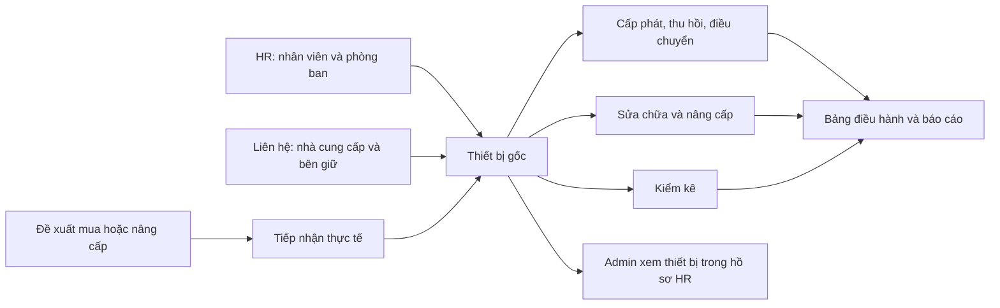

# EQUIP-001 — Thiết kế kho và quản lý thiết bị văn phòng

**Hướng UI mới CHG-20261114-013:** [EQUIP-UI-001](../prompts/CLAUDE_EQUIP_UI_001_SIMPLIFY_AND_REDESIGN.md)
thu gọn điều hướng theo thiết bị/người dùng/tồn/đề xuất, dashboard sáng có chart
lớn phía trên và bảng/filter/detail làm lại. Đây là prompt chưa triển khai;
thay ưu tiên trình bày/menu sâu của thiết kế ban đầu, giữ model/data/history/
admin-only và cùng ID HR. Không dùng blueprint cũ để mở thêm module/quyền.

**Yêu cầu tiếp theo CHG-20261114-011:** đã giao nhập thật hai file local theo
[prompt EQUIP-DATA-001](../prompts/CLAUDE_EQUIP_DATA_001_IMPORT_REAL.md); chưa
thực hiện nhập trong lượt điều phối. Phạm vi mới thay hạn chế chưa nhập nguồn
của CHG-010 bên dưới, không chứng minh dữ liệu đã có hoặc nghiệp vụ đã nghiệm thu.

Ngày 14/11/2026 — **CHG-20261114-010: SOURCE_IMPLEMENTED / MAIN_RUNTIME_EMPTY_OBSERVED**.
Addon `tp_equipment` **20.0.1.1.0** đã cài/chạy trên main **18069**; đã mở
module với dữ liệu thiết bị rỗng. Đây là ghi nhận triển khai kỹ thuật và màn
hình đã quan sát, chưa phải nghiệm thu nghiệp vụ hoặc cho phép nhập nguồn thật.

**Phạm vi đã chốt:** một module riêng **Kho thiết bị văn phòng**, chỉ admin hệ
thống truy cập/quản lý; cùng database và ID HR. Theo CHG-20261114-009, triển khai
trực tiếp main sau backup; không chạy bộ test, không dùng 18079, không seed giả
hoặc bulk nhập thật. Lượt triển khai chưa thực hiện luồng có dữ liệu, kiểm quyền
bằng vai trò khác, cạnh tranh/race, xuất PDF/QR hoặc nhập workbook thật. Các mục
thiết kế bên dưới là yêu cầu/định hướng; không được hiểu mọi hành vi đã kiểm chứng
chỉ vì source có model/action tương ứng.

Đầu vào thiết kế ban đầu là hai workbook tại NAS `06_cntt_tanphat`; phân tích
chi tiết chứa dữ liệu thật giữ riêng ở `.local/equipment001/`, ngoài Git. Bộ nhập
hiện tại đọc XLSX trong bộ nhớ, lưu hash và provenance đã làm sạch; không lưu
workbook gốc. Cột IP/MAC bị loại, địa chỉ mạng trong giá trị nguồn được làm sạch;
không có trường/cột IP/MAC để lưu hoặc xuất trong module.

## 1. Phạm vi và điều đã biết

Workbook danh mục có sheet `dashboard` và `thiet bi`, gồm hạ tầng mạng, thiết bị
dùng chung, máy in/photo, PC/laptop theo nhân sự và thiết bị trong kho. Workbook
đề xuất có hiện trạng, lỗi, phương án và số tiền dự kiến; cuối biểu có các vai
trò lập/xem xét/duyệt nhưng chưa chứng minh đã ký hoặc có hạn mức được ủy quyền.

Cần một phân hệ quản lý **vòng đời thiết bị**, không chỉ bảng xuất nhập hàng:
đăng ký → nhập/tiếp nhận → cấp phát/cho mượn/điều chuyển → sử dụng → báo hỏng/
sửa chữa/nâng cấp → thu hồi → kiểm kê → nghỉ sử dụng/thanh lý có căn cứ.
Đề xuất mua mới/nâng cấp là hồ sơ riêng, liên kết thiết bị cũ và nhu cầu người
dùng; đề xuất chưa tạo tồn kho, nghĩa vụ trả tiền hoặc tài sản kế toán.

Thiết bị công ty, thuê, cá nhân và bên thứ ba cần phân biệt. TADIC là đơn vị nội
bộ theo DEC-029, không tự tạo pháp nhân mới. Dịch vụ đường truyền trong danh mục
không phải một thiết bị vật lý. Chuỗi cấu hình có màn hình/linh kiện đi kèm không
đủ để tự tách thành nhiều tài sản có mã riêng.

## 2. Kiến trúc dùng chung dữ liệu

Tất cả trên **cùng PostgreSQL database của mỗi môi trường**: main
`tp_tanphat_dev`/18069, test `tp_tanphat_test`/18079; không DB riêng cho thiết bị,
không Excel/NAS làm database runtime, không bảng employee/department bản sao.

| Dữ liệu | Nguồn có thẩm quyền / cách đồng bộ |
| --- | --- |
| Nhân viên, mã TP, phòng, chức vụ, ảnh | `hr.employee`, `hr.department`, phiên bản HR hiện hành; dùng ID và mã đã có, không tự tạo nhân viên từ tên Excel |
| Tài khoản và quyền | `res.users`, capability/scope Odoo; liên kết người nhận qua employee, không buộc người nhận phải có user |
| Nhà cung cấp/bên giữ ngoài công ty | `res.partner`; tránh tạo trùng chỉ vì viết khác tên |
| Nơi làm việc | Tái sử dụng `hr.work.location` ở mức văn phòng; vị trí kho/tủ/kệ là danh mục cấp dưới có quan hệ, không biến thành phòng ban |
| Thiết bị vật lý | **Một** hồ sơ `maintenance.equipment` mở rộng trong custom addon; mọi màn hình dùng cùng ID |
| Sửa chữa/bảo trì | `maintenance.request` mở rộng với guard và dữ liệu cần thiết; không bảng sửa chữa thứ hai chạy song song |
| Tồn/vị trí/người giữ hiện tại | Suy ra từ giao dịch đã ghi nhận và kiểm soát bằng backend; lịch sử bất biến, không chỉnh ô người giữ để bỏ qua bàn giao |
| Đề xuất và tiếp nhận | Hồ sơ nghiệp vụ custom, liên kết thiết bị/nhân sự/nhà cung cấp gốc; sau này có bridge PO/kế toán khi được giao riêng |
| Báo cáo | Tính trên dữ liệu và scope hiện hành, không seed số liệu dashboard hay chép Excel tổng hợp |

**Nền tảng thực tế:** manifest `tp_equipment` phụ thuộc `maintenance`, `hr`,
`mail`, `tp_web_home`, `tp_hr_workspace`. Thiết bị/sửa chữa mở rộng model native;
cầu nối HR nằm trong addon với kiểm quyền admin. `hr_maintenance` vẫn chưa cài,
không thêm dependency `tp_organization`, `stock` hay `purchase` cho slice này.
Phân hệ là kho thiết bị vận hành; chưa thay sổ tồn kho kế toán/tài sản cố định.

**Cảnh báo có căn cứ source:** `addons/hr_maintenance/security/equipment.xml`
cho `hr.group_hr_user` implied `maintenance.group_equipment_manager`;
`addons/maintenance/security/ir.access.csv` cho internal user đọc thiết bị theo
công ty và manager có CRUD rộng. Không cài `hr_maintenance` nguyên trạng rồi
coi HR/staff đã đúng quyền. Phải đánh giá union quyền của Odoo, public employee,
followers/chatter/file và guard native trong addon tùy chỉnh. Không mở quyền
nhân sự riêng tư cho người quản lý thiết bị để chọn người nhận.

**Một addon riêng đã triển khai `tp_equipment`**, chứa model/security/import/views/
workspace/OWL/QWeb/SCSS và menu gốc/icon/dashboard/sidebar riêng. Không gộp
chức năng kho vào HR hoặc KH-KD, không tạo app kho thứ hai. Dùng dependency
`maintenance`, `hr`, `mail`, `tp_web_home`, `tp_hr_workspace` như manifest hiện hành. Không tách thêm `tp_equipment_workspace` trong scope này nếu
chưa có lý do kỹ thuật được chứng minh. Tái sử dụng shell/token/filter hiện có,
không copy toàn workspace hoặc nối UI sang React. Một module riêng vẫn dùng
chung database và quan hệ HR, không đồng nghĩa có bộ dữ liệu độc lập.

## 3. Mô hình tối thiểu nhưng đủ thao tác

| Nhóm | Nội dung và ràng buộc |
| --- | --- |
| Thiết bị | Mã nghiệp vụ sinh tuần tự riêng, tên, loại, hãng/model, serial nếu có, ảnh/tệp, công ty; mã nguồn/STT giữ riêng, không làm khóa |
| Sở hữu | Công ty/cá nhân/thuê/bên thứ ba/chưa xác minh; bên sở hữu, đơn vị nội bộ cung cấp, hồ sơ thuê và hạn trả nếu có. `owner_user_id` native không đồng nghĩa chủ sở hữu pháp lý |
| Kỹ thuật | Mô tả gốc + CPU/RAM/lưu trữ/GPU/màn hình khi đủ dữ liệu; không lưu IP/MAC; mức xác minh và ngày kiểm tra, không tự sửa thông số đáng ngờ |
| Cấp phát | Loại đối tượng nhận: employee/department/vị trí dùng chung/bên ngoài; lịch sử từ–đến, người giao/nhận, ngày thực tế, lý do, tình trạng, phụ kiện, tài liệu; không dùng `Phòng mạng`, `máy 1` làm tên nhân viên |
| Linh kiện/phụ kiện | Thiết bị con có mã khi thật sự cần quản lý riêng; hoặc phụ kiện mô tả theo bộ. Không tạo nhiều asset từ số màn hình ghi trong cấu hình; parent-child không vòng và không cộng trùng |
| Sửa chữa | Báo hỏng, phân công, hẹn xử lý, giao nhà cung cấp, kết quả, nâng cấp cấu hình trước/sau, linh kiện thay, chi phí biết/chưa biết, tệp, hoàn trả; liên kết `maintenance.request` |
| Bảo hành/số đo | Ngày mua/cấp/bảo hành tách nhau; ngày chính xác và chuỗi nguồn/độ chính xác lưu riêng; có điều kiện theo số bản in khi có căn cứ, ghi số đo/date/unit và quy tắc cần xác minh |
| Phần mềm | HĐH/Office/tên/phiên bản và khai báo bản quyền theo từng sản phẩm, bằng chứng và người xác minh; “nguồn ghi có bản quyền” khác “đã kiểm chứng”. Không lưu license key/mật khẩu ở field chung |
| Đề xuất | Người/bộ phận yêu cầu, thiết bị cũ, hiện trạng, phương án mua/sửa/nâng cấp/đổi, cấu hình mong muốn, số lượng/đơn vị nếu xác nhận, dự toán tiền/currency/thuế đã biết, trạng thái và bằng chứng ngoài hệ thống |
| Tiếp nhận | Phiếu/line đã nhận, đơn vị giao, số lượng và serial từng máy, ngày thực tế, tình trạng, gắn đề xuất khi có; nhận từng phần, còn lại, chống nhận vượt và retry tạo trùng |
| Kiểm kê | Kỳ/vị trí/phạm vi, snapshot kỳ vọng, người đếm, quét/mã, hiện trạng thực tế, thiếu/thừa/sai vị trí; chênh lệch không tự biến thành giao dịch đã duyệt |
| Dịch vụ CNTT | Dịch vụ thuê bao/đường truyền có nhà cung cấp, vị trí và mốc thời gian theo nguồn; không tính vào số thiết bị hay tồn vật lý |
| Nhập dữ liệu | Batch NDL, SHA-256, sheet/row/cell/raw/cache/merge đã làm sạch, disposition mọi dòng, mapping ID do admin xác nhận; loại cột IP/MAC, không lưu workbook gốc, không ghi đè tài liệu nguồn |
| Audit | Actor, timestamp, đối tượng, action/state trước–sau, reason, version/request ID, liên kết phiếu; bất biến, không nhúng secret hoặc toàn bộ PII |

Thiết bị chưa xác minh không bắt buộc có serial/ngày/giá giả. Giá biết bằng 0
khác chưa biết; chi phí đề xuất khác giá mua thực tế và chi phí sửa chữa.
Serial đã xác minh cần constraint theo phạm vi hãng/model/company đã đặc tả,
không coi mọi chuỗi serial trống/chưa biết là trùng. Số lượng đếm thiết bị vật
lý loại trừ dịch vụ, dòng nhu cầu thiếu máy và bộ phận con đã tính trong bộ.
Máy cá nhân được đăng ký phục vụ quản lý sử dụng; không ghi là tài sản công ty
hoặc tự cho phép công ty cấp/bán máy đó. Máy thuê/bên thứ ba chỉ bàn giao trong
phạm vi quyền sử dụng có căn cứ; trạng thái còn ở văn phòng không đổi chủ sở hữu.
Nếu dùng field `cost` Float native, phải kiểm toàn bộ đường truy cập; nên có
Monetary + currency/known flag phù hợp và một mapping tiền duy nhất, không để
raw field native trở thành lối đọc tiền ngoài quyền.

## 4. Trạng thái và các luồng

Không dùng một dropdown trộn tất cả khái niệm. Thiết kế các chiều riêng:

- **Vòng đời hồ sơ:** Nháp → Đã đăng ký → Ngừng sử dụng (chỉ sau xử lý quan hệ).
- **Nơi/người đang giữ:** kho, nhân viên, phòng ban, vị trí dùng chung, bên sửa/
  bên mượn, chưa xác minh. Suy ra từ giao dịch đã ghi nhận.
- **Tình trạng kỹ thuật:** Chưa xác minh / Tốt / Xuống cấp / Hỏng. Đang sửa là
  tiến trình sửa chữa; không tự kết luận tốt khi hoàn tất phiếu mà chưa có kết quả.
- **Khả dụng:** tính từ vòng đời, nơi giữ, reservation/điều chuyển và sửa chữa;
  không hiển thị máy hỏng trong danh sách “Sẵn sàng cấp”.
- **Rà soát đề xuất:** Nháp → Đang rà soát → Trả lại → Gửi lại → Hoàn tất rà soát.
  Kết quả duyệt bên ngoài và tiến độ mua/nhận là các chiều riêng.

Luồng bắt buộc:

1. **Tạo/sửa:** lưu nháp, hủy sửa, kiểm bắt buộc; đăng ký một hồ sơ đã đủ tối
   thiểu, không tạo khoản mua/tồn lần hai. Nhân bản chỉ sao metadata cho phép,
   sinh mã mới, bỏ serial/current custody/chứng từ/quyền cấp riêng.
2. **Nhập/tiếp nhận:** tạo phiếu → rà soát thông tin → ghi nhận thực tế → sinh/
   liên kết hồ sơ từng máy đúng một lần. Bàn giao ban đầu từ nguồn là “số dư
   đầu theo danh mục, chưa xác minh”, không bịa biên bản đã ký hay ngày giao.
3. **Cấp phát/cho mượn:** chọn máy khả dụng → người/phòng/vị trí nhận → preview
   trước/sau → xác nhận → lưu giao dịch và nơi giữ hiện tại cùng transaction.
   Một máy chỉ có một custody hiện hành; có mốc trả/hạn mượn nếu có căn cứ.
4. **Thu hồi/điều chuyển:** kiểm nơi giữ cũ, tình trạng/phụ kiện; nhận về kho
   hoặc chuyển đúng đối tượng; hỗ trợ pending/đang vận chuyển khi chưa nhận.
   Hủy giao dịch chưa hoàn tất giải phóng reservation; không sửa lịch sử đã ghi.
5. **Báo hỏng/sửa/nâng cấp:** báo lỗi → phân loại/phân công → xử lý → ghi kết
   quả và chi phí nếu được quyền → xác nhận nhận lại; cấu hình trước/sau có audit.
   Mua máy thay thế và sửa máy cũ tái sử dụng là hai nhánh liên kết, không mất máy cũ.
6. **Đề xuất:** lập → gửi rà soát → trả lại kèm lý do → sửa/gửi lại → hoàn tất
   rà soát → ghi nhận/kiểm chứng kết quả quy trình phê duyệt hiện hành → theo
   dõi đặt/nhận từng phần. Admin là actor trên hệ thống; người lập/xem xét/duyệt
   thực tế lưu riêng theo bằng chứng, không được cấp quyền kho vì có tên trên
   phiếu. Giữ BASE là nguồn duyệt theo quyết định trước nếu
   quy trình đó áp dụng; tài liệu nguồn chỉ gợi vai trò, chưa cấp thẩm quyền.
   Không hardcode tên người/hạn mức hoặc tạo bằng chứng duyệt giả. Chưa căn cứ duyệt
   thì hiển thị chờ xác minh, không cho đặt/nhận như hồ sơ đã được phê duyệt.
7. **Kiểm kê:** tạo kỳ/snapshot → nhập/quét thực tế → chốt kết quả chênh lệch →
   người có quyền lập giao dịch điều chỉnh có lý do. Kiểm kê không được ghi đè
   các cấp phát xảy ra sau snapshot; stale version phải báo và đối chiếu lại.
8. **Ngừng sử dụng/trả thuê/thanh lý/mất:** lập hồ sơ, xác minh quyền sở hữu,
   xử lý pending/custody; lưu căn cứ ngoài hệ thống. Không cho thanh lý tài sản
   cá nhân/thuê như của công ty; không tự ghi giảm tài sản kế toán hay xóa lịch sử.

Mọi chuyển trạng thái chạy backend: capability + company/scope + state + dữ
liệu + version/concurrency + idempotency. Khóa hàng/reservation/constraint chống
hai người cùng cấp một máy; request key theo actor/company/action và payload,
không dùng lại key với nội dung khác. Dòng tiền và audit cùng transaction.
Giao dịch đã ghi chỉ sửa bằng reverse/correction có quan hệ và lý do.

## 5. Đồng bộ HR và quyền

HR thay tên/ảnh/phòng/chức vụ thì phần thông tin nhân viên trên thiết bị cập nhật
từ quan hệ ID. **Chuyển phòng nhân sự không tự di chuyển thiết bị vật lý**:
giữ phòng chịu trách nhiệm/custody hiện hành đến khi có phiếu điều chuyển; hiện
cảnh báo cần xử lý. Phòng hiện hành của nhân viên và phòng chịu trách nhiệm
thiết bị là hai khái niệm có nhãn riêng, không làm thay lịch sử.

Tab/smart button thiết bị trong HR chỉ hiện cho admin và mở cùng equipment ID.
Giai đoạn này không có “Thiết bị của tôi”, màn self-service, thông báo/tệp
thiết bị cho non-admin. Nhân viên, kỹ thuật viên và trưởng phòng vẫn là đối
tượng nhận máy/được phân công trong dữ liệu, không là người dùng thao tác kho.
Admin ghi nhận nhu cầu, báo hỏng, kết quả và biên bản thay người thực tế, giữ
riêng actor admin và người yêu cầu/người nhận, không giả đăng nhập của nhân viên.
Khi nghỉ việc/khóa user, admin thấy danh sách cần thu hồi; khóa user không phải
biên bản thu hồi. Xóa employee không cascade mất máy/lịch sử; tham chiếu nghiệp
vụ độc lập chặn/gợi ý xử lý theo DEC-042, không phá flow xóa HR.

| Vai trò | Quyền truy cập module ở giai đoạn này |
| --- | --- |
| Admin hệ thống | Toàn bộ thao tác quản lý kho theo company/scope, state và guard; gồm thông tin kỹ thuật/chi phí trong phạm vi module, import/report/config. Quyền này không tự là thẩm quyền ký/duyệt chi pháp lý |
| HR user/manager không phải admin | Không có menu/quyền đọc/ghi kho hoặc smart button; HR vẫn là nguồn danh mục nhân viên/phòng ban |
| HEAD KH-KD/trưởng phòng/kỹ thuật/nhân viên/QT-TC không phải admin | Không truy cập, xem, sửa, export hoặc nhận dữ liệu kho; vẫn được gắn vào phiếu dưới dạng người yêu cầu/người nhận/người thực hiện thực tế |

Admin xác định bằng quyền hệ thống `base.group_system` của tài khoản internal
đang hoạt động, không theo login/tên hoặc cờ gửi từ client. Backend vẫn kiểm
company/scope/state/version. Không cấp `base.group_system` cho nhân sự để họ
nhận máy; không bật một nhóm equipment-manager thay thế cho admin trong scope này.

Backend bảo vệ native RPC, search/read/export, options/count/group/dashboard,
file/chatter/mail/activity và route QR; non-admin gọi URL trực tiếp/RPC vẫn bị
từ chối, không nhận metadata/tổng/số đếm. Guard phải bao phủ hồ sơ văn phòng do
module quản lý cả qua native maintenance, không chỉ custom form. Nếu có dữ
liệu maintenance khác dùng sẵn thì khoanh vùng managed records/flag không cho
non-admin tự đổi; không thu hồi quyền ngoài scope hoặc phá ứng dụng khác.
Không tự subscribe người nhận/manager vào chatter làm lộ file/dữ liệu qua email.
Activity, follower và native assignment của phiếu chỉ gửi đến admin được phép;
người kỹ thuật thực tế không phải admin lưu như thông tin thực hiện riêng,
không tự thêm vào native `user_ids` nếu việc đó cấp quyền/subscribe ngoài policy.

## 6. Workspace và giao diện

Tên module: **Kho thiết bị văn phòng**. Thẻ/icon riêng trên Trang chủ và menu
gốc riêng chỉ hiện với admin; click vào mở workspace/dashboard riêng. Không
đặt kho làm tab nghiệp vụ trong HR/KH-KD. Dùng shell chung, một navbar và
một sidebar thu gọn; avatar/tên dùng `TpUserAccountMenu`, thông tin cá nhân và
đăng xuất giữ đúng hiện hành. Không thiết kế lại Trang chủ hoặc thêm phòng ban
giả. Non-admin không thấy thẻ/menu/entrypoint kho hoặc số đếm thiết bị trong HR.

Sidebar gọn theo nhóm:

- Tổng quan.
- Thiết bị: Tất cả / Sẵn sàng cấp / Đang sử dụng / Cần xử lý / Ngừng sử dụng.
- Giao dịch: Tiếp nhận / Cấp phát–thu hồi–điều chuyển / Cho mượn–trả.
- Sửa chữa và nâng cấp.
- Đề xuất mua sắm.
- Kiểm kê.
- Báo cáo; Nhập và đối chiếu (quản trị); Danh mục/cấu hình (đúng quyền).
- Dịch vụ CNTT chỉ hiện khi có quyền và nội dung, không trộn vào tồn vật lý.

**Tổng quan sáng, trực quan:** header kỳ/phạm vi/ngày cập nhật và bộ lọc; 4–6 KPI
đúng định nghĩa (thiết bị đã đăng ký, sẵn sàng cấp, đang dùng, cần xử lý, phiếu
mở, chờ rà soát); donut phân bổ theo nhóm thiết bị và donut tình trạng kỹ thuật,
cột chồng theo nơi chịu trách nhiệm, xu hướng giao dịch/chi phí khi có lịch sử
đủ, bảng “Cần xử lý” có hạn/người phụ trách/nút mở. Biểu đồ click mở danh sách
cùng domain; legend có số, tooltip có tên/đơn vị, tổng khớp. Không tạo xu hướng
quá khứ từ một snapshot; thiếu ngày/giá phải hiện chưa có dữ liệu.

**Màu:** kế thừa navy của shell; xanh dương cho thao tác/đang xử lý, xanh lá cho
khả dụng/kết quả tốt, vàng cam cho cần kiểm tra, đỏ cho lỗi/quá hạn có căn cứ,
xám cho chưa xác minh. Badge có chữ, không chỉ màu. Màu biểu đồ nhất quán với
bảng. Khoảng trắng và đường kẻ nhẹ giúp đọc, tránh rải nhiều card/chữ nhỏ.

**Danh sách:** mã/tên, loại, hãng/model, sở hữu, người/phòng giữ, vị trí,
khả dụng, tình trạng kỹ thuật; cấu hình sâu/tiền là cột tùy chọn theo quyền; không có cột IP/MAC.
Tất cả bảng theo DEC-044: search + lọc nhanh riêng + nâng cao + chip + Clear,
10/20/50/100, tổng/count/export và server paging nhất quán. Không bắt người dùng
lọc thiết bị bằng các field của HR hoặc trạng thái hợp đồng.

**Chi tiết:** header ảnh/mã/tên, badge khả dụng và kỹ thuật, người/phòng giữ,
2–3 nút chính theo state/capability, tác vụ phụ trong dropdown. Các tab: Tổng
quan, Cấu hình, Bàn giao, Sửa chữa, Bảo hành, Phần mềm, Tài liệu, Lịch sử. Form
phiếu giao dịch/đề xuất/kiểm kê có bố cục riêng đúng nghiệp vụ, không clone một
form cho mọi tab. Dòng tiền chỉ hiện theo grant; mã QR không chứa PII/secret và
mở route xác thực, không biến thành URL download public.

Hover hàng/nút và transition mở panel/đổi tab khoảng 150–220ms, biểu đồ animate
nhẹ khi nạp/đổi lọc, không nhấp nháy. Có `prefers-reduced-motion`, tooltip bàn
phím, focus rõ, mobile 390px và zoom 200%. Không dùng effect để che loading,
không chart 3D, không chuyển nguyên app sang theme tối.

## 7. Bộ lọc riêng và báo cáo

| Bảng | Lọc nhanh theo nội dung |
| --- | --- |
| Thiết bị/tồn | Mã/tên/serial; loại; sở hữu; khả dụng; kỹ thuật; vị trí; người/phòng giữ |
| Cấp/thu hồi/điều chuyển/cho mượn | Loại phiếu; thiết bị; nơi giao/nhận; người; trạng thái; ngày/hạn trả |
| Sửa chữa | Thiết bị; loại lỗi; kỹ thuật viên; tiến trình; hạn; nhà cung cấp nếu được phép |
| Đề xuất | Người/phòng; mua/sửa/nâng cấp; rà soát; kết quả ngoài; kỳ/ngày; tiến độ nhận |
| Bảo hành/phần mềm | Thiết bị; hạn đã biết; mức xác minh; loại phần mềm; không dùng text nguồn làm chứng nhận |
| Kiểm kê và dòng | Kỳ; vị trí; người; đã/chưa kiểm; loại chênh lệch; tình trạng; mã/QR |
| Nhập/đối chiếu | File/batch; sheet/row; kết quả mapping; lỗi/xung đột; người/ngày apply |
| Báo cáo/lịch sử | Phạm vi; loại hành động; kỳ/ngày; actor; field tiền chỉ trong quyền |

Báo cáo: sổ thiết bị; cấp phát theo người/phòng; tồn sẵn sàng; sửa/bảo hành;
đề xuất và tiến độ tiếp nhận; kiểm kê/chênh lệch; chất lượng dữ liệu. Excel có
title, ngày/phạm vi/bộ lọc, cột rõ, số/ngày đúng kiểu, tổng đúng currency và
formula-injection guard. PDF biên bản nội bộ có chỗ xác nhận; không giả chữ ký
hoặc tuyên bố là chứng từ phê duyệt chính thức.

## 8. Trạng thái triển khai và điểm cần xác minh

| Slice | Source hiện có / giới hạn bằng chứng |
| --- | --- |
| EQUIP-001a — Nền và nhập | Addon riêng, native model/view, guard admin, bridge HR và preview/mapping/hash/provenance đã có source. Module/list rỗng mở được trên main; chưa nhập nguồn hoặc kiểm chứng mapping thực tế. |
| EQUIP-001b — Vận hành | Có source tiếp nhận, bàn giao/pending/reservation/reversal, sửa/nâng cấp, audit và khóa backend. Chưa thực hiện giao dịch có dữ liệu hoặc kiểm race trên main. |
| EQUIP-001c — Đề xuất và kiểm kê | Có source rà soát/trả lại/gửi lại, căn cứ duyệt ngoài, nhận từng phần, snapshot/chênh lệch. Chưa kiểm chứng luồng nghiệp vụ với dữ liệu thật. |
| EQUIP-001d — Dashboard/báo cáo | Có source dashboard/chart/drill-down, filter, XLSX/PDF/QR; đã quan sát giao diện dữ liệu rỗng. Chưa kiểm số liệu có dữ liệu, luồng xuất PDF/QR hoặc kiểm quyền bằng tài khoản vai trò khác. |
| EQUIP-001e — Main | `tp_equipment` 20.0.1.1.0 cài/chạy 18069, có backup và tài liệu bàn giao. Không chạy suites/18079 theo yêu cầu; visual/business acceptance và pilot authorization chưa được suy từ việc cài thành công. |

**Hợp đồng nhập hiện tại:** tệp cùng hash/loại/công ty không tạo đợt trùng; apply
retry giữ liên kết đã tạo. Lần đầu tạo hồ sơ nháp theo nguồn/chưa xác minh. Tệp
sau cần admin xác nhận đợt độc lập hay phiên bản trước, ghi lý do và đối chiếu
ID từng dòng áp dụng: chọn thiết bị/dòng đề xuất hiện có để liên kết và **giữ
nguyên dữ liệu nghiệp vụ**, hoặc xác nhận thực sự mới để tạo nháp. Không suy
định danh theo STT/số dòng hoặc tên gần giống. Provenance phiên bản mới nằm tại
đợt mới, không ghi đè nguồn cũ. Alias chỉ dùng sau xác nhận ID; không tạo HR/user.
Đây là hành vi đã triển khai trong source, chưa được diễn tập bằng nhập dữ liệu.

Chưa có: serial/mã thiết bị chuẩn, ngày/giá chính xác nhiều dòng, danh sách vị
trí/chủ sở hữu đã xác nhận, mapping tên viết tắt, hạn mức/thẩm quyền và bằng
chứng ký/duyệt. Không dùng các thiếu hụt này để bịa dữ liệu. Hoàn thiện chức
năng trực tiếp trên main sau backup, không tạo fixture/bộ test hoặc thử ghi
xóa dữ liệu thật để kiểm chức năng. Import nguồn thật giữ thao tác riêng với
preview/mapping, không tự bulk nhập từ quyền deploy. Không tự triển khai kế toán/khấu hao/thanh toán/PO chính thức,
agent quét mạng, lưu mật khẩu thiết bị hoặc module AI chỉ để “đủ công nghệ”.

[Prompt thực thi](../prompts/CLAUDE_EQUIP_001_OFFICE_EQUIPMENT.md),
[quy chuẩn bộ lọc](../ui/TP_TABLE_FILTER_STANDARD.md),
[quy trình môi trường](../../ops/runbooks/SAMPLE_DATA_CLEANUP_AND_TEST.md).

Bàn giao triển khai: [trạng thái và bằng chứng](../demo/EQUIP_001_ACCEPTANCE.md),
[hướng dẫn admin](../demo/EQUIP_001_USER_GUIDE.md),
[triển khai, nhập nguồn và rollback](../../ops/runbooks/EQUIP_001_DEPLOY_IMPORT_AND_ROLLBACK.md).
