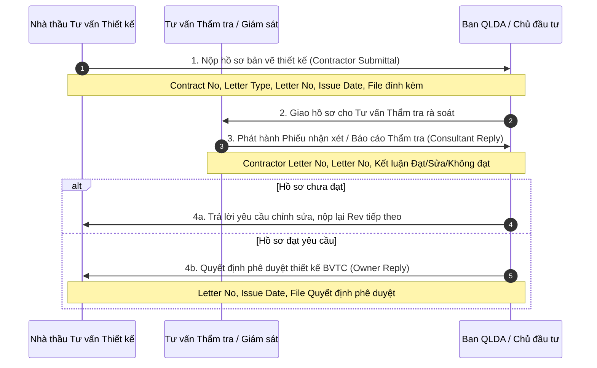

# TANPHAT ONE — Bóc tách chi tiết màn hình, biểu mẫu và quy tắc nghiệp vụ 16 tài liệu IMIS2

**Ngày lập:** 29/10/2026 (Asia/Saigon)  
**Phạm vi:** Bóc tách chuyên sâu từng trang, từng màn hình (screens), từng biểu mẫu (forms), từng trường dữ liệu (fields) và các quy tắc kiểm tra ràng buộc (validation rules / edge cases) từ đủ 16 tài liệu hướng dẫn sử dụng (HDSD) hệ thống EVN IMIS 2.0 (phiên bản Web và Mobile Onsite năm 2021 do EVNICT phát triển).  
**Tài liệu liên quan:** Bổ sung chi tiết thực thi cho [TP_IMIS2_REFERENCE_ANALYSIS.md](TP_IMIS2_REFERENCE_ANALYSIS.md) (bản phân tích chính sách và ranh giới nghiệp vụ); đối chiếu với [TP_PRODUCT_NAMING.md](TP_PRODUCT_NAMING.md), [TP_BUSINESS_WORKFLOW.md](TP_BUSINESS_WORKFLOW.md) và [ROADMAP.md](../ROADMAP.md).  
**Nguyên tắc áp dụng:** Tài liệu này đóng vai trò là **Sổ tay Đặc tả Tham chiếu Nghiệp vụ (Functional Reference Specification)**. Các quy trình, biểu mẫu và quy tắc ở đây là nguồn cảm hứng thiết kế thực tiễn của ngành xây dựng hạ tầng; chúng **không tự động biến thành mã nguồn (source code)** hay làm thay đổi kiến trúc chuẩn của TANPHAT ONE (Backend Odoo + Frontend React/TypeScript độc lập). Mọi triển khai code trong tương lai đều phải tuân thủ quy trình kiểm soát thay đổi tại `AGENTS.md`.

---

## MỤC LỤC BỘ 16 PHÂN HỆ IMIS2

1. [Phân hệ Mobile Onsite — Giám sát giai đoạn thi công (`IMIS2.MOBILE`)](#1-phân-hệ-mobile-onsite--giám-sát-giai-đoạn-thi-công)
2. [Phân hệ Web 01 — Công tác Kế hoạch (`IMIS2.WEB_01`)](#2-phân-hệ-web-01--công-tác-kế-hoạch)
3. [Phân hệ Web 02 — Chuẩn bị Đầu tư (`IMIS2.WEB_02`)](#3-phân-hệ-web-02--chuẩn-bị-đầu-tư)
4. [Phân hệ Web 03 — Bồi thường - Giải phóng mặt bằng (`IMIS2.WEB_03`)](#4-phân-hệ-web-03--bồi-thường---giải-phóng-mặt-bằng)
5. [Phân hệ Web 04 — Quản lý Đấu thầu (`IMIS2.WEB_04`)](#5-phân-hệ-web-04--quản-lý-đấu-thầu)
6. [Phân hệ Web 05 — Hợp đồng & Công việc khác (`IMIS2.WEB_05`)](#6-phân-hệ-web-05--hợp-đồng--công-việc-khác)
7. [Phân hệ Web 06 — Phê duyệt Thiết kế BVTC (`IMIS2.WEB_06`)](#7-phân-hệ-web-06--phê-duyệt-thiết-kế-bvtc)
8. [Phân hệ Web 07 — Giám sát giai đoạn Khảo sát (`IMIS2.WEB_07`)](#8-phân-hệ-web-07--giám-sát-giai-đoạn-khảo-sát)
9. [Phân hệ Web 08 — Giám sát giai đoạn Thi công Web (`IMIS2.WEB_08`)](#9-phân-hệ-web-08--giám-sát-giai-đoạn-thi-công-web)
10. [Phân hệ Web 09 — Thanh toán & Cấp vốn (`IMIS2.WEB_09`)](#10-phân-hệ-web-09--thanh-toán--cấp-vốn)
11. [Phân hệ Web 10 — Chuẩn bị Vận hành (`IMIS2.WEB_10`)](#11-phân-hệ-web-10--chuẩn-bị-vận-hành)
12. [Phân hệ Web 11 — Kết thúc Đầu tư (`IMIS2.WEB_11`)](#12-phân-hệ-web-11--kết-thúc-đầu-tư)
13. [Phân hệ Web 12 — Hồ sơ Tài liệu (`IMIS2.WEB_12`)](#13-phân-hệ-web-12--hồ-sơ-tài-liệu)
14. [Phân hệ Web 13 — Quản lý Giá VTTB & Lương Chuyên gia (`IMIS2.WEB_13`)](#14-phân-hệ-web-13--quản-lý-giá-vttb--lương-chuyên-gia)
15. [Phân hệ Web 14 — Đánh giá Chất lượng Nhà thầu (`IMIS2.WEB_14`)](#15-phân-hệ-web-14--đánh-giá-chất-lượng-nhà-thầu)
16. [Phân hệ Web 15 — Kho Dữ liệu Nhà thầu (`IMIS2.WEB_15`)](#16-phân-hệ-web-15--kho-dữ-liệu-nhà-thầu)
17. [Bản đồ Ánh xạ Thiết kế vào 9 Phân hệ của TANPHAT ONE](#17-bản-đồ-ánh-xạ-thiết-kế-vào-9-phân-hệ-của-tanphat-one)

---

## 1. PHÂN HỆ MOBILE ONSITE — GIÁM SÁT GIAI ĐOẠN THI CÔNG

* **Tên ứng dụng:** `IMISONSITE` (Mobile Native iOS & Android).
* **Đối tượng sử dụng:** Kỹ sư hiện trường của Nhà thầu thi công, Kỹ sư Tư vấn Giám sát (TVGS), Cán bộ Ban Quản lý Dự án (QLDA/Ban A).
* **Cơ chế xác thực & Ngữ cảnh làm việc:**
  * Đăng nhập tài khoản cá nhân.
  * *Màn hình Cấu hình chung (Bắt buộc thiết lập trước khi thực hiện bất kỳ thao tác nào):*
    * `Chọn đơn vị`* (Combobox bắt buộc).
    * `Chọn dự án`* (Combobox bắt buộc).
    * `Chọn loại thi công`* (Combobox bắt buộc).
    * `Chọn hợp đồng`* (Combobox bắt buộc).
    * `Chọn hạng mục thi công`* (Combobox bắt buộc).
    * `Chọn mục công việc` (Tùy chọn).
  * Ý nghĩa: Mọi bản ghi nhật ký, nghiệm thu, ảnh chụp phát sinh sau đó đều tự động kế thừa đúng context phân cấp này.

### 1.1. Nghiệp vụ Nhật ký thi công điện tử (E-Site Diary)
* **Màn hình danh sách nhật ký:** Mặc định tải danh sách nhật ký trong vòng 7 ngày gần nhất; hỗ trợ bộ lọc `Từ ngày` – `Đến ngày`.
* **Quy trình ghi nhật ký theo ca (Gồm 3 màn hình tuần tự):**
  1. *Màn hình 1 — Thông tin chung ca làm việc:*
     * `Ca làm việc`: Chọn ca (Ca 1 / Ca 2 / Ca 3), nhập khung giờ bắt đầu và kết thúc.
     * `Thời tiết`: Nhập tình trạng nắng, mưa (thời lượng mưa tính bằng giờ/phút), nhiệt độ không khí ($^\circ\text{C}$).
     * `Lực lượng thi công`: Nhập số lượng nhân lực kỹ thuật, số lượng công nhân, danh sách và số lượng thiết bị máy móc huy động trên công trường.
     * Nhấn [Lưu] $\rightarrow$ Hệ thống chuyển sang màn hình Tình hình thi công.
  2. *Màn hình 2 — Tình hình thi công chi tiết:*
     * *Nội dung công việc:* Chọn từ danh mục công việc gợi ý hoặc nhập văn bản tự do.
     * *Ảnh minh họa công việc:* Nhấn [Chụp ảnh] $\rightarrow$ Hệ thống gọi camera của thiết bị. **Yêu cầu bất biến: Ảnh chụp bắt buộc phải lấy tọa độ vệ tinh GPS (kinh độ, vĩ độ) và timestamp thời gian thực.**
     * *Nghiệm thu công việc:* Nhập nội dung nghiệm thu trong ca, đính kèm ảnh minh họa có tọa độ.
     * *An toàn lao động & Vệ sinh môi trường (HSE):* Đánh giá 3 chỉ tiêu độc lập (*An toàn lao động*, *Vệ sinh môi trường*, *Sức khỏe công nhân*). Mỗi chỉ tiêu chọn `Đạt` hoặc `Không đạt` (nếu không đạt bắt buộc nhập mô tả lý do). Đính kèm ảnh minh chứng có tọa độ.
     * *Đánh giá chung:* Nhập nhận xét tổng quan của ca.
     * *Kiến nghị:* Nhà thầu nhập nội dung kiến nghị gửi ngay cho TVGS/QLDA.
     * Nhấn [Lưu] $\rightarrow$ Chuyển sang màn hình Ký số.
  3. *Màn hình 3 — Xem và Ký điện tử:*
     * Xem lại bản tổng hợp nhật ký ca.
     * Nhà thầu nhấn nút **[Ký điện tử]** (xác thực qua Sim CA). Trạng thái bản ghi chuyển thành `Nhà thầu đã ký`.
* **Quy tắc phân quyền & kiểm tra ràng buộc ngầm:**
  * *Quy tắc 1:* Tư vấn giám sát (TVGS) và Quản lý dự án (QLDA) chỉ được xem thông tin, chụp bổ sung ảnh hiện trường và ghi nhận xét đánh giá **khi và chỉ khi Nhà thầu CHƯA ký số**. Khi Nhà thầu đã ký, nội dung bị khóa cứng.
  * *Quy tắc 2:* Ảnh chụp đã đưa vào nhật ký thi công thì hệ thống **khóa chức năng xóa**, không thể xóa khỏi kho ảnh.

### 1.2. Nghiệp vụ Nghiệm thu công việc xây dựng ngoài hiện trường
Quy trình kiểm soát 2 tầng (Nhà thầu nộp $\rightarrow$ TVGS kiểm tra hồ sơ $\rightarrow$ TVGS kiểm tra hiện trường $\rightarrow$ Ký biên bản điện tử):
1. *Bước 1 — Nhà thầu khởi tạo yêu cầu nghiệm thu:*
   * Chọn Hạng mục $\rightarrow$ Nhấn nút tạo mới.
   * Tab `Căn cứ nghiệm thu`: Chọn loại căn cứ (Tiêu chuẩn kỹ thuật, Bản vẽ thi công, Chỉ dẫn kỹ thuật), đính kèm file hoặc ảnh chụp văn bản căn cứ.
   * Tab `Hồ sơ kèm theo`: Chọn loại hồ sơ (Chứng chỉ vật liệu CO/CQ, Phiếu thí nghiệm kết quả mẫu), đính kèm file/ảnh.
   * Tab `Khối lượng & Công việc`: Nhập khối lượng công việc đề nghị nghiệm thu, chọn mã công việc nghiệm thu.
   * Nhấn [Lưu] $\rightarrow$ Trạng thái chuyển thành `Nhà thầu đã gửi yêu cầu`.
2. *Bước 2 — TVGS kiểm tra hồ sơ:*
   * TVGS mở danh sách các yêu cầu có trạng thái `Nhà thầu đã gửi yêu cầu`.
   * Mở xem chi tiết từng tài liệu/ảnh căn cứ.
   * Đưa ra kết luận: Tích chọn `Đạt` $\rightarrow$ Nhấn [Đạt hồ sơ] (chuyển sang bước kiểm tra hiện trường); hoặc tích `Không đạt` $\rightarrow$ Nhấn [Không đạt hồ sơ] (trả lại kèm lý do từ chối).
3. *Bước 3 — TVGS kiểm tra thực tế hiện trường:*
   * *Kiểm tra khối lượng:* Đối chiếu khối lượng đề nghị với khối lượng hợp đồng. **Quy tắc:** *Cho phép TVGS điều chỉnh giảm khối lượng nghiệm thu theo số đo thực tế.*
   * *Kiểm tra Checklist công việc:* Đánh giá từng tiêu chí kỹ thuật cụ thể theo tùy chọn `Đạt` / `Không đạt`.
   * *Cập nhật kết quả hiện trường:* Nếu không đạt $\rightarrow$ Nhấn [Không đạt hiện trường] kèm ý kiến chỉ đạo khắc phục; nếu đạt $\rightarrow$ Nhấn [Đạt hiện trường].
4. *Bước 4 — Xem và Ký số Biên bản nghiệm thu:*
   * Nhà thầu xem biên bản đã đạt hiện trường $\rightarrow$ Nhấn **[Ký số]**.
   * TVGS mở biên bản nhà thầu đã ký $\rightarrow$ Nhấn **[Ký số]** xác nhận hoàn tất nghiệm thu công việc.

---

## 2. PHÂN HỆ WEB 01 — CÔNG TÁC KẾ HOẠCH

* **Vị trí menu:** `Hệ thống QLDA ĐTXD` $\rightarrow$ Phân hệ `Công tác Kế hoạch`.
* **Đối tượng sử dụng:** Chuyên viên kế hoạch, Lãnh đạo Ban Kế hoạch Tập đoàn/Tổng công ty/Ban QLDA.

### 2.1. Quản lý Danh mục Dự án & Hạng mục công trình
* **Form Thêm mới / Cập nhật Dự án:**
  * `Mã dự án`: Mã định danh hệ thống (tự sinh hoặc nhập theo quy chuẩn).
  * `Tên dự án`* (Bắt buộc).
  * `Loại dự án` (Lưới điện, Nguồn điện, Đầu tư phát triển...).
  * `Cấp điện áp` (500kV, 220kV, 110kV, trung hạ thế...).
  * `Địa bàn triển khai`: Tỉnh/Thành phố.
  * `Tình trạng dự án`*: *Quy tắc: Trước khi nhấn nút [Lưu], người dùng bắt buộc phải chọn trạng thái dự án (Đang chuẩn bị ĐT, Đang thi công, Hoàn thành...).*
* **Form Thêm mới Hạng mục công trình:**
  * Chọn Dự án cha $\rightarrow$ Nhấn [Thêm mới Hạng mục].
  * `Mã hạng mục`, `Tên hạng mục`* (Bắt buộc).
  * `Quy mô`, `Đơn vị tính` (km đường dây, MVA công suất trạm...).
  * `Ngày bắt đầu dự kiến`, `Ngày kết thúc dự kiến`.

### 2.2. Quy trình Giao và Đăng ký Kế hoạch Vốn hàng năm
Quy trình phân bổ ngân sách vốn 2 cấp:
1. *Khởi tạo đợt giao kế hoạch (Dành cho cấp trên):* Khởi tạo kỳ kế hoạch theo năm tài chính (Ví dụ: Đợt 1 năm 2026).
2. *Khởi tạo danh sách dự án đăng ký (Dành cho đơn vị cấp dưới):* Chọn năm $\rightarrow$ Hệ thống tải danh sách các dự án đủ điều kiện $\rightarrow$ Tích chọn các dự án tham gia đăng ký kế hoạch vốn.
3. *Đăng ký kế hoạch vốn (Chi tiết nguồn vốn):*
   * Với từng dự án, phân rã chi tiết cơ cấu nguồn vốn: `Vốn tự có (khấu hao cơ bản, quỹ ĐTPT)`, `Vốn vay thương mại trong nước`, `Vốn vay nước ngoài/ODA`, `Vốn trái phiếu`.
   * Hỗ trợ tính năng [Import Excel] mẫu đăng ký kế hoạch và [Export Excel].
   * *Quy tắc kiểm soát cân đối:* $\sum \text{Kế hoạch vốn đăng ký} = \sum \text{Cơ cấu nguồn vốn huy động}$. Nếu không bằng, hệ thống cảnh báo lỗi cân đối vốn.
4. *Giao kế hoạch vốn (Cấp trên phê duyệt):*
   * Lấy số liệu đăng ký của đơn vị cấp dưới $\rightarrow$ Điều chỉnh số vốn giao chính thức.
   * *Quy tắc bắt buộc:* **Bắt buộc phải đính kèm file Quyết định giao kế hoạch vốn** đã ký duyệt mới được phép nhấn [Lưu và Phát hành số giao].
5. *Kế hoạch vốn bổ sung:* Chỉ mở cho các dự án đã đăng ký trong kế hoạch năm nhưng cần điều chỉnh quy mô vốn, hoặc các dự án đột xuất được bổ sung theo quyết nghị của HĐTV/HĐQT.

### 2.3. Báo cáo Thực hiện Vốn tháng và Tiến độ mốc
* **Thực hiện vốn tháng:**
  * Báo cáo định kỳ hàng tháng.
  * Phân biệt rõ 2 loại số liệu: `Số ước thực hiện trong tháng báo cáo` (dùng để tổng hợp nhanh trước ngày 20) và `Số thực hiện chính thức` (chốt sau khi có số liệu kế toán cuối tháng).
* **Quản lý Tiến độ mốc (Milestones):**
  * Theo dõi các mốc đồng bộ: Ngày phê duyệt FS, Ngày phê duyệt TKKT, Ngày khởi công, Ngày hoàn thành móng/hạ tầng, Ngày đóng điện/thông tuyến, Ngày quyết toán.

---

## 3. PHÂN HỆ WEB 02 — CHUẨN BỊ ĐẦU TƯ

* **Vị trí menu:** `Hệ thống QLDA ĐTXD` $\rightarrow$ Phân hệ `Chuẩn bị Đầu tư`.

### 3.1. Quản lý Thủ tục Đầu tư
* **Màn hình Kết quả phê duyệt thủ tục đầu tư:**
  * Cho phép lưu trữ và giám sát lộ trình pháp lý:
    * Báo cáo chủ trương đầu tư (Pre-FS).
    * Báo cáo nghiên cứu khả thi (FS) / Báo cáo kinh tế kỹ thuật.
    * Thỏa thuận hướng tuyến, thỏa thuận mặt bằng trạm với địa phương.
    * Báo cáo đánh giá tác động môi trường (ĐTM).
    * Thẩm duyệt thiết kế phòng cháy chữa cháy (PCCC).
  * Form cập nhật: Số văn bản, Ngày ban hành, Cơ quan phê duyệt, Trích yếu, File quyết định đính kèm.

### 3.2. Khởi tạo Dữ liệu Nền phục vụ các Phân hệ sau
* **Khởi tạo Vị trí khoan khảo sát:**
  * Menu: `Chuẩn bị đầu tư` $\rightarrow$ `Khởi tạo giai đoạn khảo sát` $\rightarrow$ `Khởi tạo vị trí khoan`.
  * Các trường: `Loại khảo sát`* (Pre-FS, FS, TKKT/TKBVTC), `Ký hiệu hố khoan`* (text), `Mô tả` (text), `Tọa độ X` (số), `Tọa độ Y` (số), `Cao độ Z` (số), `Độ sâu dự kiến` (mét - số).
  * *Quy tắc kiểm tra nghiệp vụ cứng:* **Chỉ được sửa hoặc xóa vị trí hố khoan khi vị trí đó CHƯA phát sinh dữ liệu chi tiết ở phân hệ Giám sát khảo sát. Nếu đã có nhật ký khoan hoặc biên bản nghiệm thu gắn vào thì hệ thống khóa nút xóa/sửa.**
* **Khởi tạo Phường/Xã phục vụ Bồi thường GPMB:**
  * Menu: `Chuẩn bị đầu tư` $\rightarrow$ `Khởi tạo giai đoạn thi công` $\rightarrow$ `Phường xã BT-GPMB`.
  * *Quy tắc thao tác thứ tự:* Dropdown bắt buộc chọn tuần tự: `Tỉnh/Thành phố` $\rightarrow$ `Quận/Huyện` $\rightarrow$ `Phường/Xã` $\rightarrow$ Tích chọn Hạng mục giải phóng mặt bằng tương ứng.

---

## 4. PHÂN HỆ WEB 03 — BỒI THƯỜNG - GIẢI PHÓNG MẶT BẰNG (BT-GPMB)

* **Vị trí menu:** `Hệ thống QLDA ĐTXD` $\rightarrow$ Phân hệ `Bồi thường - Giải phóng mặt bằng`.
* **Phạm vi quản lý theo cấu trúc công trình:**
  * `Thực hiện phần móng` (Vị trí móng cột đường dây).
  * `Thực hiện phần hành lang` (Hành lang an toàn lưới điện / khoảng cột).
  * `Thực hiện phần trạm` (Mặt bằng trạm biến áp, đường vào trạm).
  * `Thực hiện phần ngầm hóa` (Hào cáp, tuyến cáp ngầm).
* **Quy trình cập nhật tiến độ GPMB & Xử lý vướng mắc:**
  * Lựa chọn hình thức cập nhật: *Theo vị trí móng* hoặc *Theo địa bàn hành chính (xã/huyện)*.
  * Cập nhật các chỉ tiêu kiểm đếm: Tổng số hộ ảnh hưởng, Tổng diện tích đất thu hồi ($m^2$), Số hộ đã phê duyệt phương án bồi thường, Số tiền đã chi trả, Số vị trí đã nhận mặt bằng (bao gồm cả trường hợp "bàn giao do vận động").
  * Tab `Các vướng mắc`: Ghi nhận khó khăn (tranh chấp đất, khiếu nại đơn giá bồi thường, chưa bố trí được tái định cư).
  * *Quy tắc ràng buộc logic:* **Nếu một vị trí hoặc hạng mục còn tồn tại bản ghi vướng mắc ở trạng thái "Chưa giải quyết", hệ thống ngăn chặn không cho phép cập nhật trạng thái của vị trí đó thành "Đã hoàn thành bàn giao mặt bằng".**

---

## 5. PHÂN HỆ WEB 04 — QUẢN LÝ ĐẤU THẦU

* **Vị trí menu:** `Hệ thống QLDA ĐTXD` $\rightarrow$ Phân hệ `Quản lý Đấu thầu`.
* **Phân loại 5 nhóm gói thầu theo mục đích sử dụng vốn:**
  1. Gói thầu ĐTXD theo dự án.
  2. Gói thầu mua sắm tập trung toàn tập đoàn.
  3. Gói thầu sản xuất kinh doanh (SXKD).
  4. Gói thầu sửa chữa lớn (SCL).
  5. Gói thầu đầu tư phát triển (ĐTPT).

### 5.1. Quản lý Kế hoạch Lựa chọn Nhà thầu (KHLCNT)
* Form nhập: Chọn Dự án $\rightarrow$ `Tên Kế hoạch LCNT`*, `Số văn bản quyết định phê duyệt`*, `Ngày văn bản`*, File đính kèm quyết định phê duyệt.

### 5.2. Quản lý Danh mục Gói thầu & Thuộc tính pháp lý
* Form Thêm mới / Cập nhật Gói thầu:
  * Chọn KHLCNT đã phê duyệt.
  * `Tên gói thầu`* (Bắt buộc).
  * `Giá trị gói thầu`* (VNĐ - Tự động tính tổng các lô nếu gói thầu chia thành nhiều lô thầu).
  * `Loại gói thầu`* (Tư vấn, Xây lắp, Mua sắm hàng hóa, Phi tư vấn, Hỗn hợp EPC/EP).
  * `Hình thức LCNT`* (Đấu thầu rộng rãi, Đấu thầu hạn chế, Chỉ định thầu thông thường, Chỉ định thầu rút gọn, Chào hàng cạnh tranh, Tự thực hiện, Mua sắm trực tiếp).
  * `Phương thức đấu thầu` (Một giai đoạn một túi hồ sơ, Một giai đoạn hai túi hồ sơ, Hai giai đoạn một túi hồ sơ...).
  * `Hình thức hợp đồng` (Trọn gói, Đơn giá cố định, Đơn giá điều chỉnh, Theo thời gian, Hỗn hợp).
* *Các quy tắc logic ngầm trong form gói thầu:*
  * *Quy tắc 1 (Phân lô thầu):* Nếu tích chọn "Gói thầu có phân lô", trường `Giá trị gói thầu` bị khóa sửa tay, tự động cộng dồn từ bảng danh sách các lô thầu con.
  * *Quy tắc 2 (Chỉ định thầu):* Nếu hình thức là Chỉ định thầu hoặc Chỉ định thầu rút gọn, hệ thống tự động tích chọn checkbox `Được tính chỉ định thầu`, đồng thời disable combobox `Phương thức đấu thầu` và để giá trị mặc định.
  * *Quy tắc 3 (Tự thực hiện):* Nếu hình thức là Tự thực hiện, disable combobox `Phương thức đấu thầu` và `Hình thức hợp đồng`; tại bước kết quả LCNT hệ thống tự gán nhà thầu trúng thầu chính là đơn vị quản lý đang thao tác.
  * *Quy tắc 4 (Khóa bảo vệ toàn vẹn):* **Gói thầu đã cập nhật thông tin trong quy trình lựa chọn nhà thầu (đã phát hành HSMT hoặc có kết quả) thì hệ thống KHÓA CỨNG nút [Xóa], không cho phép xóa khỏi hệ thống.**

### 5.3. Quy trình Lựa chọn Nhà thầu 4 bước
Mở form `Lựa chọn nhà thầu` trên từng gói thầu:
1. *Bước 1 — Hồ sơ mời sơ tuyển (nếu có):* Ngày phát hành HSMST, Ngày đóng sơ tuyển, Danh sách nhà thầu nộp hồ sơ sơ tuyển.
2. *Bước 2 — Kết quả sơ tuyển:* Quyết định phê duyệt kết quả sơ tuyển, Danh sách nhà thầu vượt qua sơ tuyển (được mời vào bước đấu thầu tiếp theo).
3. *Bước 3 — Hồ sơ mời thầu (HSMT) / Hồ sơ yêu cầu (HSYC):* Ngày phát hành HSMT, Thời điểm đóng/mở thầu, Danh sách nhà thầu mua/nộp HSDT, Thông tin bảo lãnh dự thầu (Ngân hàng, Giá trị bảo lãnh, Thời hạn hiệu lực).
4. *Bước 4 — Kết quả lựa chọn nhà thầu (KQLCNT):* Số quyết định phê duyệt trúng thầu, Ngày ký, Danh sách nhà thầu trúng thầu (chọn từ Kho dữ liệu nhà thầu), Giá gói thầu được duyệt, Giá trúng thầu, Tỷ lệ tiết kiệm qua đấu thầu.

---

## 6. PHÂN HỆ WEB 05 — HỢP ĐỒNG & CÔNG VIỆC KHÁC

* **Vị trí menu:** `Hệ thống QLDA ĐTXD` $\rightarrow$ Phân hệ `Hợp đồng – Công việc khác`.

### 6.1. Quản lý Hợp đồng dự án
* **Form Thêm mới Hợp đồng:**
  * Chọn Dự án $\rightarrow$ Chọn Gói thầu liên kết.
  * *Kế thừa dữ liệu:* Khi chọn gói thầu, các thông tin về Nhà thầu trúng thầu, Loại hợp đồng, Hình thức hợp đồng và Giá trị trúng thầu tự động điền vào các ô tương ứng.
  * `Số hợp đồng`*, `Tên hợp đồng`*, `Ngày ký`*, `Thời gian thực hiện hợp đồng` (số ngày).
* **Cơ chế Đa tiền tệ trong Hợp đồng:**
  * Bảng `Giá trị hợp đồng` cho phép thêm nhiều dòng theo từng loại tiền tệ (VND, USD, EUR, JPY...).
  * Cột: `Đồng tiền`, `Giá trị nguyên tệ`, `Tỷ giá quy đổi`, `Giá trị quy đổi VNĐ`.
  * *Quy tắc:* Mỗi loại đồng tiền chỉ được xuất hiện trên 1 dòng duy nhất; đối với đồng tiền VND thì tỷ giá mặc định cố định bằng 1.

### 6.2. Quản lý Phụ lục Hợp đồng (Addendum)
* Thêm mới phụ lục khi có thay đổi về phạm vi, khối lượng, giá trị hoặc tiến độ:
  * `Số phụ lục hợp đồng`*, `Ngày ký phụ lục`*, `Nội dung điều chỉnh`*.
  * Bảng giá trị phụ lục: Cho phép nhập giá trị điều chỉnh tăng dương ($+$) hoặc giảm âm ($-$).
  * *Thao tác đặc thù:* Có thể sửa giá trị phụ lục về 0 bằng cách gõ trực tiếp `0` vào ô `Quy đổi VND`.

### 6.3. Quản lý Phạt Hợp đồng (Penalties)
* Ghi nhận các chế tài phạt vi phạm:
  * `Số quyết định phạt`*, `Ngày quyết định`*, `Lý do phạt`* (Chậm tiến độ, Vi phạm an toàn lao động, Không huy động đủ nhân sự/thiết bị theo hợp đồng).
  * `Giá trị phạt` (nguyên tệ và quy đổi VND).
  * Dữ liệu phạt này được liên kết trực tiếp sang phân hệ Thanh toán để tự động khấu trừ vào số tiền thanh toán của nhà thầu.

### 6.4. Quản lý Thành phần chi tiết của Hợp đồng (Rất quan trọng)
Quản lý 5 tab thuộc tính con gắn chặt với hợp đồng:
1. `Tab 1: Hạng mục công trình` — Tích chọn các hạng mục công trình của dự án thuộc phạm vi thực hiện của hợp đồng này.
2. `Tab 2: Nhà thầu tham gia` — Chọn nhà thầu chính và các thành viên liên danh (bắt buộc lấy từ Kho dữ liệu nhà thầu).
3. `Tab 3: Người đại diện pháp lý` — Đại diện theo ủy quyền, Chỉ huy trưởng công trường, Chủ nhiệm thiết kế/khảo sát.
4. `Tab 4: Thiết bị thi công` — Khai báo danh sách máy móc, thiết bị chính cam kết huy động theo hợp đồng (chủng loại, số lượng, biển số/số hiệu, công suất).
5. `Tab 5: Công việc chính` — Danh mục các đầu việc/mốc công việc chính cần kiểm soát tiến độ.

---

## 7. PHÂN HỆ WEB 06 — PHÊ DUYỆT THIẾT KẾ BVTC

* **Vị trí menu:** `Hệ thống QLDA ĐTXD` $\rightarrow$ Phân hệ `Phê duyệt TKBVTC`.
* **Mô hình Giao tiếp & Thẩm duyệt 3 bên (Submittal Workflow):**

### 7.1. Màn hình Tài liệu của Nhà thầu (Contractor Submittal)
* Chọn Dự án $\rightarrow$ Nhấn nút [Add] để thêm mới hồ sơ nộp.
* Các trường thông tin:
  * `Contract No`*: Chọn hợp đồng tư vấn thiết kế từ danh sách hợp đồng.
  * `Letter Type`*: Chọn loại tài liệu (Bản vẽ thi công, Thuyết minh tính toán, Dự toán xây dựng, Chỉ dẫn kỹ thuật).
  * `Letter Group`*: Nhóm hồ sơ (Hồ sơ nộp lần đầu, Hồ sơ tiếp thu giải trình, Hồ sơ phát hành chính thức).
  * `Letter No`*: Số công văn phát hành của nhà thầu.
  * `Issue Status`*: Trạng thái phát hành (Nộp mới, Nộp lại Rev 1, Rev 2...).
  * `Issue Date`*: Ngày công văn nộp.
  * File đính kèm: Tập tin bản vẽ CAD/PDF, file dự toán.

### 7.2. Màn hình Phản hồi của Tư vấn Thẩm tra / Giám sát (Consultant Reply)
* Trên lưới danh sách tài liệu nhà thầu, nhấn nút [Consultant Reply] tại cột Thao tác.
* Các trường cập nhật:
  * `Contractor Letter No`: Tự động map số công văn nộp của nhà thầu để liên kết quan hệ cha-con.
  * `Letter No`*: Số văn bản báo cáo/phiếu thẩm tra của đơn vị tư vấn.
  * `Issue Date`*: Ngày văn bản.
  * `Review Result`*: Kết luận đánh giá (`Đạt`, `Đạt có điều kiện cần chỉnh sửa`, `Không đạt yêu cầu lập lại`).
  * File đính kèm: Báo cáo kết quả thẩm tra bản vẽ và dự toán.

### 7.3. Màn hình Phê duyệt của Chủ đầu tư (Owner Reply)
* Nhấn nút [Owner Reply] tại cột Thao tác.
* Các trường cập nhật:
  * `Letter No`*: Số Quyết định phê duyệt thiết kế bản vẽ thi công hoặc Thông báo chấp thuận của Chủ đầu tư.
  * `Issue Date`*: Ngày ban hành quyết định.
  * `Signer`: Người ký quyết định.
  * File đính kèm: Bản scan Quyết định phê duyệt có đóng dấu pháp lý.

---

## 8. PHÂN HỆ WEB 07 — GIÁM SÁT GIAI ĐOẠN KHẢO SÁT

* **Vị trí menu:** `Hệ thống QLDA ĐTXD` $\rightarrow$ Phân hệ `Giám sát giai đoạn khảo sát`.
* **Phân chia 4 Tab nội dung chuyên ngành:**
  1. `Tab 1: Các nội dung chung`
  2. `Tab 2: Khảo sát địa chất`
  3. `Tab 3: Khảo sát địa hình`
  4. `Tab 4: Thủy văn - Hải văn`

### 8.1. Chi tiết Tab "Các nội dung chung"
Quản lý 5 khía cạnh cốt lõi phục vụ mọi loại hình khảo sát:
* `Nhiệm vụ & Phương án kỹ thuật khảo sát:` Đính kèm văn bản phê duyệt nhiệm vụ khảo sát và đề cương phương án kỹ thuật được duyệt.
* `Nhân lực & Thiết bị khảo sát:`
  * Cập nhật danh sách máy móc: Tên thiết bị, số hiệu máy, cơ quan kiểm định, hạn kiểm định máy trắc địa/khoan.
  * Đính kèm ảnh chụp thực tế máy móc tại hiện trường và file scan giấy chứng nhận kiểm định.
* `Nhật ký giám sát:` Quản lý nhật ký của Chủ đầu tư và nhật ký của Nhà thầu khảo sát.
* `Nghiệm thu khối lượng khảo sát:` Đính kèm Biên bản nghiệm thu khối lượng thực hiện ngoài hiện trường. Bắt buộc có ảnh chụp công tác nghiệm thu có gắn tọa độ GPS.
* `Kết quả thí nghiệm & Báo cáo khảo sát:` Đính kèm phiếu kết quả thí nghiệm chỉ tiêu cơ lý đất đá, thí nghiệm nén tĩnh, thí nghiệm mẫu nước...

### 8.2. Chi tiết Tab "Khảo sát Địa chất"
Quản lý chi tiết theo 4 phương pháp thi công khảo sát:
1. `Công tác khoan:`
   * Chọn từng Vị trí hố khoan cụ thể (đã khởi tạo tại phân hệ Chuẩn bị đầu tư).
   * Cập nhật Biên bản nghiệm thu hố khoan (ghi rõ độ sâu khoan thực tế so với thiết kế, số mẫu đất nguyên dạng đã lấy, số lần thí nghiệm SPT).
   * **Bắt buộc cập nhật ảnh hố khoan có tọa độ GPS** (chụp cần khoan, ống mẫu, hộp lõi khoan đất đá core box).
   * Cập nhật file hình trụ địa chất hố khoan (borehole log).
2. `Công tác hố đào:` Cập nhật vị trí, kích thước hố đào, ảnh chụp hố đào có tọa độ, biên bản mô tả hố đào.
3. `Thăm dò địa vật lý:` Đo điện trở suất, địa chấn nông sóng khúc xạ.
4. `Đào hầm khảo sát:` Nhật ký và nghiệm thu đào hầm khảo sát địa chất.

### 8.3. Tab "Khảo sát Địa hình" và "Thủy văn - Hải văn"
* Quản lý mốc cao độ quốc gia dẫn mốc, mốc trắc địa GPS, lưới khống chế mặt bằng.
* Bản đồ địa hình, bình đồ tuyến, trắc dọc, trắc ngang.
* Nhật ký điều tra mực nước lũ lịch sử, đo lưu tốc dòng chảy thủy văn.

---

## 9. PHÂN HỆ WEB 08 — GIÁM SÁT GIAI ĐOẠN THI CÔNG (WEB)

* **Vị trí menu:** `Hệ thống QLDA ĐTXD` $\rightarrow$ Phân hệ `Giám sát giai đoạn thi công`.
* **Các cấu phần chức năng quản lý:**

### 9.1. Quản lý Hồ sơ thiết kế & Hoàn công
* `Hồ sơ thiết kế BVTC:` Lưu trữ file bản vẽ thi công đã được duyệt, phân loại theo hợp đồng và hạng mục để kỹ sư công trường tra cứu.
* `Bản vẽ hoàn công:`
  * Nhấn [Thêm mới] $\rightarrow$ Chọn Hợp đồng, Hạng mục, Mục công việc.
  * `Loại bản vẽ hoàn công`, `Nội dung mô tả`.
  * Đính kèm file bản vẽ hoàn công (scan bản vẽ có dấu hoàn công và chữ ký của Nhà thầu + TVGS).

### 9.2. Nhật ký thi công & Nghiệm thu trên Web
* Hỗ trợ song song 2 hình thức:
  * `Nhật ký bản giấy:` Tải lên các file scan cuốn nhật ký giấy truyền thống đóng dấu giáp lai.
  * `Nhật ký điện tử:` Tổng hợp và tra cứu toàn bộ dữ liệu nhật ký ca được đồng bộ từ ứng dụng Mobile lên (thời tiết, nhân lực, máy móc, tình hình thi công, ảnh GPS, chữ ký số).
* Nghiệm thu công việc: Quản lý biên bản nghiệm thu scan bản giấy và danh sách biên bản nghiệm thu ký số điện tử.

### 9.3. Quản lý An toàn lao động, Vệ sinh môi trường (HSE)
Hệ thống phân định 2 góc nhìn quản lý độc lập:
* `Phần cho Tư vấn Giám sát (TVGS):`
  * TVGS nhập nhật ký giám sát an toàn hàng ngày trên công trường.
  * Chức năng [Xuất file Word]: Tự động kết xuất toàn bộ nhật ký giám sát an toàn theo mẫu báo cáo tuần/tháng gửi Chủ đầu tư.
* `Phần cho Ban A (Chủ đầu tư kiểm tra):`
  * Chức năng [Thống kê trên công trường]: Cán bộ Ban A nhập các hạng mục đã kiểm tra thực tế đột xuất.
  * Chức năng **[Cập nhật thông tin vi phạm]**:
    * Ghi nhận các lỗi vi phạm về an toàn (không đội mũ bảo hộ, không đeo dây an toàn, thiếu rào chắn hố móng, đổ phế thải sai nơi quy định).
    * Bắt buộc nhập: Ngày phát hiện*, Nội dung vi phạm*, Đơn vị vi phạm*, Biện pháp xử lý*, Thời hạn khắc phục*.
    * **Bắt buộc đính kèm file ảnh hiện trường vi phạm có gắn tọa độ GPS.**

---

## 10. PHÂN HỆ WEB 09 — THANH TOÁN & CẤP VỐN

* **Vị trí menu:** `Hệ thống QLDA ĐTXD` $\rightarrow$ Phân hệ `Thanh toán – Cấp vốn`.

### 10.1. Quản lý Phiếu giá (Payment Measurement — Phụ lục 03a)
* **Khái niệm:** Phiếu giá là chứng từ định lượng giá trị khối lượng công việc hoàn thành theo từng đợt thanh toán hợp đồng (tương ứng Biểu mẫu Phụ lục 03a theo quy định của Bộ Tài chính).
* **Form Thêm mới / Cập nhật Phiếu giá:**
  * Chọn Dự án $\rightarrow$ Chọn Hợp đồng (thông tin Nhà thầu tự động hiển thị; nếu là Hợp đồng liên danh thì cho phép chọn thành viên liên danh cụ thể).
  * `Số phiếu giá`*, `Ngày lập`*, `Năm`*, `Nội dung đợt thanh toán`.
  * File đính kèm: Bảng tính chi tiết khối lượng, biên bản nghiệm thu khối lượng hoàn thành.
* **Cấu trúc Dòng giá trị Phiếu giá (Multi-currency):**
  * `Đồng tiền`: Lấy theo loại tiền tệ đã khai báo trong hợp đồng.
  * `Giá trị khối lượng hoàn thành đợt này` ($A$).
  * `Số tiền tạm ứng đợt này` (nếu có cấp tạm ứng mới).
  * `Số tiền thu hồi tạm ứng đợt này` ($B$).
  * `Số tiền giữ lại bảo hành đợt này` ($C$ — thường từ 3% đến 5%).
  * `Số tiền giữ lại khác hoặc khấu trừ phạt` ($D$).
  * $\text{Giá trị thanh toán đề nghị đợt này} = A - B - C - D$.

### 10.2. Quản lý Phiếu Thanh toán & Giải ngân
* Menu: `Thông tin thanh toán` $\rightarrow$ `Danh sách thanh toán`.
* Lập Phiếu thanh toán dựa trên Phiếu giá đã được duyệt $\rightarrow$ Trình Lãnh đạo phê duyệt phiếu.
* Chức năng **[Giải ngân]**:
  * Khi tiền thực tế được chuyển khoản qua Kho bạc hoặc Ngân hàng thương mại, kế toán nhấn nút [Giải ngân].
  * Nhập: Số chứng từ/hợp đồng giải ngân, Ngày giải ngân thực tế.
* *Quy tắc kiểm soát kế toán tối cao:* **Chỉ được phép Sửa hoặc Xóa các phiếu thanh toán ở trạng thái CHƯA GIẢI NGÂN. Một khi phiếu đã được xác nhận [Giải ngân], toàn bộ dữ liệu bị khóa cứng vĩnh viễn để bảo toàn sổ sách kế toán.**

### 10.3. Quản lý Hợp đồng Vay vốn & Khế ước nhận nợ
* Theo dõi các khoản vay tài trợ cho dự án: Số hợp đồng vay, Ngân hàng cho vay, Hạn mức tín dụng, Thời hạn vay, Lãi suất, Kế hoạch giải ngân từng quý, Kế hoạch trả nợ gốc và lãi.

---

## 11. PHÂN HỆ WEB 10 — CHUẨN BỊ VẬN HÀNH

* **Vị trí menu:** `Hệ thống QLDA ĐTXD` $\rightarrow$ Phân hệ `Chuẩn bị vận hành`.
* **Nghiệp vụ cốt lõi:**
  * Quản lý công tác nghiệm thu đóng điện / thông xe kỹ thuật / bàn giao công trình đưa vào khai thác sử dụng.
  * Màn hình *Bàn giao vận hành hợp đồng:*
    * Đơn vị quản lý dự án (Bên giao) bàn giao tài sản cho Đơn vị quản lý vận hành (Bên nhận).
    * Nhập: Ngày bàn giao*, Thành phần hội đồng bàn giao, Danh sách các hợp đồng/hạng mục bàn giao.
  * Màn hình *Xác nhận bàn giao vận hành:*
    * Đơn vị tiếp nhận kiểm tra hiện trạng công trình $\rightarrow$ Lập bảng theo dõi các tồn tại kỹ thuật cần khắc phục (Punch list), thời hạn nhà thầu phải hoàn thành sửa chữa bảo hành.

---

## 12. PHÂN HỆ WEB 11 — KẾT THÚC ĐẦU TƯ

* **Vị trí menu:** `Hệ thống QLDA ĐTXD` $\rightarrow$ Phân hệ `Kết thúc đầu tư`.
* **Nghiệp vụ Quyết toán Vốn đầu tư hoàn thành:**
  * Cập nhật thông tin hồ sơ quyết toán:
    * `Tình trạng quyết toán`: Dropdown chuyển trạng thái theo tiến độ pháp lý (`Đang lập báo cáo quyết toán` $\rightarrow$ `Đã nộp cơ quan thẩm tra` $\rightarrow$ `Đang kiểm toán độc lập` $\rightarrow$ `Đã có quyết định phê duyệt quyết toán`).
    * Số quyết định phê duyệt quyết toán, Ngày quyết định, Cơ quan phê duyệt quyết toán (Bộ/Sở Tài chính hoặc HĐTV Tập đoàn).
  * Cập nhật cơ cấu chi phí quyết toán được duyệt:
    * Chi phí Xây lắp quyết toán.
    * Chi phí Thiết bị quyết toán.
    * Chi phí Bồi thường GPMB quyết toán.
    * Chi phí Quản lý dự án quyết toán.
    * Chi phí Tư vấn ĐTXD quyết toán.
    * Chi phí khác và chi phí lãi vay trong thời gian xây dựng.
  * Cập nhật Quy mô quyết toán: Chiều dài tuyến hoàn thành, số lượng móng, công suất trạm.

---

## 13. PHÂN HỆ WEB 12 — HỒ SƠ TÀI LIỆU

* **Vị trí menu:** `Hệ thống QLDA ĐTXD` $\rightarrow$ Phân hệ `Hồ sơ tài liệu`.

### 13.1. Quản lý Hồ sơ theo Cấu trúc Định sẵn (Standard Archive Tree)
* Hệ thống xây dựng sẵn cây thư mục hồ sơ tiêu chuẩn của dự án ĐTXD:
  * Thư mục 01: Hồ sơ pháp lý chuẩn bị đầu tư.
  * Thư mục 02: Hồ sơ khảo sát & thiết kế.
  * Thư mục 03: Hồ sơ đấu thầu & hợp đồng.
  * Thư mục 04: Hồ sơ chất lượng, nhật ký, nghiệm thu.
  * Thư mục 05: Hồ sơ hoàn công & quyết toán.
* Người dùng mở đến thư mục tương ứng $\rightarrow$ Nhấn nút thêm mới văn bản:
  * Số văn bản*, Ngày ban hành*, Cơ quan ban hành*, Trích yếu nội dung*, File tài liệu đính kèm (PDF, DOCX...).

### 13.2. Quản lý Hồ sơ khác & Cơ chế Đóng/Mở Hồ sơ
* Cho phép người dùng tự tạo các cặp hồ sơ nghiệp vụ phát sinh ngoài cấu trúc định sẵn.
* *Quy tắc nghiệp vụ kiểm soát vòng đời hồ sơ:*
  * Hồ sơ có 2 trạng thái: `Hồ sơ đang thực hiện` và `Hồ sơ đã hoàn thành (Đóng)`.
  * **Lưu ý bảo mật:** Khi dự án chưa kết thúc đầu tư, hệ thống cấm người dùng tích chọn ô "Đóng hồ sơ". Chỉ khi toàn bộ dự án đã được nghiệm thu bàn giao và phê duyệt quyết toán, người quản trị mới được phép tích đóng hồ sơ để chuyển toàn bộ tài liệu sang chế độ lưu trữ số vĩnh viễn (chỉ đọc, khóa toàn bộ tính năng thêm/sửa/xóa).

---

## 14. PHÂN HỆ WEB 13 — QUẢN LÝ GIÁ VTTB & LƯƠNG CHUYÊN GIA

* **Vị trí menu:** `Hệ thống QLDA ĐTXD` $\rightarrow$ Phân hệ `Quản lý giá`.

### 14.1. Tra cứu Giá Vật tư Thiết bị (VTTB)
* Tra cứu danh mục VTTB theo Thông số kỹ thuật (TSKT):
  * Điều kiện lọc: Đơn vị làm việc, Nước sản xuất, Khoảng thời gian áp dụng giá, Nhóm VTTB, Chủng loại, Thông số kỹ thuật chi tiết.
  * Lịch sử mua sắm: Bấm vào từng mã VTTB trên lưới kết quả, hệ thống hiển thị lịch sử trúng thầu của mặt hàng này ở tất cả các dự án trước đây (Giá trúng thầu, Tên nhà thầu cung cấp, Ngày ký hợp đồng) $\rightarrow$ Giúp kỹ sư lập và thẩm tra dự toán có cơ sở so sánh giá thị trường.
  * Hỗ trợ nút [Xuất Excel].

### 14.2. Quản lý Mức lương Chuyên gia Tư vấn
* Quản lý khung đơn giá nhân công tư vấn (Chuyên gia tư vấn trưởng, Kỹ sư thiết kế chính, Kỹ sư khảo sát, Kỹ sư giám sát) theo quy định của Nhà nước (Thông tư 11/2021/TT-BXD), phục vụ công tác lập và thẩm định dự toán gói thầu tư vấn theo man-month.

---

## 15. PHÂN HỆ WEB 14 — ĐÁNH GIÁ CHẤT LƯỢNG NHÀ THẦU

* **Vị trí menu:** `Hệ thống QLDA ĐTXD` $\rightarrow$ Phân hệ `Đánh giá chất lượng nhà thầu`.
* **Phân loại đánh giá:** Đánh giá gói thầu ĐTXD giai đoạn thi công; Đánh giá giai đoạn vận hành bảo hành; Đánh giá gói thầu SXKD.

### 15.1. Hệ thống Tiêu chí Đánh giá 3 Tầng
* Cấu trúc danh mục tiêu chí:
  * `Tiêu chí gốc cấp 1:` Tiến độ thực hiện, Chất lượng công trình/sản phẩm, An toàn lao động - Môi trường, Năng lực & Sự phối hợp.
  * `Tiêu chí nhóm cấp 2:` Các yêu cầu cụ thể của từng nhóm.
  * `Tiêu chí con cấp 3:` Các hành vi vi phạm hoặc thành tích cụ thể.
* Quản lý tiêu chí theo năm: Cho phép Hội đồng đánh giá kích hoạt bộ tiêu chí áp dụng cho từng năm tài chính, hỗ trợ nút **[Sử dụng tiêu chí năm trước]** để kế thừa nhanh.

### 15.2. Thuật toán Chấm điểm & Quy tắc Chặn trần Điểm trừ
* Mặc định điểm cơ sở cho mỗi hợp đồng là: **100 điểm**.
* Nút *[Xác nhận nhanh đánh giá 100 điểm]*: Cho phép đánh giá nhanh mức tối đa cho các hợp đồng thực hiện hoàn hảo.
* Cơ chế trừ điểm tại Tab `Điểm trừ`:
  * Người đánh giá chọn các tiêu chí con cấp 3 bị vi phạm và nhập số điểm trừ.
  * *Quy tắc kiểm soát thuật toán:* **Tổng số điểm trừ của các tiêu chí con cấp 3 KHÔNG ĐƯỢC VƯỢT QUÁ mức điểm trừ tối đa quy định của tiêu chí gốc cấp 2.** (Ngăn chặn việc trừ điểm cảm tính dẫn đến điểm số âm bất hợp lý).
* Cơ chế cộng điểm tại Tab `Điểm cộng`: Nhập điểm thưởng cho các sáng kiến rút ngắn tiến độ, giải pháp kỹ thuật vượt trội.
* Công thức tự động:
  $$\text{Điểm tổng hợp} = 100 - \sum \text{Điểm trừ} + \sum \text{Điểm cộng}$$

### 15.3. Quy trình Duyệt kết quả Đánh giá
* Bước 1: Chuyên viên đánh giá nhập điểm từng hợp đồng $\rightarrow$ Nhấn [Lưu].
* Bước 2: Lãnh đạo thẩm tra mở màn hình `Duyệt kết quả` $\rightarrow$ Có thể chỉnh sửa điểm cộng/trừ và đính kèm biên bản họp đánh giá.
* Bước 3: Duyệt chính thức:
  * Duyệt theo từng hợp đồng đơn lẻ; hoặc
  * Nhấn nút **[Duyệt kết quả hàng năm]** (nhập Số văn bản phê duyệt xếp hạng*, Ngày duyệt*, đính kèm file quyết định).
* Xếp loại nhà thầu: Xuất sắc ($\ge 90$ điểm), Tốt (80 - 89), Đạt (70 - 79), Không đạt ($< 70$).

---

## 16. PHÂN HỆ WEB 15 — KHO DỮ LIỆU NHÀ THẦU

* **Vị trí menu:** `Hệ thống QLDA ĐTXD` $\rightarrow$ Phân hệ `Kho dữ liệu nhà thầu`.

### 16.1. Quản lý Hồ sơ Pháp lý Nhà thầu
* **Form Thêm mới Nhà thầu:**
  * `Mã số thuế`* (MST — Khóa định danh duy nhất; hệ thống tự động kiểm tra trùng lặp MST trước khi cho phép tạo mới).
  * `Tên nhà thầu`*, `Tên viết tắt`, `Địa chỉ đăng ký kinh doanh`*, `Điện thoại`, `Email`.
  * `Người đại diện pháp luật`*, `Số CMND/CCCD`, `Chức vụ`.
  * `Năng lực tài chính`: Vốn điều lệ, Doanh thu trung bình 3 năm gần nhất.
  * `Chứng chỉ năng lực hoạt động xây dựng`: Số chứng chỉ, Cơ quan cấp (Bộ Xây dựng / Cục Quản lý hoạt động xây dựng), Hạng năng lực (Hạng I, Hạng II, Hạng III), Lĩnh vực hoạt động (Khảo sát, Thiết kế cầu đường, Giám sát thi công...).
* **Cơ chế Cập nhật Thay đổi Pháp lý:**
  * Khi nhà thầu thay đổi giấy phép kinh doanh (đổi tên, đổi chủ sở hữu): Hệ thống hỗ trợ chức năng copy toàn bộ thông tin sang bản ghi mới, đồng thời bảo lưu lịch sử pháp lý cũ để không làm sai lệch các hợp đồng đã ký trong quá khứ.

### 16.2. Quản lý Nhà thầu Liên danh (Joint Venture)
* Form Thêm mới Liên danh:
  * `Tên liên danh`* (Ví dụ: Liên danh Tấn Phát - CIENCO...).
  * `Ngày thành lập liên danh`*, `Thỏa thuận liên danh đính kèm`*.
  * Lưới danh sách thành viên: Chọn các nhà thầu thành viên đã có trong kho dữ liệu.
  * Phân công vai trò: Chọn 1 thành viên làm `Thành viên đứng đầu liên danh`, nhập `% tỷ lệ đảm nhận khối lượng` của từng thành viên.
  * *Quy tắc ràng buộc cứng:* **Danh sách thành viên của một liên danh bắt buộc phải có từ 2 nhà thầu độc lập trở lên.**

### 16.3. Tra cứu & Hồ sơ Lịch sử Uy tín
* Tra cứu đa chiều: Theo MST, tên, năng lực, lĩnh vực hoạt động.
* Xem lịch sử: Tích hợp hiển thị danh sách tất cả các gói thầu nhà thầu đã tham gia, các hợp đồng đang thực hiện, lịch sử điểm đánh giá chất lượng qua các năm, và danh sách cảnh báo vi phạm hợp đồng (Blacklist).

---

## 17. BẢN ĐỒ ÁNH XẠ THIẾT KẾ VÀO 9 PHÂN HỆ CỦA TANPHAT ONE

Dưới đây là bảng tổng hợp ánh xạ chi tiết các trường dữ liệu và quy tắc nghiệp vụ đắt giá nhất của IMIS2 vào thiết kế tương lai của 9 phân hệ TANPHAT ONE:

| Phân hệ TANPHAT ONE | Nguồn kế thừa IMIS2 | Các thực thể & Trường dữ liệu tiếp thu | Quy tắc nghiệp vụ (Business Rules) tiếp thu |
| :--- | :--- | :--- | :--- |
| **TP Survey** *(Khảo sát hiện trường)* | `IMIS2.WEB_07` (Giám sát khảo sát) | • `tp.survey.point`: Ký hiệu hố khoan, Tọa độ VN-2000 X/Y, Cao độ Z, Độ sâu. • `tp.survey.equipment`: Máy toàn đạc, GPS RTK, giàn khoan, hạn kiểm định máy. • `tp.survey.diary`: Ca khảo sát, thời tiết, địa tầng, mẫu lấy, SPT. • `tp.survey.lab_test`: Phiếu thí nghiệm LAS-XD. | 1. Ảnh khảo sát bắt buộc có tọa độ GPS và timestamp thực. 2. Hố khoan đã phát sinh nhật ký/nghiệm thu thì cấm xóa. 3. Kiểm định máy trắc địa phải còn hạn hiệu lực mới cho giao việc. |
| **TP Design** *(Hồ sơ thiết kế)* | `IMIS2.WEB_06` (Phê duyệt thiết kế) | • `tp.design.submittal`: Mã hồ sơ nộp, Hợp đồng, Letter Type, Letter No, Issue Status (Rev A, B, 0, 1), Issue Date. • `tp.design.review`: Báo cáo thẩm tra, kết luận Đạt/Sửa. • `tp.design.approval`: Quyết định phê duyệt của CĐT. • `tp.design.clarification`: Bảng giải trình tiếp thu ý kiến thẩm định. | 1. Luồng 3 bên Submittal $\rightarrow$ Review $\rightarrow$ Approval bất biến. 2. Versioning chặt chẽ, không ghi đè bản vẽ cũ khi ra Rev mới. 3. Mọi điểm thẩm tra không đạt phải có văn bản giải trình tương ứng. |
| **TP Contracts** *(Hợp đồng & Đối tác)* | `IMIS2.WEB_04`, `05`, `15` (Đấu thầu, Hợp đồng, Kho nhà thầu) | • `tp.contract.guarantee`: Loại bảo lãnh (Thực hiện HĐ, Tạm ứng, Bảo hành), Ngân hàng, Giá trị, Ngày hết hạn. • `tp.contract.addendum`: Phụ lục điều chỉnh giá trị, tiến độ. • `tp.contract.penalty`: Chế tài phạt vi phạm để cấn trừ thanh toán. • `tp.contract.consortium`: Liên danh nhà thầu, thành viên đứng đầu, tỷ lệ %. | 1. Cảnh báo tự động trước khi bảo lãnh ngân hàng hết hạn 30 ngày. 2. Hợp đồng hỗ trợ đa tiền tệ với tỷ giá quy đổi VNĐ. 3. Gói thầu đã có kết quả thì khóa cấm xóa. 4. Liên danh bắt buộc có từ 2 thành viên trở lên. |
| **TP Finance & STL-001** *(Sản lượng, Thanh toán)* | `IMIS2.WEB_09` (Thanh toán cấp vốn) | • `tp.settlement.measurement` (Phiếu giá Phụ lục 03a): Số phiếu, Khối lượng hoàn thành kỳ này ($A$), Thu hồi tạm ứng ($B$), Giữ lại bảo hành ($C$), Khấu trừ phạt ($D$). • `tp.payment.request`: Đề nghị thanh toán. • Giá trị thanh toán thực tế: $A - B - C - D$. | 1. Công thức thu hồi tạm ứng lũy kế theo % hoàn thành. 2. Phiếu thanh toán đã [Giải ngân] thì khóa toàn bộ, cấm sửa/xóa. 3. Số liệu thanh toán tách biệt hoàn toàn giữa Khối lượng hoàn thành và Tiền mặt thực nhận. |
| **TP Documents** *(Văn bản hồ sơ)* | `IMIS2.WEB_12` (Hồ sơ tài liệu) | • `tp.document.folder`: Thư mục hồ sơ chuẩn vòng đời dự án (Pháp lý $\rightarrow$ Khảo sát $\rightarrow$ Thiết kế $\rightarrow$ Đấu thầu $\rightarrow$ Hợp đồng $\rightarrow$ Nghiệm thu $\rightarrow$ Hoàn công $\rightarrow$ Quyết toán). • `tp.document.item`: Văn bản, số hiệu, trích yếu, tệp đính kèm. | 1. Phân loại Hồ sơ đang thực hiện vs Hồ sơ đã hoàn thành. 2. Dự án chưa kết thúc đầu tư thì cấm đóng hồ sơ. 3. Khi dự án đóng, khóa quyền ghi, chuyển sang chế độ lưu trữ số vĩnh viễn phục vụ thanh kiểm tra. |
| **TP Tasks & Giám sát hiện trường** *(TVGS Mobile)* | `IMIS2.MOBILE`, `IMIS2.WEB_08` (Thi công & Mobile) | • `tp.site.diary`: Nhật ký thi công điện tử (ca, thời tiết, nhân công, máy móc, hình ảnh GPS, chữ ký số). • `tp.site.acceptance`: Nghiệm thu công việc (Checklist hồ sơ, Checklist hiện trường, Khối lượng đo thực). • `tp.site.hse_violation`: Biên bản vi phạm an toàn hiện trường. | 1. Ảnh đã vào nhật ký/nghiệm thu thì cấm xóa. 2. Quy trình 2 bước: Đạt kiểm tra hồ sơ mới được chuyển sang kiểm tra hiện trường. 3. TVGS có quyền sửa giảm khối lượng nghiệm thu theo số đo thực tế. |
| **TP Dashboard & Partner Rating** *(Đánh giá đối tác)* | `IMIS2.WEB_14` (Đánh giá nhà thầu) | • `tp.partner.evaluation`: Hợp đồng, Năm đánh giá, Điểm cơ sở (100). • `tp.partner.criteria`: Bộ tiêu chí 3 cấp (Tiến độ, Chất lượng, HSE, Hợp tác). • `tp.partner.penalty_point`: Điểm trừ (có trần khống chế theo nhóm). • `tp.partner.bonus_point`: Điểm thưởng. | 1. Tổng điểm trừ tiêu chí con không được vượt quá mức tối đa của tiêu chí cha. 2. Chấm điểm phải có cấp Lãnh đạo thẩm duyệt và ra quyết định phê duyệt. 3. Kết quả xếp loại liên kết vào hồ sơ đối tác để xét thầu phụ/giao khoán. |

---

## 18. KẾT LUẬN & ĐỀ XUẤT CHO CÁC BƯỚC TIẾP THEO

1. **Giá trị thực tiễn:** Bộ 16 tài liệu IMIS2 là kho tri thức mẫu mực về cách số hóa nghiệp vụ xây dựng cơ bản của một tập đoàn hạ tầng quy mô lớn tại Việt Nam. Việc bóc tách chi tiết từng màn hình và biểu mẫu ở tài liệu này giúp đội ngũ phát triển TANPHAT ONE tiết kiệm hàng trăm giờ khảo sát nghiệp vụ khi bắt tay vào thiết kế các phân hệ kỹ thuật (`TP Survey`, `TP Design`, `TP Documents`, `STL-001`).
2. **Nguyên tắc an toàn dự án:**
   * Không sao chép máy móc những phần cồng kềnh, không thuộc phạm vi của Tấn Phát (như Bồi thường GPMB, đóng điện vận hành nhà máy điện, cơ chế phân bổ vốn nhà nước 3 cấp).
   * Tuyệt đối **không mở code, không tạo module rỗng, không thay đổi database hoặc cấu hình hiện tại** khi chưa có nhiệm vụ được người dùng chỉ định cụ thể.
   * Tài liệu này được lưu trữ tại `docs/architecture/` làm tài liệu tham khảo chính thức, sẵn sàng dùng làm đầu vào cho các bản đặc tả kỹ thuật (Technical Specs / RFC) trong các giai đoạn tiếp theo của Roadmap.
