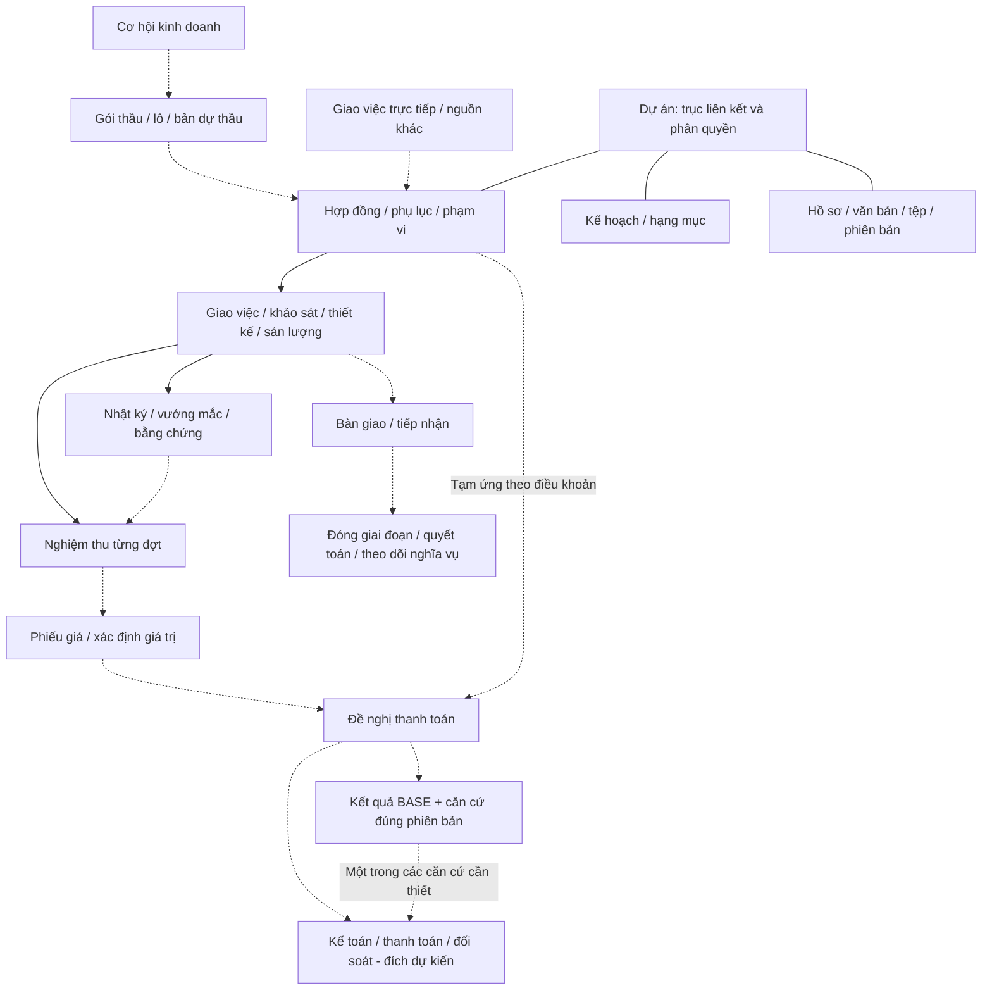

# TANPHAT ONE — Phân tích chọn lọc tài liệu tham khảo IMIS2

**Ngày review:** 29/10/2026 (Asia/Saigon)  
**Phạm vi:** đã đọc phần văn bản và bảng của đủ 16 manual DOCX IMIS2 Web/Mobile, tổng 97.674.306 byte (~97,7 MB), 250.023 ký tự trích xuất; tài liệu mang niên đại 2021  
**Loại tài liệu:** tài liệu hướng dẫn sử dụng của EVN/EVNICT; chỉ là bằng chứng tham khảo về cách tổ chức hồ sơ và màn hình  
**Bằng chứng nguồn:** `REF-IMIS2-20261029`; manifest SHA-256 và bản text trích xuất được lưu ngoài Git tại `.local/imis2_review/`; không đưa file gốc, dữ liệu thật, credential hoặc filestore vào repository.  
**Trạng thái:** hoàn tất nghiên cứu tham khảo và phản biện độc lập; chưa chuyển các đề xuất thành quy chế Tấn Phát hoặc đặc tả sẵn sàng code. Bóc tách chi tiết từng trang, màn hình, biểu mẫu và quy tắc validation xem tại [TP_IMIS2_DETAILED_MANUAL_ANALYSIS.md](TP_IMIS2_DETAILED_MANUAL_ANALYSIS.md). Đối chiếu cuối ghi tại CHG-20261029-047 và CHG-20261029-048.

Review đọc văn bản, bảng, header/footer và kiểm kê metadata. Bộ tài liệu chứa 974 media image theo kiểm kê archive; chưa rà từng ảnh chụp màn hình và chưa kiểm ứng dụng IMIS2 live. Những trường chỉ nằm trong ảnh, API, quyền thực tế, chữ ký và hành vi runtime chưa được xác nhận. SHA-256 của đủ 16 file đã đối chiếu lại với nguồn, không có sai lệch; báo cáo kiểm chứng lưu tại `.local/imis2_review/verification.json`. Đường dẫn nguồn đầy đủ chỉ lưu local để không đưa cấu trúc mạng nội bộ vào Git.

## 1. Kết luận điều phối

IMIS2 cung cấp nhiều ý tưởng tốt cho một hệ thống quản lý dự án xây dựng: dự án làm trục liên kết, cây hạng mục, hồ sơ theo giai đoạn, gói thầu và lô, hợp đồng/phụ lục, nhật ký hiện trường, vướng mắc, nghiệm thu, bàn giao và lịch sử nhà thầu. Giá trị lớn nhất là **nối được hồ sơ từ đầu đến cuối của từng dự án**, giúp truy từ một số liệu hoặc kết quả về căn cứ gốc. Đây là cơ sở để làm sâu bản thiết kế TANPHAT ONE, không đòi thay nền Odoo + web riêng hiện có.

IMIS2 không phải quy trình của Tấn Phát và không được sao chép nguyên trạng. Đây là hệ thống của EVN, được viết cho vai trò chủ đầu tư/đơn vị quản lý đầu tư, với cơ cấu tổ chức, thuật ngữ, hạn mức và thẩm quyền riêng. Manual chủ yếu mô tả thao tác CRUD và màn hình; nó không đủ để kết luận về API, ma trận quyền, chữ ký, pháp lý, transaction, audit hoặc tính đúng của các bước phê duyệt.

Vì vậy, kết quả được phân loại như sau:

- **Tiếp thu:** cách liên kết dự án–hạng mục–hồ sơ, tách loại chứng từ và bước xử lý được manual mô tả. Version bất biến, audit và kiểm soát giao dịch của TP là phần bổ sung theo nền hiện có; không khẳng định IMIS2 đã có các cơ chế này.
- **Điều chỉnh:** dùng vai trò, scope, tên gọi và quy tắc của Tấn Phát; giữ Odoo là nguồn sự thật và BASE là nơi phê duyệt chính thức theo DEC-013.
- **Chỉ tham khảo/hoãn:** các miền chưa có owner, công thức, dữ liệu hoặc căn cứ pháp lý của Tấn Phát.
- **Không áp dụng:** cơ cấu EVN, hạn mức EVN, quyền EVN, mặc định chấm điểm, cấp vốn/giải ngân của EVN và thao tác xóa/sửa làm mất lịch sử.

Không có application code, database, runtime, module hoặc quyền người dùng nào được mở từ lượt nghiên cứu này.

## 2. Bản đồ 16 tài liệu và quyết định chọn lọc

| Tài liệu | Nội dung quan sát được | Đưa vào TANPHAT ONE | Điều chỉnh/không sao chép |
| --- | --- | --- | --- |
| 01. Công tác Kế hoạch | Dự án, mã tự sinh, cây hạng mục cha/con, đợt kế hoạch theo năm, đăng ký/giao/bổ sung, theo dõi, import/export, kiểm tổng nguồn vốn | Kế hoạch theo kỳ; project → work breakdown; snapshot đăng ký/giao/thực tế; kiểm cân đối trước khi gửi; import qua staging và reconcile | Không dùng cấp EVN, cơ cấu giao vốn EVN hoặc xóa trực tiếp; công thức tiền và owner phải do Tấn Phát chốt |
| 02. Chuẩn bị đầu tư | Căn cứ thủ tục, số/ngày/người phê duyệt; khởi tạo vị trí khảo sát, trạm, BT-GPMB; chặn sửa/xóa master đã phát sinh dữ liệu | Tách cấu hình giai đoạn/vị trí khỏi dữ liệu thực hiện; lưu văn bản và căn cứ; chặn phá master có dữ liệu phụ thuộc | Dùng revision/correction thay xóa; không suy thẩm quyền từ chức danh hoặc tên trường EVN |
| 03. Bồi thường-GPMB | Tiến độ tuần/năm theo địa bàn/vị trí; khó khăn, giải pháp; manual chặn thêm khó khăn mới trong cùng hạng mục khi khó khăn cũ chưa giải quyết | Sổ vướng mắc theo project/hạng mục/vị trí; chủ xử lý, hạn và đóng việc là phần TP cần thiết kế thêm | Không bê nguyên quy tắc chỉ một vướng mắc mở cho cả hạng mục vì có thể có nhiều vấn đề độc lập; cần khóa chống trùng phù hợp. Chỉ mở miền GPMB khi TP có nhu cầu |
| 04. Quản lý đấu thầu | Kế hoạch lựa chọn gắn project/plan; gói có giá trị, hình thức/phương thức/loại/hình thức hợp đồng; có thể chia lô và liên kết gói tập trung; hồ sơ sơ tuyển, mời thầu, nhà thầu nộp hồ sơ, hồ sơ/kết quả lựa chọn, văn bản và file (L57–153) | TP Bid **đề xuất**: opportunity → tender package → lot → submission → outcome; version/hash hồ sơ, issuer/recipient, cutoff/received_at, consortium/lead member, eligibility và evidence chain; lot total cần currency/unit/basis/rounding/reconcile | TP thường là bên dự thầu/tư vấn, không mặc định là chủ đầu tư EVN; không copy phân loại, hạn mức hay authority EVN; manual không chứng minh state machine, scoring, deadline, withdrawal/replace, duplicate/amendment/no-bid hoặc contract effectivity. Kết quả trúng không đồng nghĩa hợp đồng đã ký/hiệu lực |
| 05. Hợp đồng-CV khác | Hợp đồng theo project/gói thầu, nhiều loại tiền, phụ lục, phạt, công việc, đại diện, thiết bị, hồ sơ | TP Contracts giữ contract/revision/line; appendix và penalty là cách tách record **đề xuất của TP**, không phải state/transaction được manual chứng minh; lưu currency, rate, basis, party role, hồ sơ | Không prefill gói trúng thành hợp đồng đã ký/hiệu lực; không xóa cứng hoặc nhập 0 để xóa; đây là quy tắc TP đề xuất khác với CRUD trong manual; revision và audit bắt buộc |
| 06. Phê duyệt thiết kế | Hồ sơ từ nhà thầu, tư vấn, chủ đầu tư; số/ngày/loại thư, phản hồi và file | TP Design: submission theo nguồn gửi, phản hồi từng bên, version và evidence | Lưu hồ sơ không có nghĩa là approved pháp lý; không dùng chữ approved khi thiếu authority/evidence; giữ bản cũ |
| 07. Giám sát khảo sát | Khảo sát địa chất/địa hình/thủy văn; nhiệm vụ, nhân lực, thiết bị, ảnh tọa độ, nhật ký, thí nghiệm, biên bản, kết quả | TP Survey: task → location → observation/result → minutes/evidence; typed survey; ảnh có geotag nếu chính sách cho phép; cấu hình vị trí trước khi ghi | Xác minh nhu cầu GPS và privacy; attachment phải có version/checksum/quyền, không xóa trực tiếp |
| 08. Giám sát thi công | Nhật ký điện tử/theo ca, thời tiết, nhân lực, thiết bị, công việc, ảnh tọa độ, HSE, kiến nghị, nghiệm thu theo hồ sơ/hiện trường/khối lượng | TP Tasks/Survey/Design: daily diary, HSE riêng, issue/response, acceptance workflow nhà thầu → TVGS → hiện trường → khối lượng → kết luận | Không copy chữ ký SIM CA/EVN; không mặc định vai trò TP; nghiệm thu không tự tạo payment; bản đã ký phải immutable/revision |
| 09. Thanh toán-Cấp vốn | Phiếu giá/valuation theo hợp đồng, kỳ, tạm ứng/giữ lại; trình cấp vốn, duyệt cấp vốn, giải ngân | **Đề xuất có điều kiện:** tách valuation/payment request khỏi Accounting; liên kết contract → acceptance/production → valuation → request → BASE reference → Odoo accounting sau khi Q4/Q6/Q8 và bridge được chốt | “Giải ngân” không chứng minh tiền ngân hàng/posted/reconciled; không dựng ledger thứ hai, không coi approved/request là paid; Q4/Q6 còn mở |
| 10. Chuẩn bị vận hành | Bàn giao dự án giữa đơn vị giao/nhận, danh sách hợp đồng, đã bàn giao/đã tiếp nhận | TP Documents/Tasks: handover record, sender/receiver, object list, xác nhận hai chiều | Không copy mô hình đơn vị EVN; bàn giao không đồng nghĩa hợp đồng hiệu lực hoặc đã thanh toán |
| 11. Kết thúc đầu tư | Dự án quyết toán, trạng thái, số/ngày văn bản, quy mô quyết toán, báo cáo theo nhiều chiều | Closeout/settlement record riêng, as-of snapshot, quyết định và evidence; project có lifecycle rõ | Hết task không đồng nghĩa project hoàn thành; không coi quyết toán là payment posting nếu chưa có căn cứ |
| 12. Hồ sơ tài liệu | Hồ sơ project/hạng mục theo cây định sẵn; hồ sơ mở; văn bản độc lập có thể gắn vào hồ sơ; folder đóng khi project kết thúc (L78–85, L139–160); menu Doffice được liệt kê nhưng phần text đã đọc không mô tả tích hợp | TP Documents: project → folder/tree → document → attachment; folder cố định và folder mở; metadata/version tách binary; retention/legal hold | Không cho sửa/xóa làm mất lịch sử sau submit là quy tắc TP đề xuất cần chốt, khác CRUD manual; Doffice chỉ là hệ ngoài cần adapter/reference, chưa giả định tích hợp |
| 13. Quản lý giá | Tra cứu vật tư/thiết bị theo mã, thông số kỹ thuật, đơn vị làm việc, nước sản xuất, khoảng thời gian; xem lịch sử mua sắm/export. Lương chuyên gia chỉ có tiêu đề, thiếu mô tả chi tiết | Sổ giá tham khảo **đề xuất** có mã/thông số và nguồn; đơn vị tính, tiền tệ, ngày áp dụng, phiên bản và quyền export phải do TP chốt. “Đơn vị” trong bộ lọc không đủ chứng minh là đơn vị tính | Không coi giá tham khảo là giá hợp đồng, giá kế toán hay giá được duyệt; không nhập giá EVN thật; giữ riêng với phiếu giá thanh toán của tài liệu 09; chưa đủ căn cứ thiết kế payroll |
| 14. Đánh giá chất lượng nhà thầu | Bộ tiêu chí gốc và theo năm, đánh giá theo hợp đồng/giai đoạn, điểm cộng/trừ, duyệt, báo cáo; manual có quick-confirm 100 điểm và tự tính trung bình/tổng hợp (L101–116, L122–132) | Criteria versioning; evaluation theo contract/project/period; evaluator khác approver; evidence và report artifact | Không copy thang 100, tự động trung bình, quick-confirm hoặc tiêu chí EVN; đây là chức năng quan sát được của IMIS2, không phải chính sách TP; chờ owner, semantics, appeal/correction và authority |
| 15. Kho dữ liệu nhà thầu | Tra cứu theo MST và chống tạo trùng trước khi tạo (L60–71); lịch sử đổi pháp lý (L80–94); liên danh tối thiểu 2 thành viên (L97–106); quan hệ “đơn vị sử dụng” theo đơn vị (L120–137) | Canonical `res.partner`; duplicate check theo tax ID; legal identity/history; consortium relation; usage relation theo company/project | Không nhân bản tùy tiện partner; không hard delete là quy tắc TP đề xuất điều chỉnh, trái thao tác CRUD manual; chưa mở API đăng ký thuế, scoring hay dữ liệu ngoài khi chưa có owner |
| Mobile thi công | Manual hướng dẫn app IMISONSITE cho iOS/Android, chọn đơn vị/project/contract/hạng mục trước thao tác; nhật ký, ảnh, HSE, kiến nghị, kiểm hồ sơ–hiện trường–khối lượng và ký | Học luồng thao tác gọn tại hiện trường và giữ ngữ cảnh công việc. Web responsive là lựa chọn cần đánh giá; offline là ý tưởng TP bổ sung, manual không chứng minh có offline | Không lấy cách cài app/chứng thực EVN hoặc SIM CA áp cho TP; mobile native, offline, GPS và ký số TP chưa được chốt |

Số thứ tự trong bảng trùng với tên file trong manifest `.local/imis2_review/manifest.json`; dòng Mobile là manual có tiền tố `IMIS2.MOBILE`. Bảng là inventory chọn lọc của bộ 16 file; locator chi tiết chỉ được nêu ở những điểm cần kiểm chứng để tránh biến một màn hình hướng dẫn thành đặc tả runtime.

Một số locator dùng khi audit lại bản text extraction: tài liệu 04 (gói/kế hoạch/hồ sơ L57–153), 05 (hợp đồng/phụ lục/phạt L56–214), 09 (phiếu giá và thanh toán L55–151), 13 (tra cứu giá L48–88), 12 (hồ sơ/văn bản L78–172), 14 (criteria/đánh giá/duyệt L56–165 và L207–276), 15 (MST/đổi pháp lý/liên danh/đơn vị sử dụng L60–137). Locator là dòng của text extraction, không phải số trang PDF/Word; khi cần dùng cho quyết định phải đối chiếu lại file gốc.

Đối chiếu bổ sung: tài liệu 01 cho thấy chu kỳ giao kế hoạch phải kết thúc trước chu kỳ sau và kiểm cân đối nguồn vốn/cơ cấu (L145–156, L197–208, L246–256); 02 lưu loại hiệu chỉnh/cấp/số/ngày/người duyệt và chặn sửa/xóa vị trí, trạm khi đã có dữ liệu phụ thuộc (L54–112); 03 có issue theo tuần/năm và quy tắc không mở issue cùng hạng mục khi issue cũ chưa giải quyết (L55–109); 06 tách nguồn hồ sơ nhà thầu, TVGS, Ban A nhưng chủ yếu là CRUD và phản hồi thư (L55–115); 10 tách đã bàn giao và đã tiếp nhận (L54–83); 11 có trạng thái đang/hoàn thành quyết toán, số/ngày văn bản và quy mô (L53–83). Các bất biến, audit, retention, authority và correction/revision trong các câu đề xuất dưới đây là nguyên tắc TP cần chốt, không phải tính năng đã được manual chứng minh.

## 3. Nguyên tắc kiến trúc rút ra

### 3.1 Bản đồ liên kết đề xuất

Sơ đồ thể hiện quan hệ tham chiếu giữa hồ sơ, không phải trình tự bắt buộc hay state machine. Mũi tên nét đứt chỉ quan hệ tùy chọn hoặc tích hợp tương lai. Từng miền mới vẫn cần đặc tả riêng.

Bid có thể không phát sinh khi giao trực tiếp; project có thể được lập trước hoặc sau cơ hội/hợp đồng theo căn cứ thực tế. Khảo sát, thiết kế và giao việc có thể song song/lặp lại; nghiệm thu có nhiều đợt; tạm ứng có thể trước nghiệm thu nếu điều khoản hợp lệ. Bàn giao sản phẩm không mặc định chờ thu/chi xong; hoàn thành thực hiện vẫn có thể còn công nợ, giữ lại hoặc bảo hành.

CRM không tự thay Bid; Request còn bao gồm nhiều yêu cầu phi tài chính và không đồng nghĩa mọi phiếu đều phải đi qua hợp đồng. BASE được áp dụng theo loại hồ sơ. Approved trên BASE không tự tạo chữ ký, hiệu lực hoặc tiền đã chi. Kế toán/invoice/payment/cash là các bản ghi và nguồn riêng; mũi tên tới kế toán chỉ là thiết kế đích có điều kiện Q4/Q6/Q8, chưa phải bridge runtime.

### 3.2 Quy tắc dữ liệu và kiểm soát

Các quy tắc dưới đây là hướng áp dụng cho TP theo nền hiện có; manual EVN chỉ cung cấp tình huống nghiệp vụ, không chứng minh đã thực hiện đầy đủ các kiểm soát kỹ thuật này.

1. **Bản ghi có loại rõ ràng:** kế hoạch, gói thầu, hồ sơ, nhật ký, issue, nghiệm thu, valuation, payment request, approval reference và cash event là các loại bản ghi riêng.
2. **Project/company/department scope:** mọi đọc, ghi, export và tải tệp kiểm ở backend theo scope; không suy quyền từ chức danh hoặc việc làm được một bước.
3. **Version và provenance:** số/ngày văn bản, nguồn gửi, effective/known-at, checksum file và liên kết bản trước phải truy được.
4. **Không phá lịch sử:** giữ nguyên snapshot hồ sơ đã gửi và bản đã chốt/ký/hiệu lực/hạch toán. Hồ sơ bị trả lại vẫn được mở bản nháp sửa và gửi lại theo workflow CTR hiện có, đồng thời giữ bản gửi trước; sửa sai sau chốt dùng correction, supersede, void hoặc reversal theo chính sách từng miền.
5. **Approval tách khỏi effectivity:** có bản ghi BASE/reference không có nghĩa đã ký, có hiệu lực, nghiệm thu hoặc đã trả tiền.
6. **Evidence first:** ảnh, biên bản, văn bản và file tài chính có phân loại, ACL, audit, retention và version; attachment không được dùng để né quyền API.
7. **Cân đối và snapshot:** tổng nguồn vốn/cơ cấu, tổng lô/gói, khối lượng/valuation và báo cáo phải có công thức, kỳ, currency và kiểm reconcile; frontend không tự tính tiền bằng float.
8. **Mutation an toàn:** action backend kiểm actor/capability, state trước, expected version, idempotency, transaction nguyên tử và audit; retry không tạo bản ghi trùng.

## 4. Tác động tới TANPHAT ONE

### Backend và database

- Giữ Odoo là nguồn sự thật; mở rộng `custom_addons/` theo vertical slice, không tạo một bảng giao dịch chung cho mọi lĩnh vực.
- `tp_project` tiếp tục là trục scope; `tp_contract` giữ identity/revision/line. Grant tài chính là model riêng `tp.project.grant` theo user/project, không thuộc sở hữu trực tiếp của contract.
- Các miền tương lai nên tách thành `tp_bid`, `tp_survey`, `tp_design`, `tp_documents` hoặc phần mở rộng tương ứng sau khi có owner và acceptance; không tạo addon rỗng chỉ để đủ tên.
- Dùng `res.partner` làm master nhà thầu và bổ sung legal history/consortium/usage relation khi TP xác nhận chính sách.
- Valuation/payment request là cầu nối nghiệp vụ đề xuất có điều kiện; `account.move`/payment của Odoo là đích posting/reconciliation dự kiến sau khi Q4/Q6/Q8, chủ nghiệp vụ và bridge được nghiệm thu. Việc cài `account` không đồng nghĩa TP Finance/bridge đã hoạt động; lượt này không kiểm runtime kế toán. Không dựng Data Lake hay sổ tiền thứ hai từ “Kho dữ liệu nhà thầu”.

### API và frontend

- API phải thể hiện DTO, capability, state và `allowed_actions`; React không gọi generic Odoo RPC để đổi state.
- TP Documents cần endpoint metadata/file có kiểm grant, version và audit; TP Survey/Tasks cần action diary/issue/acceptance rõ ràng.
- Mobile/offline chỉ mở khi có đặc tả sync, conflict, geolocation và retention; không suy ra từ việc manual có ảnh chụp màn hình mobile.

Về trải nghiệm, có thể học cách **chọn ngữ cảnh trước, thao tác sau**: người dùng luôn thấy đang ở dự án/hợp đồng/hạng mục nào; chọn một hồ sơ thì xem ngay căn cứ, các lần gửi, bản trả lại và tệp liên quan. Lọc theo mã/số văn bản/kỳ giúp thay tìm trong từng thư mục rời. Ngữ cảnh trên màn hình chỉ hỗ trợ sử dụng; backend vẫn kiểm quyền cho từng lần gọi API. Dữ liệu tiền, tổng tiền hoặc số lượng tệp nhạy cảm không được xuất hiện chỉ vì giao diện đã chọn đúng dự án.

### Nghiệp vụ và quyền

- BASE tiếp tục là nơi phê duyệt chính thức theo DEC-013; TANPHAT ONE lưu hồ sơ, reference và kết quả declared/verified.
- Q2, owner, hạn mức, quyền cấp/thu hồi grant, Q4/Q6/Q8 và bằng chứng thực tế vẫn là cổng trước người dùng thật/pilot.
- Mỗi workflow mới phải có RACI, scope, transition matrix, dữ liệu bắt buộc, reason khi trả lại/sửa sai, audit và ca retry/race; manual EVN không thay cho các thông tin này.

## 5. Các hướng nghiên cứu chọn lọc (không phải roadmap đã duyệt)

Danh sách dưới đây chỉ là đề xuất để lập task/spec sau này. Không mục nào tự mở code, module, connector hoặc quyền. Mỗi mục phải có user task, owner, decision và acceptance riêng trong `PROJECT_STATUS.md`.

| Phân loại | Hạng mục | Điều kiện mở |
| --- | --- | --- |
| Context hiện hành | Duy trì nền hiện có: AUTH-002 audit, TP Contracts read/CTR-002a test, backup/restore và workflow bàn giao | Đây là công việc hiện hành của dự án, không phải bài học trực tiếp từ IMIS2; tiếp tục theo `PROJECT_STATUS.md` |
| Candidate / proposed | TP Documents discovery: folder/document/attachment metadata, version, scope và read/download audit | Owner hồ sơ, retention, phân loại file và 2–3 bundle khử dữ liệu; chưa mở code |
| Candidate / proposed | TP Bid discovery/spec: opportunity → package → lot → submission/outcome | Xác nhận Tấn Phát là bidder/consultant/owner trong từng use case; owner, sample hồ sơ và negative cases |
| Candidate / proposed | TP Survey/Tasks discovery: vị trí, nhật ký, issue, ảnh/evidence, acceptance boundary | Q5/Q10, role TVGS/QLDA/nhà thầu, GPS/privacy và mẫu biên bản; chưa mở module |
| Candidate / proposed | Handover/closeout và contractor master/legal history/consortium | Q11, owner dữ liệu đối tác, policy hợp nhất/đổi pháp lý |
| Candidate / proposed | Valuation/payment request và accounting bridge | Q4/Q6/Q8, mẫu chứng từ, tax/currency, BASE reference và reconcile; phụ thuộc TP Finance bridge |
| Candidate / proposed | Criteria đánh giá nhà thầu | Chủ nghiệp vụ chốt tiêu chí, thang điểm, appeal/correction, evaluator/approver |
| Giữ khuyến nghị hiện hành | Data Lake/analytics platform từ dữ liệu dự án hoặc contractor registry | DP-001 có **recommendation `DEFER`**, chưa phải DEC. Cần use case, owner, data contract, retention, security và approval dữ liệu; contractor registry không tạo thêm căn cứ mở Lake |

Thứ tự triển khai vẫn theo [kế hoạch code](TP_CODE_EXECUTION_MASTER_PLAN.md) và [PROJECT_STATUS](../PROJECT_STATUS.md). Sau công việc hiện hành, phần nghiên cứu IMIS2 nên được dùng trước hết để **bổ sung bản đồ dữ liệu/danh mục hồ sơ cho KD**, rồi hoàn thiện đặc tả từng miền khi tới batch tương ứng. Không dùng danh sách này để đẩy Documents/Bid/Survey lên trước các phụ thuộc C01, scope/quyền hoặc nghiệp vụ còn thiếu.

Ba đầu ra thiết kế có ích nhất khi người dùng chọn mở lượt tiếp theo:

1. **Danh mục hồ sơ theo dự án:** loại hồ sơ nào cần cho hợp đồng, giao khoán, khảo sát, thiết kế, nghiệm thu, thanh toán và bàn giao; ai lập/nhận/soát; bản nào đang áp dụng; liên kết với hợp đồng/phạm vi. Ghi gap của Q2/Q5/Q10/Q11, không tự đóng câu hỏi.
2. **Vai trò TP trong Bid:** tách hồ sơ Tấn Phát đi dự thầu với hồ sơ Tấn Phát tổ chức lựa chọn đối tác/thầu phụ nếu có. Chốt gói/lô, deadline, bản nộp, liên danh, kết quả, trường hợp giao trực tiếp và cơ chế chuyển tham chiếu sang hợp đồng nháp.
3. **Bộ ca kiểm chứng luồng:** normal, trả/sửa/gửi lại, thiếu căn cứ, đổi phiên bản, sai phạm vi, bàn giao chưa nhận và sửa sai sau chốt. Chỉ chuyển sang prompt code khi field/action/capability/API/acceptance của chính batch đã đủ; tài liệu tham khảo không thay các phần này.

## 6. Những điều cần Tấn Phát xác nhận trước khi code các miền mới

- Tấn Phát đóng vai trò gì trong từng use case Bid: bên mời thầu, nhà thầu hay tư vấn.
- Ai là owner và reviewer của hồ sơ kế hoạch, thiết kế, khảo sát, nghiệm thu và bàn giao; ai được xem/ghi số tiền.
- Hạn mức ký/duyệt, thẩm quyền pháp lý, quy tắc bốn mắt và quan hệ với BASE.
- Hợp đồng nào là căn cứ cho production, acceptance, valuation, invoice và payment; cách xử lý phụ lục/correction/void.
- Có cần GPMB, GPS, mobile/offline, thiết bị, kho, mua hàng và Doffice hay không.
- Chính sách nhà thầu: mã số thuế, thay đổi pháp lý, liên danh, hợp nhất bản trùng và phạm vi sử dụng theo công ty/dự án.
- Công thức và nguồn của KPI, giá tham khảo, điểm nhà thầu, tiến độ, chi phí và lợi nhuận.
- Retention, legal hold, thời hạn lưu file, export và xử lý dữ liệu nhạy cảm.

## 7. Những khoảng trống IMIS2 không giải quyết cho Tấn Phát

| Cần của TANPHAT ONE | Bộ IMIS2 bổ sung được | Vẫn còn phải xác nhận/thiết kế |
| --- | --- | --- |
| Kế hoạch Kinh doanh, giao khoán nội bộ | Cây hạng mục, kế hoạch theo kỳ, dữ liệu đăng ký và giao | Không tương đương khoán mẹ–con/đơn giá/sản lượng của TP; Q4/Q7, tránh cộng trùng cấp khoán |
| Khảo sát và thiết kế do TP thực hiện | Phân loại khảo sát, vị trí, nhật ký, hồ sơ và phản hồi | Raw data, định dạng đo, hệ tọa độ, QA/KCS, bàn giao khảo sát sang thiết kế, release và sửa bản thiết kế: Q5/Q10 |
| Request và phê duyệt BASE | Cách đính căn cứ và ghi hồ sơ xử lý | Không có bằng chứng IMIS2 tích hợp BASE; Q2/Q3, mẫu reference/hash, actor và kết quả declared/verified giữ riêng |
| Kế toán, thu/chi và báo cáo lợi nhuận | Phiếu giá, tạm ứng/giữ lại, tra cứu giá | Q4/Q6/Q8/Q13; doanh thu, nghiệm thu, hóa đơn và cash vẫn khác nhau; không lấy thanh toán request làm tiền đã thu/chi |
| Nhân sự, quyền và vận hành | Số nhân lực theo ca, đơn vị làm việc | Không đủ HR/payroll, phân quyền TP, bàn giao nhân sự, retention/backup/security: Q2/Q11/Q14 |
| Đánh giá đối tác | Bộ tiêu chí theo năm và gắn hợp đồng | Chưa có tiêu chí TP, trọng số, người chấm/duyệt, khiếu nại hoặc căn cứ điểm; không có dữ liệu không tự chấm đạt |

Các Q tương ứng được định nghĩa tại [checklist BIZ-002](TP_BIZ002_ACCEPTANCE_AND_READINESS.md). Chỉ xử lý cổng liên quan batch được chọn, không bắt công ty đóng toàn bộ Q1–Q14 trước khi tiếp tục nghiên cứu hoặc một slice test độc lập.

## 8. Bộ ca đề xuất khi dùng các ý tưởng này

Đây là kịch bản thiết kế bằng dữ liệu giả, **chưa phải test ứng dụng đã chạy**:

- Kế hoạch đổi giữa kỳ: truy được bản đã gửi, bản được giao và bản bổ sung; không ghi đè số đã xác nhận, không cộng cả bản cũ và mới.
- Hai vấn đề độc lập cùng hạng mục: được theo dõi riêng; cùng một vướng mắc gửi lại thì nhận diện trùng; người không có quyền không đóng vấn đề.
- Một gói nhiều lô, hồ sơ mời thầu được sửa, bản dự thầu được thay trước deadline hoặc gói không tham gia/thua/trúng nhưng chưa ký: không sinh hợp đồng hiệu lực hoặc số tiền phải trả tự động.
- Hồ sơ thiết kế H1 đã gửi, H2 sửa theo phản hồi: người nhận vẫn truy được H1, biết H2 thay gì và xác nhận đang dùng bản nào; upload không tự thành phê duyệt.
- Nhật ký có ghi muộn, ảnh thiếu tọa độ hoặc tọa độ không đáng tin: lưu thời điểm xảy ra và thời điểm ghi khác nhau; có ngoại lệ/lý do theo chính sách; GPS không tự chứng minh khối lượng đã nghiệm thu.
- Nghiệm thu hồ sơ không đạt, hiện trường không đạt hoặc khối lượng khác đề nghị: trả lại có lý do, giữ bản gửi và số liệu từng bên; ký biên bản là điều kiện riêng.
- Tạm ứng trước nghiệm thu, thanh toán nhiều đợt, giữ lại và giải tỏa giữ lại: không tạo biên bản giả; không coi BASE chấp thuận là tiền đã chi; đối soát theo điều khoản/chứng từ đúng kỳ.
- Bàn giao đã gửi nhưng người nhận chưa xác nhận; dự án hoàn thành thực hiện còn công nợ/bảo hành: không đóng toàn bộ nghĩa vụ chỉ vì hết task.
- Thay đổi pháp lý nhà thầu, MST trùng hoặc đổi thành viên liên danh: giữ danh tính/pháp lý tại thời điểm ký hồ sơ, không tự copy quyền hoặc sửa các hợp đồng cũ.
- Người có quyền hồ sơ nhưng không có quyền tiền thử xem file, export, URL và tổng hợp: không lộ giá trị hoặc số đếm nhạy cảm qua các đường khác.

## 9. Phạm vi chưa được mở

Chưa cài hoặc triển khai module TP Bid, Request connector, Survey, Design, Documents, contractor scoring, mobile native, payment/cash bridge hoặc Data Lake chỉ vì IMIS2 có menu tương ứng. Chưa import Excel thật, chưa dùng hồ sơ EVN làm runtime fixture, chưa cấp grant người dùng thật và chưa thay đổi BASE approval, ký, hiệu lực, nghiệm thu, thanh toán hay kế toán.

**Kết luận:** IMIS2 nên được dùng như một thư viện ý tưởng về cấu trúc hồ sơ và kiểm soát vòng đời. TANPHAT ONE chỉ tiếp thu phần có thể kiểm chứng bằng nghiệp vụ Tấn Phát, owner, dữ liệu và acceptance riêng; các manual EVN không thể tự biến thành yêu cầu code.

## 10. Chỉ mục nguồn để AI phiên sau đọc lại

Tên dưới đây là file nguồn; full SHA-256 và đường dẫn được giữ trong manifest/verification local. `SHA-12` là 12 ký tự đầu để nhận diện bản đọc; locator L… là dòng text extraction, không phải số trang Word. Không copy dữ liệu thật từ ảnh/tài liệu vào fixture.

| File DOCX | SHA-12 | Mục/locator chính |
| --- | --- | --- |
| IMIS2.WEB.HDSD_01.Công tác Kế hoạch.docx | `96f5ee6853cf` | L61–72 dự án; L145–156 đợt kế hoạch; L197–218, L246–256 cân đối/giao; L321–347 phụ thuộc cấp đơn vị EVN |
| IMIS2.WEB.HDSD_02.Chuẩn bị đầu tư.docx | `92370b12f6b6` | L54–67 thủ tục; L76–112 vị trí/trạm và điều kiện chưa phát sinh dữ liệu; L113–124 GPMB |
| IMIS2.WEB.HDSD_03.Bồi thường-GPMB.docx | `5ae59ef245b8` | L55–109 kỳ/địa bàn/vướng mắc; L280–303 hồ sơ GPMB và thao tác xóa |
| IMIS2.WEB.HDSD_04.Quản lý đấu thầu.docx | `d617f9f4e81f` | L57–106 kế hoạch/gói/lô; L107–153 hồ sơ sơ tuyển → kết quả sơ tuyển → mời thầu → kết quả lựa chọn |
| IMIS2.WEB.HDSD_05.Hợp đồng-CV khác.docx | `a7d0f8f0b33f` | L56–128 contract/currency/phụ lục/phạt/CRUD; L177–214 thành phần/nhà thầu/đại diện |
| IMIS2.WEB.HDSD_06.Phê duyệt thiết kế.docx | `fe385dbd1d7e` | L55–115 nguồn hồ sơ, Consultant Reply, Owner Reply; chưa đặc tả authority/version |
| IMIS2.WEB.HDSD_07. Giám sát giai đoạn khảo sát.docx | `b40dad3051f2` | Mục Nội dung khảo sát; Các nội dung chung; Khảo sát địa chất; Địa hình; Thủy văn–Hải văn; L94–97 điều kiện vị trí/ảnh |
| IMIS2.WEB.HDSD_08. Giám sát giai đoạn thi công.docx | `34418d5d19d3` | Nhật ký bản giấy/điện tử; ảnh; nghiệm thu bản giấy; hoàn công; HSE; nghiệm thu điện tử web chỉ có heading |
| IMIS2.WEB.HDSD_09.Thanh toán-Cấp vốn.docx | `6bbc8c8d2abc` | L55–97 phiếu giá; L111–130 payment/giải ngân; L131–134 cấp vốn chỉ heading |
| IMIS2.WEB.HDSD_10.Chuẩn bị vận hành.docx | `769ff816d49d` | L54–83 bàn giao/tiếp nhận dự án và danh sách hợp đồng |
| IMIS2.WEB.HDSD_11.Kết thúc đầu tư.docx | `eebda53c192c` | L53–83 trạng thái, văn bản và quy mô quyết toán |
| IMIS2.WEB.HDSD_12.Hồ sơ tài liệu.docx | `242934ab44e6` | L56–136 cây hồ sơ và hồ sơ mở; L139–172 văn bản/tài liệu; Doffice chỉ được liệt kê |
| IMIS2.WEB.HDSD_13.Quản lý giá.docx | `a77f6fa54674` | L48–82 tra cứu vật tư/thiết bị; L83–88 khai báo/lương chuyên gia chỉ heading |
| IMIS2.WEB.HDSD_14. Đánh giá chất lượng nhà thầu.docx | `7aff2de6c9b7` | L56–165 criteria/năm/hợp đồng/duyệt/báo cáo; L207–276 context vận hành |
| IMIS2.WEB.HDSD_15.Kho dữ liệu nhà thầu.docx | `4d813123fa99` | L60–137 MST, pháp lý, liên danh, sử dụng theo đơn vị; là master registry, không phải Lake |
| IMIS2.MOBILE.HDSD_Giám sát giai đoạn thi công.docx | `1fdc365615be` | Cấu hình → ghi/xem/ký nhật ký; khởi tạo nghiệm thu → TVGS kiểm hồ sơ → hiện trường/khối lượng → xem/ký biên bản |

Nếu lần sau không còn manifest hoặc nguồn đã đổi: đánh dấu phần đó `source_unavailable`/`source_changed`, dùng chỉ mục này để tìm lại bản gốc; không tự nhận đã kiểm chứng lại toàn bộ từ trí nhớ hay một bản tổng hợp.
