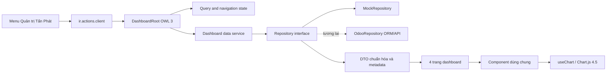
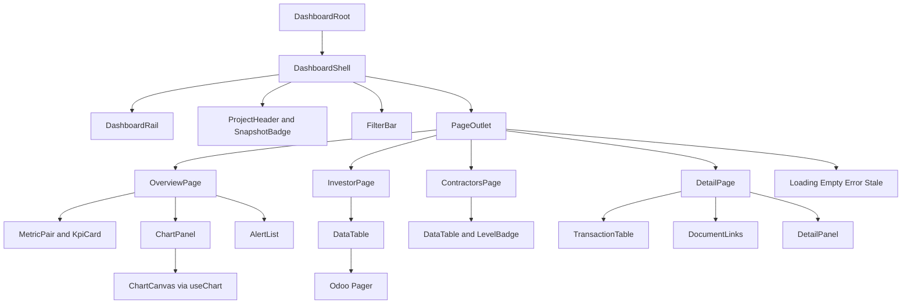
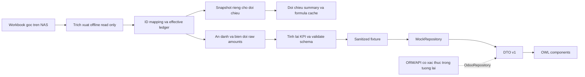
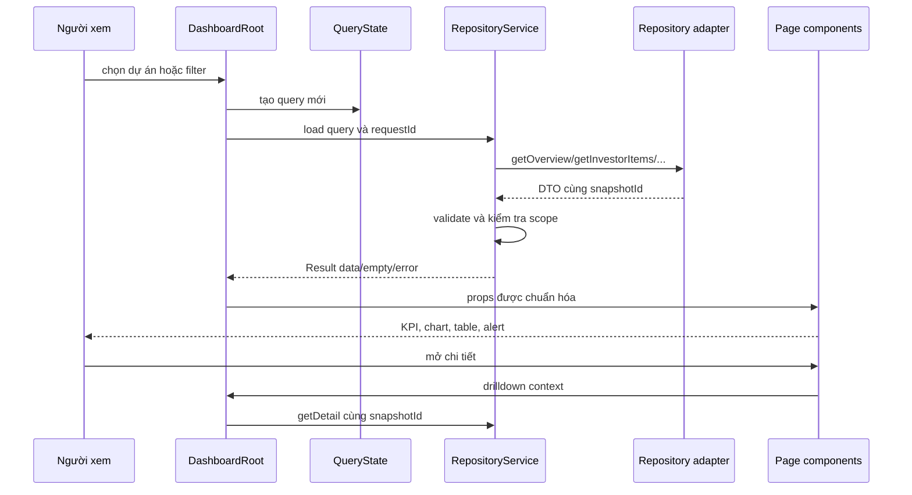

# Kiến trúc frontend Tan Phat Executive Dashboard

## 1. Quyết định kiến trúc

Chọn addon riêng trong custom_addons, **OWL 3 client action + repository chuẩn hóa + tổ chức file theo feature**. Giao diện không đọc sheet Excel hoặc tên field ORM. Cách tách này cho phép thay MockRepository bằng OdooRepository sau mà không thiết kế lại các trang.



Không patch WebClient, Navbar, GraphView hoặc global formatter. Không sửa core. Phần source đã kiểm tra dùng OWL 3.0.0-alpha.50, useProps và signal/proxy; không áp dụng static props/useState theo mẫu cũ khi chưa kiểm tra compatibility. Spike P0 phải chứng minh state/props/template/chart trên đúng commit f03f160.

## 2. Cấu trúc cuối cùng đề xuất

```text
C:\TanPhatManagement\
├── addons/                          # core giữ nguyên
├── odoo/                            # core giữ nguyên
├── docs/dashboard/                  # tám tài liệu kế hoạch
└── custom_addons/                    # chỉ tạo ở lượt triển khai
    └── tanphat_dashboard/
        ├── __init__.py
        ├── __manifest__.py
        ├── README.md
        ├── views/
        │   └── tanphat_dashboard_menus.xml
        ├── tools/
        │   ├── extract_snapshot.py   # offline, không phục vụ HTTP
        │   └── sanitize_snapshot.py  # chuyển snapshot sang fixture
        └── static/
            ├── description/
            │   └── icon.png         # asset nhận diện nếu có
            ├── src/
            │   ├── app/
            │   │   ├── dashboard_action.js
            │   │   ├── dashboard_root.js
            │   │   ├── dashboard_root.xml
            │   │   ├── dashboard_root.scss
            │   │   └── navigation_state.js
            │   ├── features/
            │   │   ├── overview/
            │   │   │   ├── overview_page.js
            │   │   │   ├── overview_page.xml
            │   │   │   └── overview_page.scss
            │   │   ├── investor/     # investor_page.js/xml/scss
            │   │   ├── contractors/  # contractors_page.js/xml/scss
            │   │   ├── detail/       # detail_page.js/xml/scss
            │   │   └── dashboard_data/
            │   │       ├── repository_contract.js
            │   │       ├── repository_service.js
            │   │       ├── mock_repository.js
            │   │       ├── query_state.js
            │   │       ├── schema.json
            │   │       ├── validate.js
            │   │       ├── effective_ledger.js
            │   │       ├── aggregates.js
            │   │       ├── crosswalk.js
            │   │       └── sanitized_snapshot.json
            │   ├── shared/
            │   │   ├── shell/       # rail/header/breadcrumb.js/xml/scss
            │   │   ├── kpi/         # kpi_card, metric_pair
            │   │   ├── charts/      # chart_panel, configs, fallback table
            │   │   ├── table/       # data_table, hierarchy, Odoo Pager
            │   │   ├── filters/     # project_selector, filter_bar
            │   │   ├── alerts/      # alert_list, status_badge
            │   │   ├── detail/      # detail_panel, document_links
            │   │   ├── states/      # loading, empty, error, stale
            │   │   └── formatting/  # currency, ratio, date, search
            │   └── styles/
            │       └── tokens.scss
            └── tests/
                ├── data_contract.test.js
                ├── effective_ledger.test.js
                ├── aggregates.test.js
                ├── repository.test.js
                ├── dashboard_action.test.js
                ├── filters.test.js
                ├── chart_lifecycle.test.js
                ├── accessibility.test.js
                └── fixtures/       # chỉ synthetic/ẩn danh
```

Mỗi component dưới shared cũng dùng file .js/.xml/.scss đặt cạnh nhau. Chỉ tạo SCSS riêng nếu feature thực sự có style riêng. Không thêm models/, controllers/, access CSV hoặc odoo_repository.js rỗng trong phase mock. Raw workbook/snapshot/golden thật đặt ngoài static và ngoài repository công khai; đường dẫn riêng do đội triển khai chốt.

Cấu trúc điều chỉnh từ gợi ý ban đầu để tuân guideline repo: logic data thuộc feature dashboard_data; component dùng chung nằm trong shared theo chức năng; test không nằm trong src để tránh glob asset backend kéo test vào production.

## 3. Cây component và trách nhiệm



| Thành phần | Input/output chính | Trách nhiệm |
| --- | --- | --- |
| DashboardRoot | action params → query/route | Một nguồn state, load dữ liệu, xử lý race/request lỗi |
| DashboardShell/Rail | route → onNavigate | Layout/sidebar/breadcrumb; không fetch |
| ProjectHeader | project/meta → onProjectChange/onRefresh | Định danh, nguồn, snapshot, fixture badge |
| FilterBar/ProjectSelector | filter options/query → onChange/onReset | Control có label; không tự tính tổng |
| OverviewPage | Overview DTO → onDrillDown | Bố trí hai phía, 8 KPI, chart, alert |
| InvestorPage | ItemList DTO → onItemSelect | Bảng/biểu đồ CĐT và panel |
| ContractorsPage | ContractorList DTO → onUnitSelect | Hierarchy, tổng cấp 1/cấp 2 riêng |
| DetailPage | Detail DTO → onBack | Chi tiết dự án/đơn vị, tab giao dịch/lịch sử |
| KpiCard/MetricPair | Metric DTO → onSelect | Value, availability, nguồn, tooltip; không cộng tiền |
| ChartPanel | ChartSpec → onDatumSelect | Chart.js, fallback table và lifecycle |
| DataTable | columns/rows/totals/sort/page → events | Sort đúng type, pager, row context, footer |
| AlertList/StatusBadge | Alert DTO → onContextSelect | Cảnh báo có ý nghĩa; không suy đoán từ màu |
| DetailPanel/DocumentLinks | detail/allowed links → onClose | Dialog, focus restoration, link hợp lệ |
| StateView | loading/empty/error/stale → onRetry | Nội dung ngắn gọn, aria-live/busy |
| Formatting | amount/ratio/date → string | Chỉ trình bày; không làm thay đổi số gốc |
| RepositoryService | query → Result DTO | Validation, cache snapshot, error mapping |

## 4. Luồng dữ liệu

### Nguồn theo từng trang

| Trang | Nguồn nghiệp vụ | Method repository | Phạm vi |
| --- | --- | --- | --- |
| Overview | DATA D6:D8; NHAT_KY_TC/NHAT_KY hiệu lực; ChuDauTu dòng9/Thauphu dòng4,5 đối chiếu | getProjects + getOverview | Một dự án; cấp1/cấp2 tách riêng |
| Chủ đầu tư | ChuDauTu dòng11–110, NHAT_KY_TC; link P/Q nếu có | getInvestorItems + getTransactions(side=investor) | item CĐT; không tự join item thầu phụ |
| Thầu phụ/giao khoán | Thauphu dòng7–206; NHAT_KY; DanhBa_ThauPhu | getContractors | cặp đơn vị×item, loại/cấp/khoán mẹ |
| Chi tiết dự án/đơn vị | DATA/danh bạ; nhật ký; TP_* chỉ là đối chiếu view; document links | getProjectDetail/getContractorDetail/getTransactions | cùng projectId/snapshotId/context drill-down |

Tất cả nguồn trên chỉ được trích xuất offline thành DTO; phase mock trình duyệt nhận fixture đã ẩn danh và biến đổi số tiền. Số thật phục vụ reconciliation đặt riêng ngoài webroot.

### Trích xuất offline và thay adapter



### Trạng thái khi người dùng tương tác



Query change tạo request token mới. Hủy request cũ nếu adapter hỗ trợ AbortSignal; luôn guard token trước update state. Không để response của dự án A ghi đè khi đã chọn B. Cache theo repository kind + schemaVersion + snapshotId + projectId + filters; không cache toàn cục lẫn user/company khi lên dữ liệu thật. Không dùng localStorage cho tài chính.

Metadata snapshot phải đồng nhất giữa KPI, bảng và chart. Không nối tổng từ một snapshot với transaction từ snapshot khác. Lỗi một trường giữ giá trị unavailable tại trường đó; lỗi cả snapshot thì hiển thị error state. Kết quả cũ có thể giữ dưới trạng thái stale rõ ràng khi reload, không thay bằng dãy 0.

## 5. Repository contract

```text
getProjects() -> Promise<Result<Project[]>>
getOverview(projectId, scope, options) -> Promise<Result<Overview>>
getInvestorItems(projectId, scope, options) -> Promise<Result<ItemList>>
getContractors(projectId, scope, options) -> Promise<Result<ContractorList>>
getProjectDetail(projectId, scope, options) -> Promise<Result<ProjectDetail>>
getContractorDetail(projectId, contractorId, scope, options)
    -> Promise<Result<ContractorDetail>>
getTransactions(projectId, filters, options) -> Promise<Result<TransactionList>>

options: { snapshotId?, signal? }
Result: { status: ok|empty, data, meta }
Error: { code, message, retryable }  # reject với error chuẩn hóa
```

Chi tiết field, scope và pagination nằm trong [05_DATA_CONTRACT.md](05_DATA_CONTRACT.md), là contract chuẩn duy nhất. Các DTO được coi read-only. UI không gọi trực tiếp factory/JSON; MockRepository được inject qua service registry tên tanphat_dashboard.repository.

## 6. Tích hợp Odoo và assets

| Quyết định | Đặc tả |
| --- | --- |
| Manifest | depends=['web']; version=20.0.1.0.0; application=True; auto_install=False; installable=True; license=LGPL-3 |
| Action | Record ir.actions.client, XML ID tanphat_dashboard_action; tag tanphat_dashboard.dashboard; target=current |
| Menu | XML ID tanphat_dashboard_menu, action khai báo trước; nhóm demo base.group_system; không coi nhóm menu là bảo mật asset |
| JS registration | registry.category('actions').add('tanphat_dashboard.dashboard', DashboardAction) |
| Template namespace | tanphat_dashboard.DashboardRoot, tanphat_dashboard.OverviewPage,... |
| Assets | tokens.scss trước SCSS khác; src app/features/shared vào web.assets_backend; static/tests vào web.assets_unit_tests; chỉ sanitized JSON được tải bằng URL module |
| SCSS | Prefix .o_tanphat_dashboard; 4-space indent; class phẳng; CSS variables đặt ở root component, không :root |
| State/props | useProps + signal/proxy/computed theo mẫu thực tế trong web; không định nghĩa static props/defaultProps |
| Navigation | 4 route nội bộ, action service mở dashboard; state nhỏ qua client action context khi cần; không router bên thứ ba |

Sử dụng Pager, Dropdown/DropdownItem, dialog/notification, useService, registry và useChart có trong web. ListView/GraphView chuẩn phụ thuộc model/ORM nên không ép chúng làm việc với DTO mock. Một bảng HTML OWL nhỏ với Pager đáp ứng phase này.

`useChart` tự load `web.chartjs_lib`, tạo chart khi mounted, destroy trước patched/unmount. Không load Chart.js thêm qua CDN/npm. Chart có fallback table, cấu hình animation theo reduced-motion và teardown test. Hook hiện tại dựng lại chart ở mỗi patch; kiểm tra tần suất render, giữ chart subtree ổn định khi đổi search bảng không liên quan.

## 7. Đổi nguồn dữ liệu và nâng cấp

1. UI và tests contract phát triển trên MockRepository.
2. Tương lai OdooRepository đọc ORM/API có xác thực, map field vào cùng DTO. Tính hiệu lực/aggregate và kiểm quyền chủ yếu ở server.
3. Chạy contract test với cả hai adapter và golden reconciliation; chuyển provider config, giữ UI.
4. Mọi thay đổi KPI phải sửa contract, định nghĩa nghiệp vụ và test trước; thay schema breaking tăng major version.

Không thêm dependency board/spreadsheet_dashboard, React, Vue, Tailwind, moment hoặc chart library mới. Không tạo model SQL/controller để phục vụ mock. Đa dự án, company scope, quyền và performance aggregation là roadmap có điều kiện, mô tả trong [08_FUTURE_ROADMAP.md](08_FUTURE_ROADMAP.md).
