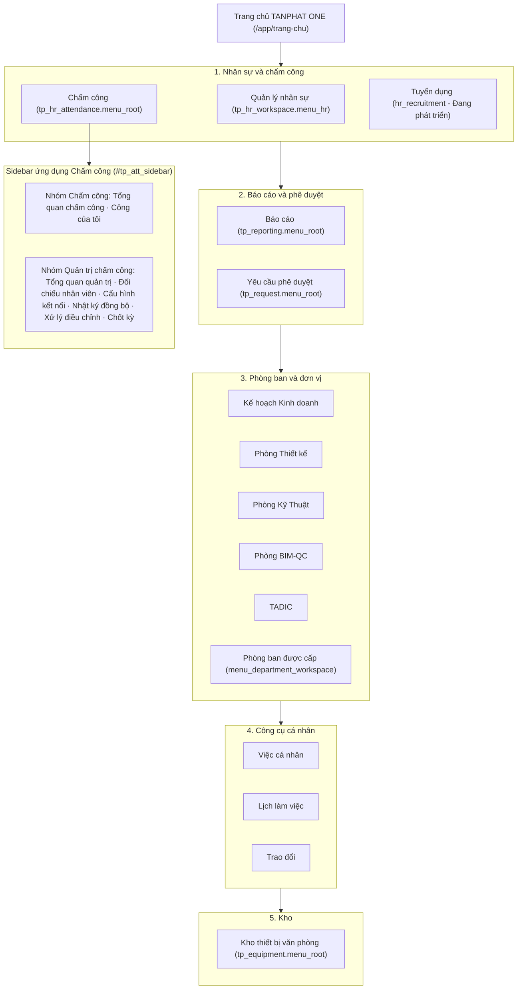

# ATTENDANCE-APP-HOME-001 — Nghiệm thu kỹ thuật (Trang chủ 5 nhóm, Đổi tên Yêu cầu phê duyệt & Ứng dụng Chấm công riêng)

- **Change ID:** `CHG-20261125-001`
- **Phạm vi addon:**
  - `tp_web_home` `20.0.1.12.0` → **`20.0.1.13.0`**
  - `tp_branding` `20.0.2.2.2` → **`20.0.2.3.0`**
  - `tp_hr_workspace` `20.0.1.23.0` → **`20.0.1.24.0`**
  - `tp_hr_attendance` `20.0.3.9.1` (`application: False`) → **`20.0.4.0.0`** (`application: True`)
  - `tp_request` `20.0.1.1.1` → **`20.0.1.2.0`**
  - `tp_equipment` `20.0.1.7.0` → **`20.0.1.7.1`**
  - `tp_reporting/static/src/registration.js` (đồng bộ đăng ký nhóm `Báo cáo và phê duyệt`)

---

## 1. Sơ đồ bố cục Trang chủ & Cây menu mới

- Nhóm cũ **“Vận hành nội bộ”** đã được loại bỏ khi chuyển **Yêu cầu phê duyệt** sang **Báo cáo và phê duyệt** và chuyển **Kho thiết bị văn phòng** xuống nhóm **Kho** cuối trang; không render nhóm rỗng với bất kỳ tài khoản nào.
- Đăng ký trang chủ qua `registerHomeSection` / `registerHomeModule` với khóa `order` tường minh và khử trùng lặp theo `key` + `menu.id`, bảo đảm thứ tự bất biến không phụ thuộc thứ tự nạp gói JS và không mất/lặp thẻ sau F5.
- Trong **TP HR (`#tp_hr_sidebar`)**: đã gỡ hoàn toàn các nhóm menu chấm công khỏi `tp_hr_workspace.menu_hr` bằng cách chuyển `parent` sang `tp_hr_attendance.menu_root`. Tab **“Công của tôi”** trong **Thông tin cá nhân** chuyển thẳng sang ứng dụng **Chấm công** (`/app/cham-cong/cua-toi`), không còn nhúng bản chấm công thứ hai bên trong HR.

---

## 2. Quy ước URL Chấm công mới và Alias đường dẫn cũ

Registry Python (`tp_branding/brand_routes.py`, `brand_urls.py`) và JavaScript (`tp_branding/static/src/brand_routes.js`) đã được đồng bộ 100%. Mọi đường dẫn cũ `/app/nhan-su/cham-cong/...` tiếp tục hoạt động qua chuyển hướng `302` / router canon hóa không vòng lặp, giữ nguyên query string, bộ lọc, `<id>` chi tiết, `/tao-moi`, `redirect` đăng nhập, F5 và Back/Forward.

| Chức năng | Action / Model | URL chính thức mới | Đường dẫn cũ / Alias được giữ tương thích |
| --- | --- | --- | --- |
| Tổng quan chấm công | `tp_hr_attendance.action_dashboard` | `/app/cham-cong/tong-quan` | `/app/cham-cong`, `/app/nhan-su/cham-cong/tong-quan`, `/app/nhan-su/cham-cong` |
| Công của tôi | `tp_hr_attendance.action_mine` | `/app/cham-cong/cua-toi` | `/app/cong-cua-toi`, `/app/nhan-su/cham-cong/cua-toi` |
| Tổng quan quản trị / Nguồn dữ liệu | `tp_hr_attendance.action_sources` | `/app/cham-cong/quan-tri` | `/app/nguon-cham-cong`, `/app/nhan-su/cham-cong/quan-tri`, `/app/nhan-su/cham-cong/nguon-du-lieu` |
| Cấu hình kết nối ENTI | `tp_hr_attendance.action_enti_config` | `/app/cham-cong/cau-hinh` | `/app/nhan-su/cham-cong/cau-hinh` |
| Đối chiếu nhân viên | `tp_hr_attendance.action_enti_mapping` | `/app/cham-cong/doi-chieu-nhan-vien` (+ `/<id>`) | `/app/nhan-su/cham-cong/doi-chieu-nhan-vien` (+ `/<id>`) |
| Nhật ký đồng bộ ENTI | `tp_hr_attendance.action_enti_logs` | `/app/cham-cong/nhat-ky-dong-bo` (+ `/<id>`) | `/app/nhan-su/cham-cong/nhat-ky-dong-bo` (+ `/<id>`) |
| Nhật ký đồng bộ ảnh hồ sơ ENTI | `tp_hr_attendance.action_enti_employee_images` | `/app/cham-cong/dong-bo-anh` (+ `/<id>`) | `/app/nhan-su/cham-cong/dong-bo-anh` (+ `/<id>`) |
| Xử lý điều chỉnh công | `tp_hr_attendance.action_review` | `/app/cham-cong/dieu-chinh` (+ `/<id>`, `/tao-moi`) | `/app/nhan-su/cham-cong/dieu-chinh` (+ `/<id>`, `/new`) |
| Yêu cầu điều chỉnh của tôi | `tp_hr_attendance.action_my_requests` | `/app/cham-cong/yeu-cau-cua-toi` (+ `/<id>`) | `/app/nhan-su/cham-cong/yeu-cau-cua-toi` (+ `/<id>`) |
| Chốt kỳ công | `tp_hr_attendance.action_periods` | `/app/cham-cong/chot-ky` (+ `/<id>`, `/tao-moi`) | `/app/nhan-su/cham-cong/chot-ky` (+ `/<id>`) |
| Bảng ngày công | `tp_hr_attendance.action_days` | `/app/cham-cong/bang-cong` (+ `/<id>`) | `/app/nhan-su/cham-cong/bang-cong` (+ `/<id>`) |
| Tổng đi muộn theo kỳ | `tp_hr_attendance.action_late` | `/app/cham-cong/di-muon` (+ `/<id>`) | `/app/nhan-su/cham-cong/di-muon` (+ `/<id>`) |
| Quy tắc / Mã máy / Phân công / Nhật ký kỳ | `action_rules`, `action_codes`, `action_assignments`, `action_logs` | `/app/cham-cong/quy-tac`, `/app/cham-cong/ma-may`, `/app/cham-cong/phan-cong`, `/app/cham-cong/nhat-ky-cham-cong` | `/app/nhan-su/cham-cong/quy-tac`, `/app/nhan-su/cham-cong/ma-may`, `/app/nhan-su/cham-cong/phan-cong`, `/app/nhan-su/cham-cong/nhat-ky-cham-cong` |

> Các chức năng đã đóng/ẩn trước đó (`menu_board`, `menu_my_requests`, `menu_import` `active=False`; các menu cấu hình cũ đã gỡ tại `20.0.3.5.6`) giữ nguyên trạng thái không tự bật lại trên sidebar.

---

## 3. Bảng đối chiếu phân quyền trước / sau cho 5 vai trò

Không mở rộng nhóm quyền, không thêm `sudo()` vượt kiểm quyền, giữ nguyên toàn bộ ACL, record rule, `attendance_menu.py`, `tp_admin_delegation` (DEC-053/054/061/062) và bridge `tp.hr.attendance.correction` ↔ `tp.request`.

| Vai trò | Trước thay đổi | Sau thay đổi | Kết luận bảo toàn quyền |
| --- | --- | --- | --- |
| **1. Nhân viên thường** (`base.group_user`) | Xem Tổng quan chấm công theo phạm vi hiện hành; xem Công của tôi & xuất Excel cá nhân lấy nhân viên từ `session`; chỉ tạo/sửa/gửi lại/thu hồi đề nghị điều chỉnh của chính mình; không sửa trực tiếp ngày công; không đọc cấu hình/credential ENTI hay phiếu người khác. | Thấy thẻ **Chấm công** trên Trang chủ; sidebar Chấm công chỉ hiện nhóm **Chấm công** (`Tổng quan chấm công`, `Công của tôi`), ẩn hoàn toàn `Quản trị chấm công`, ẩn thẻ `Tuyển dụng` và nhóm `Kho`; giữ nguyên mọi ràng buộc session, phiếu cá nhân và chặn `ir.config_parameter` / cấu hình ENTI. | **Tương đương 100%** |
| **2. Người phụ trách chấm công theo phân công** (`tp_hr_attendance.group_attendance_officer`) | Theo cờ `can_import`, `can_lock` và `department_ids` trên `tp.hr.attendance.assignment`: mở Nguồn dữ liệu/Đối chiếu/Nhật ký đồng bộ khi có `import`, mở Chốt kỳ khi có `lock`; không mở `Cấu hình kết nối` credential; không có quyền duyệt phiếu điều chỉnh công. | Sidebar Chấm công hiển thị đúng các mục thuộc capability được phân công (`attendance_menu.py` giữ nguyên `GATED`); vẫn chặn `menu_enti_config`, `image_url`/`raw_metadata_json` nhạy cảm và không mở/duyệt hàng đợi `Xử lý điều chỉnh`. | **Tương đương 100%** |
| **3. Quản lý nhân sự** (`hr.group_hr_manager`) | Quản trị Nguồn dữ liệu, Đối chiếu nhân viên, Cấu hình kết nối, Nhật ký đồng bộ, Đồng bộ ảnh ENTI; xem giám sát Xử lý điều chỉnh / Chốt kỳ nhưng không tự có quyền duyệt phiếu điều chỉnh hoặc chốt kỳ khi không phải Admin / không có phân công chốt. | Mở ứng dụng **Chấm công** riêng với đủ nhóm `Quản trị chấm công`; không thấy các thẻ placeholder quản trị hệ thống (`Tuyển dụng`, phòng ban đang phát triển) và không thấy `Kho thiết bị văn phòng`; giữ nguyên ranh giới không tự duyệt điều chỉnh công. | **Tương đương 100%** |
| **4. Admin được ủy quyền** (`tp_admin_delegation.group_full_admin`, grant `active`) | Toàn quyền quản trị nghiệp vụ mọi phòng ban (gồm cả phòng của mình), duyệt/trả lại điều chỉnh công (trừ phiếu của chính mình), thấy đủ ứng dụng trên Trang chủ; không được cấp/thu quyền admin và không sửa tài khoản/hồ sơ admin khác; khi bị thu hồi grant thì mất phiên admin ngay qua `tp_admin_scope_revision`. | Thấy đủ 5 nhóm Trang chủ và toàn bộ chức năng trong ứng dụng **Chấm công** & **Yêu cầu phê duyệt**; giữ nguyên chặn tự duyệt phiếu của mình, chặn cấp/thu admin, chặn sửa admin ngang cấp; khi thu hồi quyền admin lập tức trở về đúng menu nhân viên thường. | **Tương đương 100%** |
| **5. Admin gốc** (`tp_admin_delegation.group_original_admin`) | Toàn quyền hệ thống, công cụ quản trị trên Trang chủ (`Cài đặt`, `Quản lý ứng dụng`, `Tất cả ứng dụng`), cấp/thu quyền admin, quản trị toàn bộ Chấm công, Nhân sự, Yêu cầu phê duyệt, Báo cáo, Kho. | Thấy đủ 5 nhóm Trang chủ theo thứ tự chuẩn, thanh công cụ quản trị trên đầu trang, toàn bộ ứng dụng **Chấm công** độc lập và **Yêu cầu phê duyệt**; giữ nguyên độc quyền cấp/thu quyền admin và bảo vệ tài khoản hệ thống. | **Tương đương 100%** |

---

## 4. Kết quả kiểm thử kỹ thuật trước khi bàn giao

- **Kiểm tra tĩnh:** `py_compile` (16 tệp Python), `ET.parse` (11 tệp XML/SVG), `node --check` (16 tệp JS), `git diff --check` đều **PASS**.
- **Odoo backend & HTTP tests (`tp_tanphat_test`):**
  - `tp_branding`: **34/34 PASS** (bao gồm chuẩn URL `/app/cham-cong/...`, parity registry Python ↔ JS, redirect `302` các đường dẫn cũ `/app/nhan-su/cham-cong/...` giữ nguyên query & ID chi tiết).
  - `tp_request`: **13/13 PASS** (bao gồm bridge 1-1 `tp.hr.attendance.correction` ↔ `tp.request` và link `/app/cham-cong/dieu-chinh/<id>`).
  - `tp_hr_attendance`: `TestAttendanceAccess` (bao gồm `test_standalone_attendance_app_and_hr_menu_separation`), `TestAttendanceCorrection`, `TestEntiImageSync`, `TestExportTemplate`, `TestExcelImportClosed`, `TestDirectoryPrivacy` đều **PASS**; test độc lập OWL dialog (`test_attendance_correction_dialog.cjs`) và 11 unit test ENTI/metrics **PASS**.
- **Playwright trình duyệt thật (`1440×900` desktop & `390×844` mobile, minified assets):** **8/8 PASS, `errors = []` (0 console error, 0 page/OWL error, 0 tràn ngang)**:
  - Trang chủ Admin đủ 5 nhóm đúng thứ tự và icon, giữ ổn định sau F5.
  - Trang chủ Nhân viên thường ẩn đúng placeholder và nhóm không có quyền (`Kho`), không có nhóm rỗng `Vận hành nội bộ`.
  - Bấm thẻ **Chấm công** mở `/app/cham-cong/tong-quan` với sidebar **Chấm công** riêng (`#tp_att_sidebar`), không xuất hiện đồng thời `#tp_hr_sidebar`.
  - Mở **Quản lý nhân sự** hiển thị `#tp_hr_sidebar` không còn nhóm/mục chấm công; bấm tab **Công của tôi** trong Hồ sơ cá nhân chuyển sang `/app/cham-cong/cua-toi`.
  - Ứng dụng Request hiển thị đồng bộ **Yêu cầu phê duyệt** trên Trang chủ, Sidebar (`YC | Yêu cầu phê duyệt`), Tổng quan, Quản trị và tiêu đề tab.
  - Xuất Excel cá nhân `tp_export_mine` trả tệp `.xlsx` hợp lệ (`PK..`); nhân viên thường bị từ chối đọc `ir.config_parameter`.
