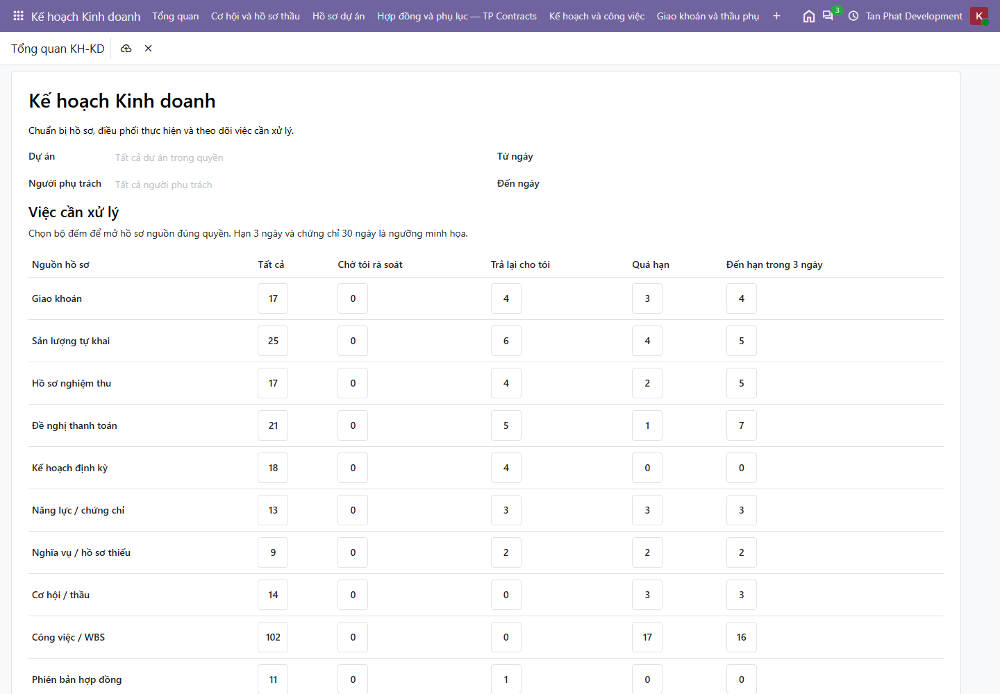
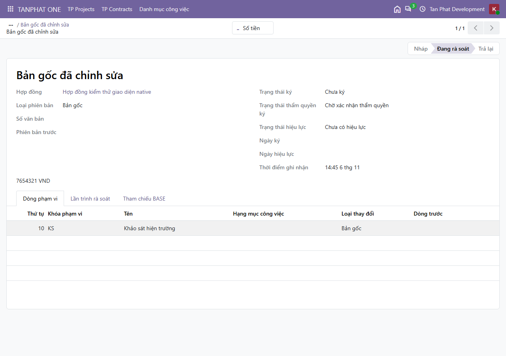

# KH-KD — Hướng dẫn trình bày trực tiếp trên dev18069

Ngày06/11/2026. Dữ liệu tổng hợp, phạm vi quản trị hồ sơ và rà soát nội bộ. Technical verification phục vụ trình diễn; business acceptance, Q2 và pilot chưa được xác nhận. [Số lượng/manifest/dọn riêng](KD_NATIVE_001_DATASET.md), [ma trận nghiệm thu](KD_NATIVE_001_ACCEPTANCE.md).

## Đăng nhập

Mở [TANPHAT ONE](http://127.0.0.1:18069/web/login?db=tp_tanphat_dev), database `tp_tanphat_dev`. Mật khẩu nằm riêng tại `C:\TANPHAT ONE\.local\kd-native001\dataset\dev\credentials.json`; không sao chép file này vào Git hoặc slide chia sẻ. Tài khoản cũ không bị reset.

| Vai trò trình diễn | Login | Việc được kiểm |
| --- | --- | --- |
| Lập hồ sơ | `kd_native001_editor` | CRM, typed dossier, hợp đồng nháp/gửi; có grant tiền fixture |
| Rà soát | `kd_native001_reviewer` | Trả hồ sơ của actor khác, có lý do; không tự cấp quyền |
| Hỗ trợ metadata | `kd_native001_metadata` | Lập/sửa metadata trong scope; không đọc số tiền |
| Điều phối WBS | `kd_native001_planner` | Manager fixture tạo/sửa/giao/cha-con theo policy hiện có |

Chuẩn bị hai profile trình duyệt riêng cho editor/reviewer; đăng nhập trước buổi họp. Chọn Home → **Kế hoạch Kinh doanh**. Nếu gặp “Phiên làm việc đã hết hạn”, ngừng thao tác ghi, tải lại và đăng nhập mới; tìm mã hồ sơ và kiểm trạng thái trước khi thao tác tiếp. Không bấm gửi lại vì tưởng lần trước chưa lưu. Lỗi phiên chập chờn đã có từ nền native và còn xuất hiện trong automation; lượt đăng nhập mới đã chạy đạt. Chưa sửa core/session trong task này.

## Đường bấm thực tế

Từ KD-UI-002 (06/11/2026), trong KH-KD thanh menu ngang được thay bằng **sidebar trái** có 5 nhóm đóng/mở; trên điện thoại bấm **Menu KH-KD**. Các action ID dưới đây được đọc từ dev, không dùng ID clone; deep link action cũ vẫn dùng được. Một số smart button nằm trong **Thêm** khi màn hình hẹp. Thao tác chi tiết: [hướng dẫn sidebar và Tổng quan](KD_UI_002_USER_GUIDE.md).

| Việc | Sidebar KH-KD | URL dev |
| --- | --- | --- |
| Hộp việc/lọc/drilldown | Tổng quan, hoặc Báo cáo và quản trị › Báo cáo KH-KD | [Tổng quan](http://127.0.0.1:18069/odoo/action-510) |
| Cơ hội | Kinh doanh và dự án › Cơ hội và hồ sơ thầu | [Danh sách](http://127.0.0.1:18069/odoo/action-512) |
| Hồ sơ dự án | Kinh doanh và dự án › Hồ sơ dự án | [Danh sách](http://127.0.0.1:18069/odoo/action-511) |
| Hợp đồng | Hợp đồng và triển khai › Hợp đồng và phụ lục — TP Contracts | [Native action](http://127.0.0.1:18069/odoo/action-509) |
| WBS/truyền thông | Hợp đồng và triển khai › Kế hoạch và công việc | [Danh sách](http://127.0.0.1:18069/odoo/action-513) |
| Khoán | Hợp đồng và triển khai › Giao khoán và thầu phụ | [Danh sách](http://127.0.0.1:18069/odoo/action-514) |
| Sản lượng | Sản lượng và kế hoạch › Sản lượng theo kỳ | [Danh sách](http://127.0.0.1:18069/odoo/action-515) |
| Nghiệm thu | Sản lượng và kế hoạch › Hồ sơ nghiệm thu | [Danh sách](http://127.0.0.1:18069/odoo/action-516) |
| Kế hoạch kỳ | Sản lượng và kế hoạch › Kế hoạch định kỳ | [Danh sách](http://127.0.0.1:18069/odoo/action-518) |
| Đề nghị | Thanh toán và hồ sơ › Đề nghị thanh toán | [Danh sách](http://127.0.0.1:18069/odoo/action-517) |
| Năng lực | Thanh toán và hồ sơ › Năng lực và chứng chỉ | [Danh sách](http://127.0.0.1:18069/odoo/action-519) |
| Nghĩa vụ | Thanh toán và hồ sơ › Nghĩa vụ và hồ sơ còn thiếu | [Danh sách](http://127.0.0.1:18069/odoo/action-520) |

Tổng quan mới có KPI, biểu đồ G01–G05 (bấm đoạn mở đúng danh sách nguồn), bảng điều hành dự án với **Thao tác ▾** theo từng dự án, khối **Việc của tôi** và nút **Tạo hồ sơ ▾** chỉ liệt kê loại được tạo. Bảng nguồn hồ sơ cũ nằm ở khối mở rộng cuối trang. Mục hoặc nút không hiện là do quyền backend.

## Ba tình huống với mã hồ sơ

**A — An Phú, chuỗi quản trị hồ sơ:** mở dự án `KD26-ANP` (ID14), tên “Tư vấn khảo sát và lập thiết kế tuyến kết nối Khu công nghiệp An Phú”. Bấm Cơ hội/thầu → Hợp đồng `KD26-HD-01` (ID4) → Kế hoạch/WBS → Giao khoán `KD26-GK-01` → Sản lượng `KD26-SL-01` → Nghiệm thu `KD26-NT-01` → Đề nghị `KD26-TT-01` → Nghĩa vụ `KD26-NV-01`. Các typed code trên có ID1 trong model tương ứng. Đọc hồ sơ nguồn, kỳ, khối lượng và căn cứ tạm ứng; đề nghị tạm ứng không cần dựng nghiệm thu giả. Đây là thao tác mở/đối chiếu hồ sơ đã seed, chưa phải đã duyệt pháp lý hoặc trả tiền.

**B — Nam Thành, xử lý trả lại:** dự án `KD26-NTH` ID16, hợp đồng `KD26-HD-03` ID6, revision gốc ID7 đang returned từ seed. Mở ý kiến/lần trình → editor bấm **Bắt đầu chỉnh sửa lại**, nhập lý do → **Chỉnh sửa nháp**, bổ sung mô tả phạm vi → **Lưu nháp** → **Trình rà soát lại**, chọn “KH-KD — rà soát tổng hợp”, nhập tóm tắt sửa → xác nhận. Reviewer profile riêng mở revision và **Trả lại để chỉnh sửa**, nhập lý do. Luồng tương tự đã chạy bằng hồ sơ tự tạo ngoài seed; mã chính xác nằm tại `.local/kd-native001/dataset/dev/ui/contract-browser.json`. Hồ sơ ngoài seed kết thúc in_review, lịch sử hai lần trình được lưu. Buổi họp thay đổi state thật trong DB; không chạy lại seed để reset kịch bản.

**C — Việc cần xử lý:** Tổng quan chọn dự án Hòa Lâm `KD26-HLM` ID15; bấm bộ đếm đến hạn/quá hạn hoặc chứng chỉ30ngày. Mở `KD26-NL-02` ID2, hạn06/12/2026; từ hồ sơ bấm nơi dùng trong cơ hội. Quay về An Phú, mở `KD26-KH-11` ID11 (tháng11/2026) để xem hai chỉ tiêu sản lượng/doanh thu riêng và nguồn đối chiếu. Mở `KD26-NV-01` xem checklist còn thiếu; với bản đang nháp, cập nhật cần lý do. Từ WBS mở đầu việc “Tổng hợp báo cáo KH-KD tháng” hoặc “Chuẩn bị nội dung truyền thông được giao”. Không gửi/xuất bản ra ngoài.

## Kịch bản 12–15 phút

| Phút | Màn hình/nút | Quan sát/kết quả | Lời trình bày ngắn |
| --- | --- | --- | --- |
| 0–1 | Đăng nhập editor → Home → KH-KD | Một session Odoo, sidebar chỉ hiện nhóm/mục đúng quyền | “Đây là không gian tác nghiệp của phòng trên TANPHAT ONE.” |
| 1–3 | Tổng quan → chọn dự án → bấm một đoạn G01 hoặc ô KPI → Việc của tôi | Danh sách nguồn cùng filter, số dòng bằng số trên biểu đồ; tiền chỉ trong quyền | “Mỗi số mở lại hồ sơ tạo ra số đó.” |
| 3–6 | Tình huống A, smart buttons theo chuỗi | Cùng khách hàng/dự án/hợp đồng; nhiều kỳ/đợt | “Bộ hồ sơ liên thông, từng nguồn có trạng thái riêng.” |
| 6–10 | Tình huống B, đổi profile reviewer | Có lý do, phiên bản và lịch sử; lưu/mở lại | “Trả lại không sửa đè lần đã trình; cần mở bản sửa.” |
| 10–12 | Kế hoạch kỳ → nguồn sản lượng; metadata profile | Không cộng tháng/quý/năm; thiếu chứng từ doanh thu | “Mục tiêu quản trị khác doanh thu kế toán.” |
| 12–14 | Tình huống C → chứng chỉ/nghĩa vụ/WBS | Hạn và checklist, người chịu trách nhiệm, đầu ra | “Ưu tiên việc đến hạn và phần hồ sơ còn thiếu.” |
| 14–15 | Lưu/refresh, nêu gate còn mở | Dữ liệu còn sau đăng nhập lại/restart | “254 bản ghi được giữ; thiếu6phụ lục do gate workflow.” |

## Tạo thêm khi được yêu cầu

Editor mở danh sách nguồn → **Mới**, nhập mã duy nhất, tên, project, hợp đồng nguồn, reviewer khác mình và phạm vi. Khoán chọn nội bộ/phòng nhận hoặc thầu phụ/đối tác. Sản lượng nhập kỳ, đơn vị/khối lượng; nghiệm thu chọn sản lượng cùng phạm vi và không vượt kỳ/khối lượng; đề nghị chọn tạm ứng/căn cứ hoặc nghiệm thu cùng hợp đồng. Năng lực nhập đối tượng, hạn và ghi chú nguồn. Nghĩa vụ nhập checklist và lý do. Lưu bằng biểu tượng đám mây/Lưu → mở lại → **Gửi rà soát** khi đủ điều kiện. Sau trả lại dùng **Mở bản sửa**, sửa nháp, rồi gửi với tóm tắt.

Hợp đồng dùng **Tạo nháp hợp đồng**, chọn dự án, mã/tên, VND và dòng phạm vi; lưu rồi chỉnh sửa, gửi theo UI001a. WBS dùng planner; nhân viên thường vẫn bị TASK-001 chặn ghi. Không dùng admin để che lỗi quyền. Từ dự án có thể mở/tạo hồ sơ con với default đúng dự án; dữ liệu FK vẫn được backend kiểm.

## Chỉ số và bàn giao nghiệp vụ

| Chỉ số | Định nghĩa/nguồn và cách kiểm |
| --- | --- |
| Tất cả/chờ tôi rà soát/trả lại | Count hồ sơ đúng domain/scope/state/actor; bấm mở và đối chiếu phân trang, không chỉ số dòng trên trang đầu |
| Quá hạn/đến3ngày | So hạn với ngày hiện hành, cùng filter nguồn; ngưỡng minh họa |
| Chứng chỉ30ngày | Hồ sơ trong quyền và hạn hiện hành; không xác minh giá trị pháp lý |
| Sản lượng đối chiếu kế hoạch | Chỉ hồ sơ in_review cùng project/kỳ/currency/basis; unknown hiển thị chưa xác nhận |
| Doanh thu | Chưa có bridge chứng từ ghi sổ được kiểm; không lấy đề nghị/tiền dự kiến làm thực hiện |

KH-KD chuẩn bị đầu vào và hồ sơ; phòng kỹ thuật cung cấp đầu ra/khối lượng; reviewer rà soát và trả lý do; QT-TC/kế toán tiếp nhận căn cứ theo scope riêng. Các thao tác trong task dừng ở quản trị hồ sơ và rà soát nội bộ.

Cần lãnh đạo/chủ nghiệp vụ xác nhận trước vận hành thật: Q2 người cấp quyền/phân công, thẩm quyền ký và review_complete, policy tiền G7, chuẩn căn cứ/thuế/thời hạn và archive/retention. Không mở BASE, ký/hiệu lực, hạch toán/thu chi thật, upload ngoài gate, grant người thật hoặc nới TASK-001. Chưa kiểm Safari/thiết bị thật; responsive là Chromium emulation. Không commit/push.

## Hồ sơ thao tác đã kiểm và ảnh

Hợp đồng tự tạo `HD-BROWSER-1793951138473`: contract ID14, revision ID15; [mở revision](http://127.0.0.1:18069/odoo/tp.contract.revision/15). Khoán tạo từ dự án `KD-UI-PROJECT-1793952655197` ID18, [mở bản nháp](http://127.0.0.1:18069/odoo/tp.allocation/18). Tổng seed254 và14hồ sơ UI riêng được giữ sau kiểm. Không dùng ID trên cho database clone.

[Giao khoán trên điện thoại](images/kd_native001/allocation-mobile.png) · [Tìm/lọc/nhóm dự án](images/kd_native001/search-group.png).
