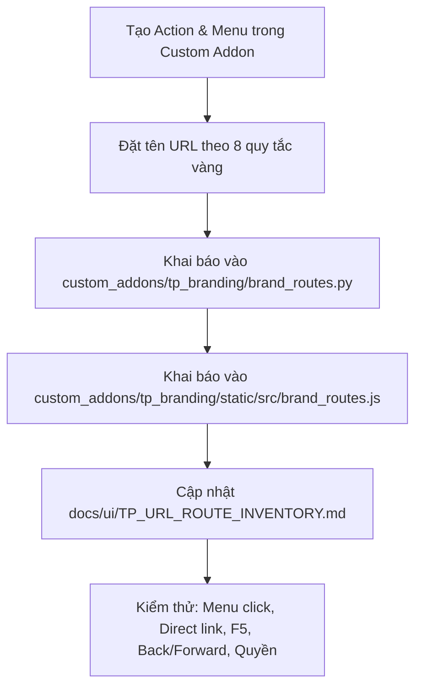

# Quy chuẩn đặt tên URL hệ thống TANPHAT ONE (TP_URL_NAMING_STANDARD)

> **Mã quy chuẩn:** TP-URL-STD-001  
> **Áp dụng:** Toàn bộ phân hệ và màn hình trên nền tảng TANPHAT ONE (`https://tpone.tadic.vn`)  
> **Ngày ban hành:** 20/11/2026  
> **Quyết định liên quan:** DEC-030 (Native Odoo Direction), BRAND-WHITELABEL-002, SYSTEM-URL-001  

---

## 1. Mục đích và phạm vi

Tài liệu này xác lập quy chuẩn bắt buộc về cấu trúc, định dạng và quy tắc đặt tên URL điều hướng giao diện người dùng trên toàn hệ thống **TANPHAT ONE**.

Mục tiêu cốt lõi:
1. **Rõ ràng nghiệp vụ:** Người dùng nhìn vào URL trên thanh địa chỉ phải biết ngay đang ở phân hệ nào, mục nào và đang xem hồ sơ gì.
2. **Loại bỏ định danh kỹ thuật:** Chấm dứt hoàn toàn việc hiển thị `action-528`, tên model kỹ thuật (`hr.employee`, `tp.bid.package`) hoặc tên component Owl làm đường dẫn chính.
3. **Thống nhất toàn hệ thống:** Tất cả các phân hệ hiện có và các module phát triển sau bắt buộc tuân thủ cùng một cấu trúc phân cấp.
4. **Bảo mật và an toàn dữ liệu:** Không để lộ dữ liệu nhạy cảm trên URL; bảo toàn 100% quyền hạn và logic phân quyền Odoo backend.

---

## 2. Cấu trúc URL chuẩn

Tất cả các màn hình ứng dụng người dùng chạy dưới domain chính:
```
https://tpone.tadic.vn
```

### 2.1. Cấu trúc cấp 2 (Phân hệ / Mục)
Áp dụng cho các màn hình trực thuộc phân hệ chính:
```
/app/<phan-he>/<muc>
```
*Ví dụ:*
- `/app/trang-chu`
- `/app/nhan-su/nhan-vien`
- `/app/khkd/tong-quan`
- `/app/thiet-bi/danh-sach`
- `/app/bao-cao/tong-quan`
- `/app/quan-tri/tai-khoan`

### 2.2. Cấu trúc cấp 3 (Phân hệ / Nhóm / Mục)
Áp dụng khi phân hệ có các nhóm chức năng lớn có tính độc lập cao:
```
/app/<phan-he>/<nhom>/<muc>
```
*Ví dụ:*
- `/app/nhan-su/cham-cong/tong-quan`
- `/app/nhan-su/cham-cong/cua-toi`
- `/app/nhan-su/cham-cong/cau-hinh`
- `/app/nhan-su/cham-cong/doi-chieu-nhan-vien`
- `/app/nhan-su/cham-cong/dieu-chinh`
- `/app/nhan-su/cham-cong/chot-ky`

### 2.3. Cấu trúc trang chi tiết bản ghi
```
/app/<phan-he>/<muc>/<id>
/app/<phan-he>/<nhom>/<muc>/<id>
```
- `<id>` là ID bản ghi số nguyên trong cơ sở dữ liệu Odoo.
- Phần tiền tố phía trước bắt buộc phải nói rõ loại hồ sơ.
- *Ví dụ:*
  - `/app/nhan-su/nhan-vien/44` (Hồ sơ nhân viên ID 44)
  - `/app/khkd/du-an-tiem-nang/12` (Dự án tiềm năng ID 12)
  - `/app/thiet-bi/danh-sach/5` (Thiết bị ID 5)
  - `/app/thiet-bi/phieu-ban-giao/8` (Phiếu bàn giao ID 8)
  - `/app/quan-tri/tai-khoan/2` (Tài khoản người dùng ID 2)

### 2.4. Cấu trúc trang tạo mới bản ghi
```
/app/<phan-he>/<muc>/tao-moi
/app/<phan-he>/<nhom>/<muc>/tao-moi
```
- Dùng hậu tố cố định `/tao-moi` cho tất cả các form thêm mới.
- Hệ thống hỗ trợ tương thích alias `/new` tự động chuyển về `/tao-moi`.
- *Ví dụ:*
  - `/app/nhan-su/nhan-vien/tao-moi`
  - `/app/khkd/du-an-tiem-nang/tao-moi`
  - `/app/thiet-bi/danh-sach/tao-moi`

---

## 3. Tám quy tắc vàng đặt tên URL

| STT | Quy tắc | Yêu cầu bắt buộc | Ví dụ đúng | Ví dụ sai (Cấm) |
| :---: | :--- | :--- | :--- | :--- |
| **1** | **Tiếng Việt không dấu** | Viết chữ thường toàn bộ, không dùng ký tự có dấu hay ký tự đặc biệt. | `nhan-vien`, `cham-cong` | `nhân-viên`, `ChamCong` |
| **2** | **Kebab-case** | Dùng duy nhất dấu gạch ngang (`-`) để phân tách giữa các từ. | `ho-so-thau`, `cho-ra-soat` | `ho_so_thau`, `hoSoThau` |
| **3** | **Đúng mã phân hệ** | - Nhân sự dùng `nhan-su`<br>- Kế hoạch Kinh doanh dùng `khkd` (tuyệt đối không viết nhầm `khkh`)<br>- Thiết bị dùng `thiet-bi`<br>- Báo cáo dùng `bao-cao`<br>- Quản trị dùng `quan-tri` | `/app/khkd/hop-dong`<br>`/app/nhan-su/nhan-vien` | `/app/khkh/hop-dong`<br>`/app/hr/nhan-vien`<br>`/app/ns/nhan-vien` |
| **4** | **Ngắn gọn & rõ nghĩa** | Tên phải phản ánh trực diện nghiệp vụ màn hình; không viết tắt tối nghĩa. | `du-an-tiem-nang`, `bang-cong` | `dan-tn`, `bc` |
| **5** | **Không dùng ID kỹ thuật** | Cấm dùng `action-528`, tên model Odoo (`hr.employee`) hay component làm URL chính. | `/app/nhan-su/nhan-vien` | `/app/action-528`<br>`/app/hr.employee` |
| **6** | **Tuyệt đối an toàn dữ liệu** | Không đưa họ tên nhân viên, mật khẩu, token, thông tin bảo mật vào URL. | `/app/nhan-su/nhan-vien/44` | `/app/nhan-su/tran-phuong-dong`<br>`?token=secret123` |
| **7** | **ID chi tiết có loại hồ sơ** | Phía trước ID số phải là slug rõ ràng của loại hồ sơ đó. Không dùng mã nhân viên có thể sửa đổi làm ID URL. | `/app/nhan-su/nhan-vien/44` | `/app/nhan-su/44`<br>`/app/nhan-su/nhan-vien/TP001` |
| **8** | **Tách biệt Quản lý & Quản trị** | Quản lý dự án (thực hiện) và Quản trị dự án là 2 góc nhìn khác nhau, phải có URL riêng biệt. | `/app/khkd/quan-ly-du-an`<br>`/app/khkd/quan-tri-du-an` | `/app/khkd/du-an-all`<br>Gom chung 1 URL |

---

## 4. Cơ chế kỹ thuật và kiến trúc triển khai

### 4.1. Tận dụng Odoo Router Native và giải quyết giới hạn `action.path`
- Odoo có trường `ir.actions.actions.path`. Tuy nhiên, core Odoo áp đặt constraint:
  ```python
  if not re.fullmatch(r'[a-z][a-z0-9_-]*', action.path):
      raise ValidationError(...)
  ```
  Ràng buộc này **không chấp nhận dấu gạch chéo (`/`)**, do đó không thể gán trực tiếp chuỗi phân cấp như `nhan-su/nhan-vien` vào trường `path` của Odoo.
- **Giải pháp chuẩn:**
  1. Với các action có thể dùng slug đơn, giữ slug native duy nhất (như `tp-home`, `users`, `apps`).
  2. Xây dựng **URL Registry hai chiều** (`custom_addons/tp_branding/brand_routes.py` và `static/src/brand_routes.js`).
  3. Mở rộng router adapter (`custom_addons/tp_branding/static/src/router_patch.js`):
     - `stateToUrl`: Ánh xạ từ action/state native sang URL nghiệp vụ chuẩn (ví dụ action `tp_hr_workspace.action_employees` -> `/app/nhan-su/nhan-vien`).
     - `urlToState`: Ánh xạ từ URL nghiệp vụ phân cấp sang action/state native để Odoo webclient tải đúng controller và view.
  4. Động hoá ID thông qua `session_info`: Backend nhúng mapping `xml_id <-> action_id` của database hiện hành, loại bỏ 100% hardcode numeric ID.

### 4.2. Tương thích ngược (Backward Compatibility)
Hệ thống duy trì khả năng mở và chuẩn hoá tự động cho:
- Link cũ dạng `/app/action-528` hoặc `/app/action-528/44` -> Tự chuẩn hoá sang `/app/nhan-su/nhan-vien/44`.
- Link alias cũ: `/app/tp-home` -> `/app/trang-chu`, `/app/cham-cong` -> `/app/nhan-su/cham-cong/tong-quan`, `/app/kho-thiet-bi` -> `/app/thiet-bi/danh-sach`.
- Bookmark cũ dạng `/web#action=...&id=...` -> Chuẩn hoá sang URL chuẩn.
- Các liên kết từ chatter, email thông báo và bookmark trình duyệt cũ.

### 4.3. URL không tồn tại
Nếu người dùng truy cập một URL không tồn tại trong Registry và không phải action Odoo hợp lệ, hệ thống hiển thị thông báo lỗi rõ ràng của action service ("Tác vụ không tồn tại"). Tuyệt đối **không âm thầm chuyển hướng về Trang chủ**.

---

## 5. Quy trình thêm màn hình mới cho lập trình viên

Khi thêm một menu hoặc màn hình mới vào hệ thống:



1. **Đặt tên URL:** Tuân thủ cấu trúc `/app/<phan-he>/<muc>` và 8 quy tắc vàng.
2. **Đăng ký vào Route Registry:**
   - Khai báo entry trong `custom_addons/tp_branding/brand_routes.py`.
   - Khai báo entry tương ứng trong `custom_addons/tp_branding/static/src/brand_routes.js`.
3. **Cập nhật Inventory:** Bổ sung dòng mới vào `docs/ui/TP_URL_ROUTE_INVENTORY.md`.
4. **Kiểm thử nghiệm thu:**
   - Click menu sinh đúng URL trên thanh địa chỉ.
   - Dán trực tiếp URL vào tab trình duyệt mới mở đúng màn hình.
   - F5 tải lại trang không bị lỗi 404 hoặc nhảy về trang chủ.
   - Back/Forward hoạt động mượt mà.
   - Tài khoản không đủ quyền bị chặn an toàn ở backend.
